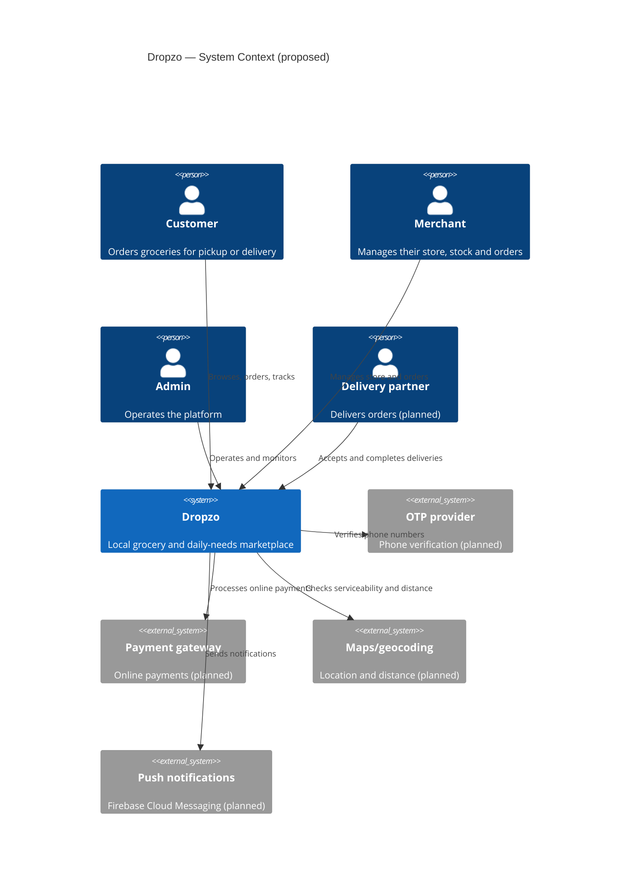
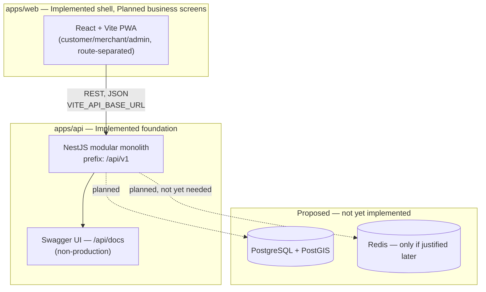
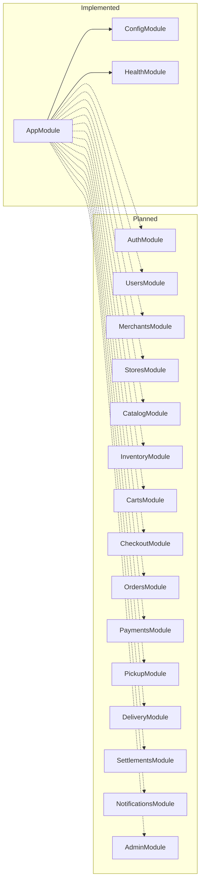
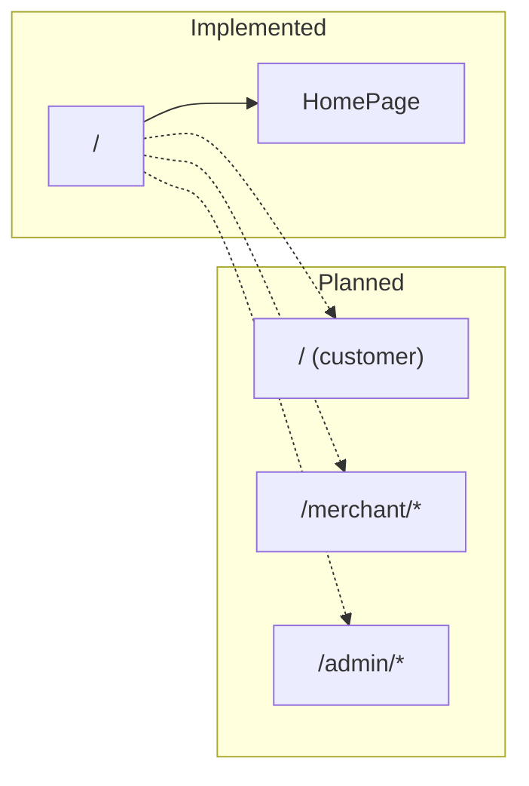

# System architecture

**Status:** Sections are individually labelled **Implemented** or **Proposed**. This document
covers backend and frontend architecture together — see
[`../05-engineering/DOCUMENTATION-STANDARDS.md`](../05-engineering/DOCUMENTATION-STANDARDS.md) for
why they are not split into separate files.

## Architectural principle: modular monolith first

**Accepted.** See [`../03-decisions/ADR-0001-modular-monolith.md`](../03-decisions/ADR-0001-modular-monolith.md).
One deployable backend, internally organised into independent modules. No microservices, Kafka,
Redis, or Kubernetes without a new ADR.

## System context (Proposed — target shape, most actors not built yet)

## Container view (mixed: frontend/backend Implemented, data stores Proposed)

## Backend module boundaries

Rule: a module never directly modifies another module's database tables. Modules interact through
service interfaces. See
[`../05-engineering/CODING-STANDARDS.md`](../05-engineering/CODING-STANDARDS.md).

## Frontend application boundaries

One frontend codebase, route-separated by role, each route enforcing its own authentication and
permission check once authentication exists.

## Technology choices

See [`../03-decisions/README.md`](../03-decisions/README.md) for the ADRs behind each of these.

| Layer            | Technology                          | Status                        |
| ---------------- | ----------------------------------- | ----------------------------- |
| Frontend         | React + TypeScript + Vite           | Implemented                   |
| Routing          | React Router                        | Implemented (one route today) |
| Server state     | TanStack Query                      | Implemented                   |
| Client state     | Zustand                             | Implemented                   |
| Styling          | styled-components                   | Implemented                   |
| Frontend testing | Vitest                              | Implemented                   |
| Backend          | Node.js + TypeScript + NestJS (ESM) | Implemented                   |
| API style        | REST + Swagger/OpenAPI              | Implemented                   |
| Backend testing  | Jest                                | Implemented                   |
| Monorepo         | npm workspaces + Nx                 | Implemented                   |
| Database         | PostgreSQL                          | Proposed, not implemented     |
| ORM              | Prisma                              | Planned, not implemented      |
| E2E testing      | Playwright                          | Planned, not introduced       |
| CI/CD            | GitHub Actions                      | Planned, not configured       |
| Diagrams         | Mermaid in Markdown                 | Implemented (this document)   |

## Related documents

- [`../03-decisions/`](../03-decisions/) — why each of these was chosen
- [`../04-design/DATABASE-DESIGN.md`](../04-design/DATABASE-DESIGN.md) — proposed data model
- [`../04-design/API-SPECIFICATION.md`](../04-design/API-SPECIFICATION.md)
