# Database design

**Status: Finalized (BC-003.4); implemented in BC-004, live verification pending.** This document
remains the single canonical schema specification — every rule below is authoritative, and nothing
here changes to accommodate an implementation detail. The implementation itself lives in
[`../../apps/api/prisma/schema.prisma`](../../apps/api/prisma/schema.prisma) (all 41 MVP-required
tables) and [`../../apps/api/prisma/migrations/`](../../apps/api/prisma/migrations/) (the initial
migration, including every hand-written addition this document's own Prisma Implementation
Readiness Checklist requires). See
[`../06-delivery/BC-004-IMPLEMENTATION-PLAN.md`](../06-delivery/BC-004-IMPLEMENTATION-PLAN.md) and
[`../06-delivery/PROGRESS.md`](../06-delivery/PROGRESS.md)'s BC-004 entry for what has and has not
been verified against a live database so far. This document has now been through three correction
rounds (BC-003.2, BC-003.3, BC-003.4) and is considered **closed** for database-design review — see
[`DATABASE-DESIGN-REVIEW.md`](DATABASE-DESIGN-REVIEW.md) for the full history. Further changes
should only happen if implementation work discovers an actual, demonstrable defect, not as another
round of preliminary review.

This remains one canonical file, by decision (BC-003.2) — not split across `02-architecture/` and
`04-design/`, and not split per module.

## Design principles

- UUID primary keys (`gen_random_uuid()`), generated by the database.
- `NUMERIC(12,2)` for money, `NUMERIC(12,3)` for quantities — never floating-point.
- Timestamps are `TIMESTAMPTZ`, stored in UTC.
- The product catalogue and store listings are separate — see [`BUSINESS-RULES.md`](BUSINESS-RULES.md).
- Order items retain historical price/product-name snapshots — never a live reference.
- Every inventory change is an append-only movement row, not just a mutated counter.
- A store has exactly one location, stored directly on `stores`.
- Financial history is append-only; corrections are new rows, never edits to the past.
- **Every posted financial transaction balances**: total debits equal total credits (new in this
  revision — see "Financial accounting model").
- **Stock is never counted twice**: a store listing's stock is tracked either entirely through
  `stock_batches` (perishables) or entirely through `inventory`'s own counters (non-perishables),
  never a mix for the same listing (new clarification — see "Inventory and FEFO allocation").
- Idempotency keys are scoped to the requesting user and operation, never globally unique across
  unrelated users or endpoints (corrected in this revision).

## Change log for BC-009

Added one forward-only migration (`20261111090000_bc009_pickup_workflow_checks`): one `CHECK`
constraint on the previously-unconstrained `payment_status_history.source` column, extending its
documented value list from `(SYSTEM, WEBHOOK, ADMIN, CUSTOMER)` to add `MERCHANT` - the value this
milestone's COD-collection flow writes when a merchant physically collects cash at pickup (the same
class of gap BC-006/007/008 closed for other previously-unconstrained status/category columns). No
new tables and no enum changes: the full `CREATED -> ACCEPTED -> PREPARING -> READY -> COMPLETED`
order lifecycle, `order_status.REJECTED`/`CANCELLED`, and `pickup_verifications` (`code_hash,
expires_at, verified_at, attempt_count, max_attempts`) were all already fully modeled by BC-004's
init migration - this milestone is the first application code to actually use most of them. See
[`ORDER-FULFILMENT-DESIGN.md`](ORDER-FULFILMENT-DESIGN.md) and
[`PICKUP-WORKFLOW-DESIGN.md`](PICKUP-WORKFLOW-DESIGN.md) for the design this supports.

## Change log for BC-008

Added one forward-only migration (`20261109120000_bc008_cart_checkout_order_checks`): three
`CHECK` constraints on previously-unconstrained `VARCHAR` status columns - `carts.status` (`ACTIVE`,
`CHECKED_OUT`, `ABANDONED`), `stock_reservations.status` (`ACTIVE`, `CONSUMED`, `RELEASED`,
`EXPIRED` - the column already had two `CHECK`s tying status to its timestamps, but nothing
restricted the value itself), and `idempotency_records.status` (`IN_PROGRESS`, `COMPLETED`,
`FAILED`) - the same class of gap BC-006/BC-007 closed for `merchants.verification_status` and
`stock_movements.movement_type`. Also added `uq_carts_active_per_user`, a partial unique index
(`ON carts (user_id) WHERE status = 'ACTIVE'`) guaranteeing at most one active cart per customer -
mirroring the init migration's own `uq_stock_reservations_active_cart`/`_active_order` pattern. No
new tables: `carts`, `cart_items`, `stock_reservations`, `stock_reservation_items`, `orders`,
`order_items`, `order_status_history`, `payments`, and `idempotency_records` were all already fully
modeled by BC-004's init migration. No existing table, constraint, or MVP/deferred classification
was otherwise changed. See [`CART-CHECKOUT-DESIGN.md`](CART-CHECKOUT-DESIGN.md) and
[`ORDER-MANAGEMENT-DESIGN.md`](ORDER-MANAGEMENT-DESIGN.md) for the design this supports.

## Change log for BC-007

Added one forward-only migration (`20261109060000_bc007_stock_movement_type_check`): a `CHECK`
restricting `stock_movements.movement_type` to its seven real values (`RECEIVED`, `RESERVED`,
`RELEASED`, `SOLD`, `DAMAGED`, `EXPIRED`, `ADJUSTED`), previously an unconstrained `VARCHAR(30)` -
the same class of gap BC-006 closed for `merchants.verification_status`. No new tables: `categories`,
`products`, `product_variants`, `store_products`, `inventory`, `stock_batches`, and
`stock_movements` were all already fully modeled by BC-004's init migration, including the relevant
non-negative/consistency `CHECK` constraints listed below. No existing table, constraint, or
MVP/deferred classification was otherwise changed. See
[`PRODUCT-CATALOGUE-DESIGN.md`](PRODUCT-CATALOGUE-DESIGN.md) and
[`INVENTORY-MANAGEMENT-DESIGN.md`](INVENTORY-MANAGEMENT-DESIGN.md) for the design this supports.

## Change log for BC-006

Extended `merchants` and `stores` (no new tables) via a single forward-only migration
(`20261107180000_bc006_merchant_store_onboarding`): structured address fields, application-review
fields (`submitted_at`/`reviewed_at`/`reviewed_by_user_id`/`rejection_reason`), a `UNIQUE` on
`merchants.owner_user_id` (one merchant per user), a `CHECK` restricting `verification_status` to
its five real lifecycle values (previously an unconstrained `VARCHAR`), contact/timezone fields on
`stores`, and `stores.service_zone_id` — the one new inbound reference, to `service_zones`, which
`DATABASE-DESIGN.md`'s own delivery-eligibility rule already assumed ("the store's `service_zones`
membership") but the schema never actually implemented. No existing table, constraint, or
MVP/deferred classification was otherwise changed. See
[`MERCHANT-STORE-DESIGN.md`](MERCHANT-STORE-DESIGN.md) for the design this supports.

## Change log for BC-005

Added `otp_challenges` (see its table specification under "Identity") via a new, forward-only
migration — the only schema change BC-005 required. No existing table, constraint, or MVP/deferred
classification was changed. See
[ADR-0013](../03-decisions/ADR-0013-phone-otp-auth-opaque-refresh-tokens.md) and
[`AUTHENTICATION-DESIGN.md`](AUTHENTICATION-DESIGN.md) for the design this table supports.

## Change log for this revision (BC-003.4 — final)

A comprehensive, final review of the complete BC-003.3 design (not just its three headline
findings) found five further defects, all corrected here:

1. **`financial_accounts` platform-account uniqueness was broken.** PostgreSQL treats every `NULL`
   as distinct in an ordinary `UNIQUE` constraint, so `UNIQUE (account_type, merchant_id)` did
   **not** stop two `PLATFORM_CASH` (or any other platform-level) rows from both existing with
   `merchant_id = NULL`. Added a partial unique index,
   `UNIQUE (account_type) WHERE merchant_id IS NULL`, alongside the existing composite unique
   (which correctly handles merchant-owned accounts, where `merchant_id` is never null).
2. **Settlement reconciliation lacked a worked example and failed-payout handling.** Added a full
   numeric example showing that outstanding balance is never double-counted (the payout entry
   itself is tagged with the settlement it closes, at creation time), plus explicit partial-
   settlement and failed-payout procedures (a failed settlement's amount re-enters the outstanding
   balance via an `OR settlement.status = 'FAILED'` clause, without altering history).
3. **The outbox/notification design didn't address external delivery guarantees.** Added an
   explicit statement that database event processing is idempotent but push delivery to a device
   is at-least-once (a worker can crash between calling FCM and recording success) — with
   `notifications.source_outbox_event_id` (new, unique) as the database-side dedup key and
   `notifications.id` as the client-side display-dedup key sent in the push payload.
4. **Lock ordering for FEFO allocation wasn't fully deadlock-safe.** Batch locking now specifies an
   `id` tiebreaker on top of `expiry_date` ordering, and a global rule (always lock `inventory`
   before its `stock_batches`) is stated explicitly.
5. **The ERD omitted five tables** (`service_zones`, `categories`, `audit_logs`,
   `idempotency_records`, `outbox_events`) despite the document claiming none were omitted. Added
   every real foreign-key relationship these tables have (`categories` ↔ `products`/self;
   `audit_logs`/`idempotency_records` ↔ `users`; `outbox_events` ↔ `notifications`); `service_zones`
   remains unconnected in the diagram by design (no FK — see the note under the diagram) rather
   than forced into a misleading relationship.

None of these corrections changed any existing product decision, and none required touching any
MVP-required vs. deferred classification.

## Change log for the BC-003.3 revision

An independent review of the BC-003.2 design found the following gaps, all corrected then:

1. **Financial ledger could not guarantee balanced accounting.** A single `ledger_entries` table
   with a `direction` column had no mechanism forcing debits to equal credits. Replaced with a
   proper accounts + journal-entry model: `financial_accounts`, `ledger_transactions`,
   `ledger_entries` — see "Financial accounting model."
2. **Stock reservations did not reference batches.** `stock_reservation_items` only referenced
   `inventory`, so FEFO allocation and "which physical batch is this quantity reserved from" could
   not be answered, and double-counting was possible. Added `batch_id` and batch-level counters.
3. **Reservation integrity relied on comments, not constraints.** Added a `CHECK` constraint
   (`num_nonnulls(cart_id, order_id) = 1`) and partial unique indexes to actually prevent invalid
   or duplicate active reservations.
4. **No payment history.** `payments.updated_at` only shows the latest state. Added an append-only
   `payment_status_history` table, mirroring `order_status_history`.
5. **Order snapshots were incomplete.** Added SKU snapshot, per-line tax, and — critically — a
   frozen delivery-address and store-name/address snapshot on `orders`, so a later address edit or
   store rename never changes a past order's record.
6. **Idempotency keys were globally unique**, risking cross-user/cross-endpoint collisions.
   Rescoped `orders.idempotency_key` to `(customer_id, idempotency_key)` and
   `idempotency_records` to `(scope, user_id, idempotency_key)`.
7. **`settlement_items` conflated commission rate with commission amount.** Added
   `commission_rate_applied` (the % used) alongside `commission_amount` (the ₹ result), and
   tightened `settlement_items.order_id` to a standalone `UNIQUE` so an order can never appear in
   two settlements.
8. **`outbox_events` had no worker-claiming or retry model.** Added `status` states for
   claim-based processing (`SELECT ... FOR UPDATE SKIP LOCKED` — no Kafka/Redis), `attempt_count`,
   `max_attempts`, `next_attempt_at`, and a `DEAD` terminal state.
9. **Service zone / delivery eligibility was unspecified.** Added a dedicated section defining the
   MVP approach (radius check within an active zone) and the PostGIS prerequisite.
10. **`ON DELETE` behaviour was unspecified for most foreign keys.** Documented a default
    (`RESTRICT`) and the two deliberate exceptions (`cart_items`, `stock_reservation_items`).
11. **No Prisma-readiness gate existed.** Added the checklist at the end of this document.

None of these corrections change any existing product decision — still one store per order, still
merchant-owned inventory at launch, still COD-first, still no microservices.

## Table inventory and classification

| Module        | Table                           | Classification                 | Purpose                                              |
| ------------- | ------------------------------- | ------------------------------ | ---------------------------------------------------- |
| Identity      | `users`                         | MVP-required                   | One row per person                                   |
| Identity      | `user_roles`                    | MVP-required                   | A user may hold more than one role                   |
| Identity      | `user_sessions`                 | MVP-required                   | Refresh-token sessions, revocable                    |
| Identity      | `otp_challenges`                | MVP-required                   | OTP codes for login/registration (added BC-005)      |
| Identity      | `user_addresses`                | MVP-required                   | Saved delivery addresses                             |
| Merchant      | `merchants`                     | MVP-required                   | A business entity owning stores                      |
| Merchant      | `merchant_staff`                | MVP-required                   | Which users act for a merchant                       |
| Merchant      | `stores`                        | MVP-required                   | A physical location, own stock/price/location        |
| Location      | `service_zones`                 | MVP-required                   | Where the platform accepts orders                    |
| Catalogue     | `categories`                    | MVP-required                   | Product taxonomy                                     |
| Catalogue     | `products`                      | MVP-required                   | Catalogue-level product identity                     |
| Catalogue     | `product_variants`              | MVP-required                   | Sellable units/sizes                                 |
| Catalogue     | `store_products`                | MVP-required                   | A store's own listing, price, availability           |
| Inventory     | `inventory`                     | MVP-required                   | Aggregate stock counters per store listing           |
| Inventory     | `stock_batches`                 | MVP-required                   | Batch/expiry tracking for perishables                |
| Inventory     | `stock_movements`               | MVP-required                   | Append-only audit trail of stock changes             |
| Commerce      | `carts`                         | MVP-required                   | A customer's in-progress, single-store cart          |
| Commerce      | `cart_items`                    | MVP-required                   | Line items in a cart                                 |
| Commerce      | `stock_reservations`            | MVP-required                   | Holds stock during checkout, with expiry             |
| Commerce      | `stock_reservation_items`       | MVP-required                   | Which batch/inventory + quantity a reservation holds |
| Commerce      | `orders`                        | MVP-required                   | A placed order, with frozen snapshots                |
| Commerce      | `order_items`                   | MVP-required                   | Order line items with full snapshots                 |
| Commerce      | `order_status_history`          | MVP-required                   | Append-only order lifecycle trail                    |
| Payment       | `payments`                      | MVP-required                   | One row per payment attempt                          |
| Payment       | `payment_status_history`        | **MVP-required (new)**         | Append-only payment status trail                     |
| Payment       | `payment_webhook_events`        | MVP-required (schema only)     | Dedupes gateway webhooks                             |
| Payment       | `refunds`                       | MVP-required                   | Refund requests and completions                      |
| Fulfilment    | `pickup_verifications`          | MVP-required                   | Hashed, expiring pickup codes                        |
| Fulfilment    | `delivery_partners`             | MVP-required                   | Delivery partner profile                             |
| Fulfilment    | `delivery_assignments`          | MVP-required                   | Partner-to-order assignment                          |
| Fulfilment    | `delivery_events`               | MVP-required                   | Append-only delivery status trail                    |
| Fulfilment    | `delivery_verifications`        | **MVP-required (new, BC-010)** | Hashed, expiring delivery-completion codes           |
| Fulfilment    | `delivery_cod_handovers`        | **MVP-required (new, BC-010)** | Recorded cash handovers from delivery partners       |
| Finance       | `financial_accounts`            | **MVP-required (new)**         | The MVP chart of accounts                            |
| Finance       | `ledger_transactions`           | **MVP-required (new)**         | A balanced group of ledger entries                   |
| Finance       | `ledger_entries`                | MVP-required (redesigned)      | Individual debit/credit journal lines                |
| Finance       | `settlements`                   | MVP-required                   | Periodic merchant payout batches                     |
| Finance       | `settlement_items`              | MVP-required (corrected)       | Which orders contributed, rate vs. amount separated  |
| Marketing     | `coupons`, `coupon_redemptions` | Future extension               | Deferred per `SCOPE.md`                              |
| Communication | `notifications`                 | MVP-required                   | A record of a message sent to a user                 |
| Communication | `notification_devices`          | MVP-required                   | Registered push device tokens                        |
| Support       | `complaints`                    | MVP-required                   | FR-SUP-001                                           |
| Audit         | `audit_logs`                    | MVP-required                   | Required by NFR-SEC-003                              |
| Reliability   | `idempotency_records`           | MVP-required (corrected scope) | Request deduplication, properly scoped               |
| Reliability   | `outbox_events`                 | MVP-required (redesigned)      | Transactional outbox with retry/claim                |

No table for "commissions" as its own entity: a merchant's current rate is a column on
`merchants`; the rate actually applied to a given order is `settlement_items.commission_rate_applied`.

## Entity-relationship diagram

```mermaid
erDiagram
    USERS ||--o{ USER_ROLES : has
    USERS ||--o{ USER_SESSIONS : has
    USERS ||--o{ USER_ADDRESSES : owns
    USERS ||--o{ ORDERS : places
    USERS ||--o{ MERCHANT_STAFF : works_as
    USERS ||--o| DELIVERY_PARTNERS : profile
    USERS ||--o{ NOTIFICATION_DEVICES : registers
    USERS ||--o{ NOTIFICATIONS : receives
    USERS ||--o{ COMPLAINTS : raises
    USERS ||--o{ AUDIT_LOGS : performs
    USERS ||--o{ IDEMPOTENCY_RECORDS : initiates

    CATEGORIES ||--o{ CATEGORIES : has_subcategory
    CATEGORIES ||--o{ PRODUCTS : classifies

    OUTBOX_EVENTS ||--o| NOTIFICATIONS : dispatches

    MERCHANTS ||--o{ MERCHANT_STAFF : employs
    MERCHANTS ||--o{ STORES : operates
    MERCHANTS ||--o{ SETTLEMENTS : receives
    MERCHANTS ||--o| FINANCIAL_ACCOUNTS : owns_payable

    STORES ||--o{ STORE_PRODUCTS : lists
    STORES ||--o{ CARTS : scoped_to
    STORES ||--o{ ORDERS : fulfils

    PRODUCTS ||--o{ PRODUCT_VARIANTS : has
    PRODUCT_VARIANTS ||--o{ STORE_PRODUCTS : listed_as
    STORE_PRODUCTS ||--|| INVENTORY : tracked_by
    STORE_PRODUCTS ||--o{ CART_ITEMS : added_as
    STORE_PRODUCTS ||--o{ ORDER_ITEMS : sold_as

    INVENTORY ||--o{ STOCK_BATCHES : contains
    INVENTORY ||--o{ STOCK_MOVEMENTS : records
    INVENTORY ||--o{ STOCK_RESERVATION_ITEMS : reserved_in
    STOCK_BATCHES ||--o{ STOCK_RESERVATION_ITEMS : allocated_from
    STOCK_BATCHES ||--o{ STOCK_MOVEMENTS : records

    CARTS ||--o{ CART_ITEMS : contains
    CARTS ||--o| STOCK_RESERVATIONS : may_hold

    STOCK_RESERVATIONS ||--o{ STOCK_RESERVATION_ITEMS : contains
    ORDERS ||--o| STOCK_RESERVATIONS : confirms

    ORDERS ||--|{ ORDER_ITEMS : contains
    ORDERS ||--o{ ORDER_STATUS_HISTORY : records
    ORDERS ||--o{ PAYMENTS : has
    ORDERS ||--o| PICKUP_VERIFICATIONS : verified_by
    ORDERS ||--o| DELIVERY_ASSIGNMENTS : assigned
    ORDERS ||--o{ SETTLEMENT_ITEMS : contributes
    ORDERS ||--o{ COMPLAINTS : may_raise
    ORDERS ||--o{ LEDGER_TRANSACTIONS : generates
    ORDERS ||--o{ NOTIFICATIONS : triggers

    PAYMENTS ||--o{ PAYMENT_STATUS_HISTORY : records
    PAYMENTS ||--o{ REFUNDS : may_have
    PAYMENTS ||--o{ PAYMENT_WEBHOOK_EVENTS : confirmed_by

    DELIVERY_PARTNERS ||--o{ DELIVERY_ASSIGNMENTS : receives
    DELIVERY_ASSIGNMENTS ||--o{ DELIVERY_EVENTS : logs
    DELIVERY_ASSIGNMENTS ||--o| DELIVERY_VERIFICATIONS : verified_by
    DELIVERY_PARTNERS ||--o{ DELIVERY_COD_HANDOVERS : hands_over
    DELIVERY_COD_HANDOVERS ||--o{ DELIVERY_ASSIGNMENTS : settles

    FINANCIAL_ACCOUNTS ||--o{ LEDGER_ENTRIES : posted_to
    LEDGER_TRANSACTIONS ||--|{ LEDGER_ENTRIES : contains

    SETTLEMENTS ||--o{ SETTLEMENT_ITEMS : contains
    SETTLEMENTS ||--o{ LEDGER_TRANSACTIONS : pays_out
```

No entity appears in this diagram without a full specification below. Every table with at least
one foreign-key relationship to another MVP table appears in this diagram. One table —
`service_zones` — has **no** foreign-key relationship to any other table by design: delivery
eligibility is computed at query time against it (radius/polygon check), not stored as a FK on
`stores` or `orders` — see "Service zones and delivery eligibility." It is still a MVP-required
table (see the inventory above); it is simply not a connected node in this particular diagram.

## Table specifications

### Identity

#### `users` — MVP-required

| Column       | Type         | Null     | Default             | Notes  |
| ------------ | ------------ | -------- | ------------------- | ------ |
| `id`         | UUID         | NOT NULL | `gen_random_uuid()` | PK     |
| `phone`      | VARCHAR(20)  | NOT NULL | —                   | UNIQUE |
| `email`      | VARCHAR(255) | NULL     | —                   |        |
| `full_name`  | VARCHAR(150) | NULL     | —                   |        |
| `is_active`  | BOOLEAN      | NOT NULL | `TRUE`              |        |
| `created_at` | TIMESTAMPTZ  | NOT NULL | `NOW()`             |        |
| `updated_at` | TIMESTAMPTZ  | NOT NULL | `NOW()`             |        |

`ON DELETE`: not deleted in the MVP — deactivate via `is_active`. Business rule: FR-AUTH-001.

#### `user_roles` — MVP-required

| Column    | Type             | Null     | Default | Notes                                                                                                                   |
| --------- | ---------------- | -------- | ------- | ----------------------------------------------------------------------------------------------------------------------- |
| `user_id` | UUID             | NOT NULL | —       | FK → `users.id` `ON DELETE RESTRICT`, part of PK                                                                        |
| `role`    | ENUM `user_role` | NOT NULL | —       | part of PK. `CUSTOMER`, `MERCHANT_OWNER`, `MERCHANT_STAFF`, `DELIVERY_PARTNER`, `ADMIN`, `SUPER_ADMIN`, `SUPPORT_AGENT` |

PK: `(user_id, role)`.

#### `user_sessions` — MVP-required

| Column               | Type        | Null     | Default             | Notes                                |
| -------------------- | ----------- | -------- | ------------------- | ------------------------------------ |
| `id`                 | UUID        | NOT NULL | `gen_random_uuid()` | PK                                   |
| `user_id`            | UUID        | NOT NULL | —                   | FK → `users.id` `ON DELETE RESTRICT` |
| `refresh_token_hash` | TEXT        | NOT NULL | —                   | hashed, never raw                    |
| `issued_at`          | TIMESTAMPTZ | NOT NULL | `NOW()`             |                                      |
| `expires_at`         | TIMESTAMPTZ | NOT NULL | —                   |                                      |
| `revoked_at`         | TIMESTAMPTZ | NULL     | —                   |                                      |
| `user_agent`         | TEXT        | NULL     | —                   |                                      |
| `ip_address`         | INET        | NULL     | —                   |                                      |

Index: `(user_id)`. Business rule: FR-AUTH-003.

#### `otp_challenges` — MVP-required (added BC-005)

| Column          | Type        | Null     | Default             | Notes                                         |
| --------------- | ----------- | -------- | ------------------- | --------------------------------------------- |
| `id`            | UUID        | NOT NULL | `gen_random_uuid()` | PK                                            |
| `phone`         | VARCHAR(20) | NOT NULL | —                   | E.164; **not** FK'd to `users` — see below    |
| `purpose`       | VARCHAR(20) | NOT NULL | `'AUTH'`            | reserved for future non-login OTP purposes    |
| `code_hash`     | TEXT        | NOT NULL | —                   | HMAC-SHA256, never the raw code               |
| `status`        | VARCHAR(20) | NOT NULL | `'PENDING'`         | `PENDING` / `VERIFIED` / `EXPIRED` / `FAILED` |
| `attempt_count` | INTEGER     | NOT NULL | `0`                 | CHECK `>= 0`                                  |
| `max_attempts`  | INTEGER     | NOT NULL | `5`                 | CHECK `> 0`                                   |
| `expires_at`    | TIMESTAMPTZ | NOT NULL | —                   |                                               |
| `verified_at`   | TIMESTAMPTZ | NULL     | —                   |                                               |
| `ip_address`    | INET        | NULL     | —                   | for the per-IP rate limit                     |
| `created_at`    | TIMESTAMPTZ | NOT NULL | `NOW()`             |                                               |

Index: `(phone, created_at)` — supports the cooldown/rate-limit lookups and the
"most recent challenge for this phone" query, both ordered by `created_at DESC`.

**Deliberately not FK'd to `users.id`**: at OTP-request time, the phone may not have an account yet
(this table serves both registration and login — see
[`AUTHENTICATION-DESIGN.md`](AUTHENTICATION-DESIGN.md)). Business rule: FR-AUTH-001, FR-AUTH-002.
Added in its own forward-only migration
(`apps/api/prisma/migrations/20261107140000_bc005_otp_challenges/`), never by editing the BC-004
init migration; `dropzo_app` is explicitly `GRANT`ed access to this table, since BC-004's blanket
grant only covered tables that existed when it ran.

#### `user_addresses` — MVP-required

| Column            | Type                   | Null     | Default             | Notes                                        |
| ----------------- | ---------------------- | -------- | ------------------- | -------------------------------------------- |
| `id`              | UUID                   | NOT NULL | `gen_random_uuid()` | PK                                           |
| `user_id`         | UUID                   | NOT NULL | —                   | FK → `users.id` `ON DELETE RESTRICT`         |
| `label`           | VARCHAR(50)            | NULL     | —                   |                                              |
| `recipient_name`  | VARCHAR(150)           | NULL     | —                   |                                              |
| `recipient_phone` | VARCHAR(20)            | NULL     | —                   |                                              |
| `address_line1`   | TEXT                   | NOT NULL | —                   |                                              |
| `address_line2`   | TEXT                   | NULL     | —                   |                                              |
| `landmark`        | TEXT                   | NULL     | —                   |                                              |
| `locality`        | VARCHAR(150)           | NULL     | —                   |                                              |
| `city`            | VARCHAR(100)           | NULL     | —                   |                                              |
| `district`        | VARCHAR(100)           | NULL     | —                   |                                              |
| `state`           | VARCHAR(100)           | NOT NULL | `'Assam'`           |                                              |
| `postal_code`     | VARCHAR(10)            | NULL     | —                   |                                              |
| `location`        | GEOGRAPHY(POINT, 4326) | NULL     | —                   | see "Service zones and delivery eligibility" |
| `is_default`      | BOOLEAN                | NOT NULL | `FALSE`             |                                              |
| `created_at`      | TIMESTAMPTZ            | NOT NULL | `NOW()`             |                                              |

Indexes: `(user_id)`; GIST on `location`. **Note**: editing or deleting this row never changes a
past order — see `orders.delivery_address_snapshot` below.

### Merchant

#### `merchants` — MVP-required

| Column                 | Type         | Null     | Default             | Notes                                                                                     |
| ---------------------- | ------------ | -------- | ------------------- | ----------------------------------------------------------------------------------------- |
| `id`                   | UUID         | NOT NULL | `gen_random_uuid()` | PK                                                                                        |
| `owner_user_id`        | UUID         | NOT NULL | —                   | FK → `users.id` `ON DELETE RESTRICT`. **UNIQUE** (added BC-006) — one merchant per user   |
| `legal_name`           | VARCHAR(200) | NOT NULL | —                   |                                                                                           |
| `display_name`         | VARCHAR(200) | NOT NULL | —                   |                                                                                           |
| `business_type`        | VARCHAR(50)  | NULL     | —                   | added BC-006                                                                              |
| `contact_person_name`  | VARCHAR(150) | NULL     | —                   | added BC-006                                                                              |
| `contact_phone`        | VARCHAR(20)  | NOT NULL | —                   |                                                                                           |
| `business_email`       | VARCHAR(255) | NULL     | —                   | added BC-006                                                                              |
| `business_address`     | TEXT         | NOT NULL | —                   |                                                                                           |
| `city`                 | VARCHAR(100) | NULL     | —                   | added BC-006                                                                              |
| `district`             | VARCHAR(100) | NULL     | —                   | added BC-006                                                                              |
| `state`                | VARCHAR(100) | NOT NULL | `'Assam'`           | added BC-006                                                                              |
| `postal_code`          | VARCHAR(10)  | NULL     | —                   | added BC-006                                                                              |
| `business_description` | TEXT         | NULL     | —                   | added BC-006                                                                              |
| `verification_status`  | VARCHAR(30)  | NOT NULL | `'PENDING'`         | CHECK restricts to `DRAFT`/`PENDING`/`APPROVED`/`REJECTED`/`SUSPENDED` (added BC-006)     |
| `commission_percent`   | NUMERIC(5,2) | NOT NULL | `8.00`              | **current** rate only — historical rate is `settlement_items.commission_rate_applied`     |
| `submitted_at`         | TIMESTAMPTZ  | NULL     | —                   | added BC-006                                                                              |
| `reviewed_at`          | TIMESTAMPTZ  | NULL     | —                   | added BC-006; CHECK: set together with `reviewed_by_user_id`, never one without the other |
| `reviewed_by_user_id`  | UUID         | NULL     | —                   | added BC-006; FK → `users.id` `ON DELETE RESTRICT`                                        |
| `rejection_reason`     | TEXT         | NULL     | —                   | added BC-006                                                                              |
| `created_at`           | TIMESTAMPTZ  | NOT NULL | `NOW()`             |                                                                                           |
| `updated_at`           | TIMESTAMPTZ  | NOT NULL | `NOW()`             | added BC-006; Prisma-managed `@updatedAt`                                                 |

Index: `(verification_status, created_at)` (added BC-006 — admin list/filter by status).
Business rules: ADR-0007, FR-MER-004. See
[`MERCHANT-STORE-DESIGN.md`](MERCHANT-STORE-DESIGN.md) for the full application lifecycle.

#### `merchant_staff` — MVP-required

| Column        | Type        | Null     | Default             | Notes                                    |
| ------------- | ----------- | -------- | ------------------- | ---------------------------------------- |
| `id`          | UUID        | NOT NULL | `gen_random_uuid()` | PK                                       |
| `merchant_id` | UUID        | NOT NULL | —                   | FK → `merchants.id` `ON DELETE RESTRICT` |
| `user_id`     | UUID        | NOT NULL | —                   | FK → `users.id` `ON DELETE RESTRICT`     |
| `role`        | VARCHAR(30) | NOT NULL | `'STAFF'`           |                                          |
| `created_at`  | TIMESTAMPTZ | NOT NULL | `NOW()`             |                                          |

Unique: `(merchant_id, user_id)`. Business rule: FR-MER-003 — merchant isolation is enforced at
the application layer by checking this table before granting access to merchant resources.

#### `stores` — MVP-required

| Column                | Type                   | Null     | Default             | Notes                                                                                |
| --------------------- | ---------------------- | -------- | ------------------- | ------------------------------------------------------------------------------------ |
| `id`                  | UUID                   | NOT NULL | `gen_random_uuid()` | PK                                                                                   |
| `merchant_id`         | UUID                   | NOT NULL | —                   | FK → `merchants.id` `ON DELETE RESTRICT`                                             |
| `name`                | VARCHAR(200)           | NOT NULL | —                   |                                                                                      |
| `description`         | TEXT                   | NULL     | —                   |                                                                                      |
| `contact_phone`       | VARCHAR(20)            | NULL     | —                   | added BC-006                                                                         |
| `email`               | VARCHAR(255)           | NULL     | —                   | added BC-006                                                                         |
| `address`             | TEXT                   | NOT NULL | —                   | human-readable                                                                       |
| `locality`            | VARCHAR(150)           | NULL     | —                   | added BC-006                                                                         |
| `district`            | VARCHAR(100)           | NOT NULL | —                   |                                                                                      |
| `city`                | VARCHAR(100)           | NOT NULL | —                   |                                                                                      |
| `state`               | VARCHAR(100)           | NOT NULL | `'Assam'`           | added BC-006                                                                         |
| `postal_code`         | VARCHAR(10)            | NULL     | —                   |                                                                                      |
| `location`            | GEOGRAPHY(POINT, 4326) | NOT NULL | —                   | a store's one location                                                               |
| `timezone`            | VARCHAR(50)            | NOT NULL | `'Asia/Kolkata'`    | added BC-006, IANA string                                                            |
| `service_zone_id`     | UUID                   | NULL     | —                   | added BC-006; FK → `service_zones.id` `ON DELETE RESTRICT`                           |
| `status`              | ENUM `store_status`    | NOT NULL | `'PENDING'`         | `PENDING`, `ACTIVE`, `PAUSED`, `SUSPENDED`, `CLOSED`                                 |
| `supports_pickup`     | BOOLEAN                | NOT NULL | `TRUE`              |                                                                                      |
| `supports_delivery`   | BOOLEAN                | NOT NULL | `FALSE`             |                                                                                      |
| `preparation_minutes` | INTEGER                | NOT NULL | `20`                |                                                                                      |
| `opening_hours`       | JSONB                  | NOT NULL | `'{}'`              | per-weekday shape validated at the DTO layer (BC-006) — see MERCHANT-STORE-DESIGN.md |
| `created_at`          | TIMESTAMPTZ            | NOT NULL | `NOW()`             |                                                                                      |
| `updated_at`          | TIMESTAMPTZ            | NOT NULL | `NOW()`             | added BC-006; Prisma-managed `@updatedAt`                                            |

Indexes: `(merchant_id)`; GIST on `location`; `(service_zone_id)` (added BC-006). Business rules:
FR-MER-001, FR-MER-005, ADR-0010. See [`MERCHANT-STORE-DESIGN.md`](MERCHANT-STORE-DESIGN.md) for
the full status lifecycle.

### Location

#### `service_zones` — MVP-required

| Column                   | Type                     | Null     | Default             | Notes                                              |
| ------------------------ | ------------------------ | -------- | ------------------- | -------------------------------------------------- |
| `id`                     | UUID                     | NOT NULL | `gen_random_uuid()` | PK                                                 |
| `name`                   | VARCHAR(150)             | NOT NULL | —                   |                                                    |
| `city`                   | VARCHAR(100)             | NOT NULL | —                   |                                                    |
| `state`                  | VARCHAR(100)             | NOT NULL | `'Assam'`           |                                                    |
| `boundary`               | GEOGRAPHY(POLYGON, 4326) | NULL     | —                   | optional for MVP; see delivery-eligibility section |
| `max_delivery_radius_km` | NUMERIC(5,2)             | NULL     | —                   | used when `boundary` is not yet mapped             |
| `is_active`              | BOOLEAN                  | NOT NULL | `TRUE`              |                                                    |
| `created_at`             | TIMESTAMPTZ              | NOT NULL | `NOW()`             |                                                    |

Business rule: FR-LOC-002. See "Service zones and delivery eligibility" for how this, `stores`,
`user_addresses`, and `orders` relate.

### Catalogue

#### `categories` — MVP-required

| Column       | Type         | Null     | Default             | Notes                                                       |
| ------------ | ------------ | -------- | ------------------- | ----------------------------------------------------------- |
| `id`         | UUID         | NOT NULL | `gen_random_uuid()` | PK                                                          |
| `parent_id`  | UUID         | NULL     | —                   | FK → `categories.id` `ON DELETE RESTRICT`, self-referential |
| `name`       | VARCHAR(120) | NOT NULL | —                   |                                                             |
| `slug`       | VARCHAR(140) | NOT NULL | —                   | UNIQUE                                                      |
| `is_active`  | BOOLEAN      | NOT NULL | `TRUE`              |                                                             |
| `sort_order` | INTEGER      | NOT NULL | `0`                 |                                                             |

#### `products` — MVP-required

| Column         | Type         | Null     | Default             | Notes                                     |
| -------------- | ------------ | -------- | ------------------- | ----------------------------------------- |
| `id`           | UUID         | NOT NULL | `gen_random_uuid()` | PK                                        |
| `category_id`  | UUID         | NULL     | —                   | FK → `categories.id` `ON DELETE RESTRICT` |
| `name`         | VARCHAR(250) | NOT NULL | —                   |                                           |
| `brand`        | VARCHAR(150) | NULL     | —                   |                                           |
| `description`  | TEXT         | NULL     | —                   |                                           |
| `is_food`      | BOOLEAN      | NOT NULL | `FALSE`             |                                           |
| `storage_type` | VARCHAR(40)  | NULL     | —                   | `REFRIGERATED`, `AMBIENT`, `FROZEN`       |
| `attributes`   | JSONB        | NOT NULL | `'{}'`              |                                           |
| `is_active`    | BOOLEAN      | NOT NULL | `TRUE`              |                                           |
| `created_at`   | TIMESTAMPTZ  | NOT NULL | `NOW()`             |                                           |

Index: GIN full-text on `name`.

#### `product_variants` — MVP-required

| Column         | Type          | Null     | Default             | Notes                                   |
| -------------- | ------------- | -------- | ------------------- | --------------------------------------- |
| `id`           | UUID          | NOT NULL | `gen_random_uuid()` | PK                                      |
| `product_id`   | UUID          | NOT NULL | —                   | FK → `products.id` `ON DELETE RESTRICT` |
| `sku`          | VARCHAR(100)  | NULL     | —                   | UNIQUE if present                       |
| `variant_name` | VARCHAR(150)  | NOT NULL | —                   | e.g. "1 kg"                             |
| `unit`         | VARCHAR(30)   | NOT NULL | —                   | `g`, `kg`, `ml`, `l`, `piece`, `pack`   |
| `pack_size`    | NUMERIC(12,3) | NULL     | —                   |                                         |
| `barcode`      | VARCHAR(100)  | NULL     | —                   |                                         |
| `is_active`    | BOOLEAN       | NOT NULL | `TRUE`              |                                         |

Business rule: FR-CAT-002.

#### `store_products` — MVP-required

| Column                | Type                        | Null     | Default             | Notes                                                                                                                                                     |
| --------------------- | --------------------------- | -------- | ------------------- | --------------------------------------------------------------------------------------------------------------------------------------------------------- |
| `id`                  | UUID                        | NOT NULL | `gen_random_uuid()` | PK                                                                                                                                                        |
| `store_id`            | UUID                        | NOT NULL | —                   | FK → `stores.id` `ON DELETE RESTRICT`                                                                                                                     |
| `variant_id`          | UUID                        | NOT NULL | —                   | FK → `product_variants.id` `ON DELETE RESTRICT`                                                                                                           |
| `owner_type`          | ENUM `inventory_owner_type` | NOT NULL | `'MERCHANT'`        | `MERCHANT` or `PLATFORM`                                                                                                                                  |
| `uses_batch_tracking` | BOOLEAN                     | NOT NULL | `FALSE`             | **new** — determines whether this listing's stock lives in `stock_batches` or directly on `inventory`'s own counters; see "Inventory and FEFO allocation" |
| `selling_price`       | NUMERIC(12,2)               | NOT NULL | —                   | CHECK `>= 0`                                                                                                                                              |
| `mrp`                 | NUMERIC(12,2)               | NULL     | —                   | CHECK `mrp IS NULL OR mrp >= selling_price`                                                                                                               |
| `is_available`        | BOOLEAN                     | NOT NULL | `TRUE`              |                                                                                                                                                           |
| `created_at`          | TIMESTAMPTZ                 | NOT NULL | `NOW()`             |                                                                                                                                                           |

Unique: `(store_id, variant_id)`. Index: `(store_id, is_available)`. Business rule: FR-CAT-003.

### Inventory

#### `inventory` — MVP-required

| Column                | Type          | Null     | Default             | Notes                                                                                                                                              |
| --------------------- | ------------- | -------- | ------------------- | -------------------------------------------------------------------------------------------------------------------------------------------------- |
| `id`                  | UUID          | NOT NULL | `gen_random_uuid()` | PK                                                                                                                                                 |
| `store_product_id`    | UUID          | NOT NULL | —                   | FK → `store_products.id` `ON DELETE RESTRICT`, UNIQUE                                                                                              |
| `on_hand_quantity`    | NUMERIC(12,3) | NOT NULL | `0`                 | CHECK `>= 0`. Authoritative only when `store_products.uses_batch_tracking = FALSE`; otherwise a maintained sum of `stock_batches.on_hand_quantity` |
| `reserved_quantity`   | NUMERIC(12,3) | NOT NULL | `0`                 | CHECK `>= 0`. Same authority rule as above                                                                                                         |
| `blocked_quantity`    | NUMERIC(12,3) | NOT NULL | `0`                 | CHECK `>= 0`                                                                                                                                       |
| `low_stock_threshold` | NUMERIC(12,3) | NOT NULL | `0`                 |                                                                                                                                                    |
| `updated_at`          | TIMESTAMPTZ   | NOT NULL | `NOW()`             |                                                                                                                                                    |

CHECK: `reserved_quantity + blocked_quantity <= on_hand_quantity`. See "Inventory and FEFO
allocation" for exactly how this stays in sync with `stock_batches` when batch tracking is used.

#### `stock_batches` — MVP-required

| Column              | Type          | Null     | Default             | Notes                                                   |
| ------------------- | ------------- | -------- | ------------------- | ------------------------------------------------------- |
| `id`                | UUID          | NOT NULL | `gen_random_uuid()` | PK                                                      |
| `inventory_id`      | UUID          | NOT NULL | —                   | FK → `inventory.id` `ON DELETE RESTRICT`                |
| `batch_code`        | VARCHAR(100)  | NULL     | —                   |                                                         |
| `received_quantity` | NUMERIC(12,3) | NOT NULL | —                   | CHECK `>= 0`, immutable once received                   |
| `on_hand_quantity`  | NUMERIC(12,3) | NOT NULL | —                   | CHECK `>= 0`; decreases on sale/damage/expiry           |
| `reserved_quantity` | NUMERIC(12,3) | NOT NULL | `0`                 | CHECK `>= 0`                                            |
| `received_at`       | TIMESTAMPTZ   | NOT NULL | `NOW()`             |                                                         |
| `manufacture_date`  | DATE          | NULL     | —                   |                                                         |
| `expiry_date`       | DATE          | NULL     | —                   | NULL = no expiry (shelf-stable); see FEFO ordering rule |
| `cost_price`        | NUMERIC(12,2) | NULL     | —                   |                                                         |
| `storage_notes`     | TEXT          | NULL     | —                   |                                                         |

CHECK: `reserved_quantity <= on_hand_quantity`. Index: `(inventory_id, expiry_date)`. Renamed from
the previous `remaining_quantity` to `on_hand_quantity` for consistency with the `inventory` table
and to separate "physically present" from "available" (`on_hand_quantity - reserved_quantity`).

#### `stock_movements` — MVP-required

| Column           | Type          | Null     | Default             | Notes                                                                                                    |
| ---------------- | ------------- | -------- | ------------------- | -------------------------------------------------------------------------------------------------------- |
| `id`             | UUID          | NOT NULL | `gen_random_uuid()` | PK                                                                                                       |
| `inventory_id`   | UUID          | NOT NULL | —                   | FK → `inventory.id` `ON DELETE RESTRICT`                                                                 |
| `batch_id`       | UUID          | NULL     | —                   | FK → `stock_batches.id` `ON DELETE RESTRICT`; NULL only when `uses_batch_tracking = FALSE`               |
| `movement_type`  | VARCHAR(30)   | NOT NULL | —                   | CHECK restricts to `RECEIVED`, `RESERVED`, `RELEASED`, `SOLD`, `DAMAGED`, `EXPIRED`, `ADJUSTED` (BC-007) |
| `quantity`       | NUMERIC(12,3) | NOT NULL | —                   | signed                                                                                                   |
| `reference_type` | VARCHAR(50)   | NULL     | —                   | `ORDER`, `RESERVATION`                                                                                   |
| `reference_id`   | UUID          | NULL     | —                   |                                                                                                          |
| `notes`          | TEXT          | NULL     | —                   |                                                                                                          |
| `created_by`     | UUID          | NULL     | —                   | FK → `users.id` `ON DELETE RESTRICT`                                                                     |
| `created_at`     | TIMESTAMPTZ   | NOT NULL | `NOW()`             |                                                                                                          |

Append-only. Index: `(inventory_id, created_at)`, `(batch_id, created_at)`. `quantity` sign
convention (BC-007, not previously specified): `RECEIVED`/`DAMAGED`/`EXPIRED` store a positive
magnitude (direction implied by `movement_type`); `ADJUSTED` stores the signed delta.

### Commerce — cart and reservation

#### `carts` — MVP-required

| Column       | Type        | Null     | Default             | Notes                                                            |
| ------------ | ----------- | -------- | ------------------- | ---------------------------------------------------------------- |
| `id`         | UUID        | NOT NULL | `gen_random_uuid()` | PK                                                               |
| `user_id`    | UUID        | NOT NULL | —                   | FK → `users.id` `ON DELETE RESTRICT`                             |
| `store_id`   | UUID        | NOT NULL | —                   | FK → `stores.id` `ON DELETE RESTRICT`                            |
| `status`     | VARCHAR(20) | NOT NULL | `'ACTIVE'`          | CHECK restricts to `ACTIVE`, `CHECKED_OUT`, `ABANDONED` (BC-008) |
| `updated_at` | TIMESTAMPTZ | NOT NULL | `NOW()`             |                                                                  |

Partial unique index `uq_carts_active_per_user` (BC-008): `ON carts (user_id) WHERE status =
'ACTIVE'` - at most one active cart per customer.

#### `cart_items` — MVP-required

| Column             | Type          | Null     | Default             | Notes                                                                                                       |
| ------------------ | ------------- | -------- | ------------------- | ----------------------------------------------------------------------------------------------------------- |
| `id`               | UUID          | NOT NULL | `gen_random_uuid()` | PK                                                                                                          |
| `cart_id`          | UUID          | NOT NULL | —                   | FK → `carts.id` **`ON DELETE CASCADE`** (deliberate exception — a cart's items have no independent meaning) |
| `store_product_id` | UUID          | NOT NULL | —                   | FK → `store_products.id` `ON DELETE RESTRICT`                                                               |
| `quantity`         | NUMERIC(12,3) | NOT NULL | —                   | CHECK `> 0`                                                                                                 |

Unique: `(cart_id, store_product_id)`.

#### `stock_reservations` — MVP-required (corrected)

| Column        | Type        | Null     | Default             | Notes                                                                      |
| ------------- | ----------- | -------- | ------------------- | -------------------------------------------------------------------------- |
| `id`          | UUID        | NOT NULL | `gen_random_uuid()` | PK                                                                         |
| `cart_id`     | UUID        | NULL     | —                   | FK → `carts.id` `ON DELETE RESTRICT`                                       |
| `order_id`    | UUID        | NULL     | —                   | FK → `orders.id` `ON DELETE RESTRICT`                                      |
| `status`      | VARCHAR(20) | NOT NULL | `'ACTIVE'`          | CHECK restricts to `ACTIVE`, `CONSUMED`, `RELEASED`, `EXPIRED` (BC-008)    |
| `expires_at`  | TIMESTAMPTZ | NOT NULL | —                   |                                                                            |
| `consumed_at` | TIMESTAMPTZ | NULL     | —                   | **new** — set exactly once, when stock actually leaves (order `COMPLETED`) |
| `released_at` | TIMESTAMPTZ | NULL     | —                   | **new** — set exactly once, on cancellation/expiry                         |
| `created_at`  | TIMESTAMPTZ | NOT NULL | `NOW()`             |                                                                            |

**New, DB-enforced constraints** (closing the review's gap — these are real constraints, not
comments):

- `CHECK (num_nonnulls(cart_id, order_id) = 1)` — exactly one owner at a time, enforced by
  PostgreSQL, not application discipline.
- `CREATE UNIQUE INDEX ... ON stock_reservations (cart_id) WHERE status = 'ACTIVE' AND cart_id IS NOT NULL`
  — a cart can have at most one active reservation.
- `CREATE UNIQUE INDEX ... ON stock_reservations (order_id) WHERE status = 'ACTIVE' AND order_id IS NOT NULL`
  — same, per order.
- `CHECK ((status = 'CONSUMED') = (consumed_at IS NOT NULL))` and
  `CHECK ((status = 'RELEASED') = (released_at IS NOT NULL))` — status and timestamp can't
  disagree.

See "Reservation lifecycle" for exactly when `cart_id` becomes `order_id`, and when status
transitions happen. "Reservation items cannot exceed allocated quantity" is enforced by
application logic under row locks at write time (see that section) — not a standalone `CHECK`,
since it depends on aggregating sibling rows, which PostgreSQL `CHECK` constraints cannot do.

#### `stock_reservation_items` — MVP-required (corrected)

| Column           | Type          | Null     | Default             | Notes                                                                                                        |
| ---------------- | ------------- | -------- | ------------------- | ------------------------------------------------------------------------------------------------------------ |
| `id`             | UUID          | NOT NULL | `gen_random_uuid()` | PK                                                                                                           |
| `reservation_id` | UUID          | NOT NULL | —                   | FK → `stock_reservations.id` **`ON DELETE CASCADE`** (deliberate exception — meaningless without its parent) |
| `inventory_id`   | UUID          | NOT NULL | —                   | FK → `inventory.id` `ON DELETE RESTRICT`                                                                     |
| `batch_id`       | UUID          | NULL     | —                   | **new** — FK → `stock_batches.id` `ON DELETE RESTRICT`; NULL only when `uses_batch_tracking = FALSE`         |
| `quantity`       | NUMERIC(12,3) | NOT NULL | —                   | CHECK `> 0`                                                                                                  |

Unique: `(reservation_id, inventory_id, batch_id)` — a reservation holds at most one row per
batch (or per inventory row, for non-batch-tracked listings).

### Orders

#### `orders` — MVP-required (corrected)

| Column                              | Type                   | Null     | Default             | Notes                                                                                                                                                         |
| ----------------------------------- | ---------------------- | -------- | ------------------- | ------------------------------------------------------------------------------------------------------------------------------------------------------------- |
| `id`                                | UUID                   | NOT NULL | `gen_random_uuid()` | PK                                                                                                                                                            |
| `order_number`                      | VARCHAR(40)            | NOT NULL | —                   | UNIQUE                                                                                                                                                        |
| `customer_id`                       | UUID                   | NOT NULL | —                   | FK → `users.id` `ON DELETE RESTRICT`                                                                                                                          |
| `store_id`                          | UUID                   | NOT NULL | —                   | FK → `stores.id` `ON DELETE RESTRICT`                                                                                                                         |
| `store_name_snapshot`               | VARCHAR(200)           | NOT NULL | —                   | **new** — copied at order time                                                                                                                                |
| `store_address_snapshot`            | TEXT                   | NOT NULL | —                   | **new** — copied at order time                                                                                                                                |
| `fulfilment_type`                   | ENUM `fulfilment_type` | NOT NULL | —                   | `PICKUP`, `DELIVERY`                                                                                                                                          |
| `status`                            | ENUM `order_status`    | NOT NULL | `'CREATED'`         | see state list below                                                                                                                                          |
| `delivery_address_id`               | UUID                   | NULL     | —                   | FK → `user_addresses.id` `ON DELETE RESTRICT`; **traceability pointer only, never read for display**                                                          |
| `delivery_recipient_name_snapshot`  | VARCHAR(150)           | NULL     | —                   | **new**; required if `fulfilment_type = DELIVERY` (app-level check)                                                                                           |
| `delivery_recipient_phone_snapshot` | VARCHAR(20)            | NULL     | —                   | **new**; required if `fulfilment_type = DELIVERY`                                                                                                             |
| `delivery_address_snapshot`         | JSONB                  | NULL     | —                   | **new** — full frozen address (line1/line2/landmark/locality/city/district/state/postal_code/lat/lng) at order time; required if `fulfilment_type = DELIVERY` |
| `subtotal`                          | NUMERIC(12,2)          | NOT NULL | —                   | CHECK `>= 0`                                                                                                                                                  |
| `discount_amount`                   | NUMERIC(12,2)          | NOT NULL | `0`                 |                                                                                                                                                               |
| `delivery_fee`                      | NUMERIC(12,2)          | NOT NULL | `0`                 |                                                                                                                                                               |
| `convenience_fee`                   | NUMERIC(12,2)          | NOT NULL | `0`                 |                                                                                                                                                               |
| `tax_amount`                        | NUMERIC(12,2)          | NOT NULL | `0`                 | order-level total; see `order_items.tax_amount` for the per-line breakdown                                                                                    |
| `total_amount`                      | NUMERIC(12,2)          | NOT NULL | —                   | CHECK `>= 0`; server-computed                                                                                                                                 |
| `payment_method`                    | VARCHAR(30)            | NOT NULL | —                   |                                                                                                                                                               |
| `idempotency_key`                   | VARCHAR(150)           | NOT NULL | —                   | **UNIQUE scope corrected**: `UNIQUE (customer_id, idempotency_key)`, not a bare global unique column                                                          |
| `customer_notes`                    | TEXT                   | NULL     | —                   |                                                                                                                                                               |
| `pickup_code_hash`                  | TEXT                   | NULL     | —                   | denormalised pointer; canonical row is `pickup_verifications`                                                                                                 |
| `estimated_ready_at`                | TIMESTAMPTZ            | NULL     | —                   |                                                                                                                                                               |
| `placed_at`                         | TIMESTAMPTZ            | NOT NULL | `NOW()`             |                                                                                                                                                               |
| `completed_at`                      | TIMESTAMPTZ            | NULL     | —                   |                                                                                                                                                               |
| `created_at`                        | TIMESTAMPTZ            | NOT NULL | `NOW()`             |                                                                                                                                                               |

Indexes: `(customer_id, created_at DESC)`, `(store_id, status, created_at DESC)`. Unique:
`(customer_id, idempotency_key)`. States:
`CREATED → PAYMENT_PENDING → CONFIRMED → ACCEPTED → PREPARING → READY → {PICKED_UP |
ASSIGNED → OUT_FOR_DELIVERY → DELIVERED} → COMPLETED`, exceptions `REJECTED`, `CANCELLED`,
`PAYMENT_FAILED`, `REFUND_PENDING`, `REFUNDED`, `DELIVERY_FAILED`. Business rule: a later edit or
deletion of `user_addresses` or a store rename **never** changes `delivery_*_snapshot` or
`store_*_snapshot` on an existing order — those columns are written once, at order creation, and
never updated afterward.

#### `order_items` — MVP-required (corrected)

| Column                  | Type          | Null     | Default             | Notes                                         |
| ----------------------- | ------------- | -------- | ------------------- | --------------------------------------------- |
| `id`                    | UUID          | NOT NULL | `gen_random_uuid()` | PK                                            |
| `order_id`              | UUID          | NOT NULL | —                   | FK → `orders.id` `ON DELETE RESTRICT`         |
| `store_product_id`      | UUID          | NOT NULL | —                   | FK → `store_products.id` `ON DELETE RESTRICT` |
| `product_name_snapshot` | VARCHAR(250)  | NOT NULL | —                   |                                               |
| `variant_snapshot`      | VARCHAR(150)  | NOT NULL | —                   |                                               |
| `sku_snapshot`          | VARCHAR(100)  | NULL     | —                   | **new** — copied at order time                |
| `unit_price`            | NUMERIC(12,2) | NOT NULL | —                   |                                               |
| `quantity`              | NUMERIC(12,3) | NOT NULL | —                   | CHECK `> 0`                                   |
| `tax_amount`            | NUMERIC(12,2) | NOT NULL | `0`                 | **new** — per-line tax                        |
| `line_total`            | NUMERIC(12,2) | NOT NULL | —                   | `unit_price * quantity + tax_amount`          |

All snapshot columns are immutable once written — never recalculated from `store_products` or
`products` after order creation.

#### `order_status_history` — MVP-required

Unchanged from the previous revision.

| Column       | Type                | Null     | Default             | Notes                                 |
| ------------ | ------------------- | -------- | ------------------- | ------------------------------------- |
| `id`         | UUID                | NOT NULL | `gen_random_uuid()` | PK                                    |
| `order_id`   | UUID                | NOT NULL | —                   | FK → `orders.id` `ON DELETE RESTRICT` |
| `old_status` | ENUM `order_status` | NULL     | —                   |                                       |
| `new_status` | ENUM `order_status` | NOT NULL | —                   |                                       |
| `changed_by` | UUID                | NULL     | —                   | FK → `users.id` `ON DELETE RESTRICT`  |
| `reason`     | TEXT                | NULL     | —                   |                                       |
| `created_at` | TIMESTAMPTZ         | NOT NULL | `NOW()`             |                                       |

### Payments

#### `payments` — MVP-required

| Column                | Type                  | Null     | Default             | Notes                                                                                                                                    |
| --------------------- | --------------------- | -------- | ------------------- | ---------------------------------------------------------------------------------------------------------------------------------------- |
| `id`                  | UUID                  | NOT NULL | `gen_random_uuid()` | PK                                                                                                                                       |
| `order_id`            | UUID                  | NOT NULL | —                   | FK → `orders.id` `ON DELETE RESTRICT`                                                                                                    |
| `provider`            | VARCHAR(50)           | NOT NULL | `'COD'`             |                                                                                                                                          |
| `provider_payment_id` | VARCHAR(150)          | NULL     | —                   |                                                                                                                                          |
| `amount`              | NUMERIC(12,2)         | NOT NULL | —                   |                                                                                                                                          |
| `status`              | ENUM `payment_status` | NOT NULL | `'PENDING'`         | `PENDING`, `AUTHORIZED`, `CAPTURED`, `FAILED`, `REFUND_PENDING`, `PARTIALLY_REFUNDED`, `REFUNDED`                                        |
| `idempotency_key`     | VARCHAR(150)          | NULL     | —                   | UNIQUE if present (payment-intent creation is naturally per-order, so a bare unique column is acceptable here — see "Idempotency rules") |
| `created_at`          | TIMESTAMPTZ           | NOT NULL | `NOW()`             |                                                                                                                                          |
| `updated_at`          | TIMESTAMPTZ           | NOT NULL | `NOW()`             | reflects the latest status only — see `payment_status_history` for the trail                                                             |

Business rule: ADR-0009 — payment status is independent of order status.

#### `payment_status_history` — MVP-required (new)

| Column          | Type                  | Null     | Default             | Notes                                                                        |
| --------------- | --------------------- | -------- | ------------------- | ---------------------------------------------------------------------------- |
| `id`            | UUID                  | NOT NULL | `gen_random_uuid()` | PK                                                                           |
| `payment_id`    | UUID                  | NOT NULL | —                   | FK → `payments.id` `ON DELETE RESTRICT`                                      |
| `old_status`    | ENUM `payment_status` | NULL     | —                   |                                                                              |
| `new_status`    | ENUM `payment_status` | NOT NULL | —                   |                                                                              |
| `actor_user_id` | UUID                  | NULL     | —                   | FK → `users.id` `ON DELETE RESTRICT`; NULL for system/webhook-driven changes |
| `source`        | VARCHAR(20)           | NOT NULL | —                   | `SYSTEM`, `WEBHOOK`, `ADMIN`, `CUSTOMER`                                     |
| `reason`        | TEXT                  | NULL     | —                   |                                                                              |
| `created_at`    | TIMESTAMPTZ           | NOT NULL | `NOW()`             |                                                                              |

Append-only, mirrors `order_status_history`. Index: `(payment_id, created_at)`.

#### `payment_webhook_events` — MVP-required (schema only)

Unchanged.

| Column              | Type         | Null     | Default             | Notes |
| ------------------- | ------------ | -------- | ------------------- | ----- |
| `id`                | UUID         | NOT NULL | `gen_random_uuid()` | PK    |
| `provider`          | VARCHAR(50)  | NOT NULL | —                   |       |
| `provider_event_id` | VARCHAR(150) | NOT NULL | —                   |       |
| `payload`           | JSONB        | NOT NULL | —                   |       |
| `processed_at`      | TIMESTAMPTZ  | NULL     | —                   |       |
| `created_at`        | TIMESTAMPTZ  | NOT NULL | `NOW()`             |       |

Unique: `(provider, provider_event_id)`.

#### `refunds` — MVP-required (corrected)

| Column         | Type          | Null     | Default             | Notes                                                               |
| -------------- | ------------- | -------- | ------------------- | ------------------------------------------------------------------- |
| `id`           | UUID          | NOT NULL | `gen_random_uuid()` | PK                                                                  |
| `payment_id`   | UUID          | NOT NULL | —                   | FK → `payments.id` `ON DELETE RESTRICT`                             |
| `order_id`     | UUID          | NOT NULL | —                   | FK → `orders.id` `ON DELETE RESTRICT`                               |
| `refund_type`  | VARCHAR(10)   | NOT NULL | —                   | **new** — `FULL` or `PARTIAL`                                       |
| `amount`       | NUMERIC(12,2) | NOT NULL | —                   | CHECK `> 0`                                                         |
| `reason`       | TEXT          | NOT NULL | —                   |                                                                     |
| `status`       | VARCHAR(20)   | NOT NULL | `'PENDING'`         | `PENDING` (initiated), `COMPLETED` (money actually moved), `FAILED` |
| `initiated_by` | UUID          | NULL     | —                   | FK → `users.id` `ON DELETE RESTRICT`                                |
| `created_at`   | TIMESTAMPTZ   | NOT NULL | `NOW()`             | initiation time                                                     |
| `completed_at` | TIMESTAMPTZ   | NULL     | —                   | **new** — completion time, separate from initiation                 |

See "Refunds and settlements" for the maximum-refundable rule and the COD-vs-online distinction.

### Fulfilment

#### `pickup_verifications` — MVP-required

Unchanged.

| Column          | Type        | Null     | Default             | Notes                                         |
| --------------- | ----------- | -------- | ------------------- | --------------------------------------------- |
| `id`            | UUID        | NOT NULL | `gen_random_uuid()` | PK                                            |
| `order_id`      | UUID        | NOT NULL | —                   | FK → `orders.id` `ON DELETE RESTRICT`, UNIQUE |
| `code_hash`     | TEXT        | NOT NULL | —                   | hashed                                        |
| `expires_at`    | TIMESTAMPTZ | NOT NULL | —                   |                                               |
| `verified_at`   | TIMESTAMPTZ | NULL     | —                   |                                               |
| `attempt_count` | INTEGER     | NOT NULL | `0`                 |                                               |
| `max_attempts`  | INTEGER     | NOT NULL | `5`                 |                                               |

#### `delivery_partners` — MVP-required

Unchanged — `is_approved` is reused by BC-010 as the single admin-controlled active/inactive flag
(no new column added; see `DELIVERY-PARTNER-DESIGN.md`).

| Column         | Type        | Null     | Default             | Notes                                        |
| -------------- | ----------- | -------- | ------------------- | -------------------------------------------- |
| `id`           | UUID        | NOT NULL | `gen_random_uuid()` | PK                                           |
| `user_id`      | UUID        | NOT NULL | —                   | FK → `users.id` `ON DELETE RESTRICT`, UNIQUE |
| `vehicle_type` | VARCHAR(50) | NULL     | —                   |                                              |
| `is_approved`  | BOOLEAN     | NOT NULL | `FALSE`             |                                              |
| `is_available` | BOOLEAN     | NOT NULL | `FALSE`             |                                              |
| `created_at`   | TIMESTAMPTZ | NOT NULL | `NOW()`             |                                              |

#### `delivery_assignments` — MVP-required

**Extended in BC-010** (additive only — see migration `20261111115032_bc010_delivery_workflow`).
One row per order (`UNIQUE(order_id)` unchanged) — reassignment reuses this same row rather than
creating a new one; see `DELIVERY-MANAGEMENT-DESIGN.md`.

| Column                               | Type               | Null     | Default             | Notes                                                                                                              |
| ------------------------------------ | ------------------ | -------- | ------------------- | ------------------------------------------------------------------------------------------------------------------ |
| `id`                                 | UUID               | NOT NULL | `gen_random_uuid()` | PK                                                                                                                 |
| `order_id`                           | UUID               | NOT NULL | —                   | FK → `orders.id` `ON DELETE RESTRICT`, UNIQUE                                                                      |
| `delivery_partner_id`                | UUID               | NOT NULL | —                   | FK → `delivery_partners.id` `ON DELETE RESTRICT`                                                                   |
| `assigned_at`                        | TIMESTAMPTZ        | NOT NULL | `NOW()`             | manual, per ADR-0010                                                                                               |
| `accepted_at`                        | TIMESTAMPTZ        | NULL     | —                   | BC-010                                                                                                             |
| `rejected_at` / `rejected_reason`    | TIMESTAMPTZ / TEXT | NULL     | —                   | BC-010                                                                                                             |
| `picked_up_at`                       | TIMESTAMPTZ        | NULL     | —                   |                                                                                                                    |
| `picked_up_confirmed_by_merchant_at` | TIMESTAMPTZ        | NULL     | —                   | BC-010 — informational only, never drives a status transition                                                      |
| `out_for_delivery_at`                | TIMESTAMPTZ        | NULL     | —                   | BC-010                                                                                                             |
| `delivered_at`                       | TIMESTAMPTZ        | NULL     | —                   |                                                                                                                    |
| `failed_at` / `failed_reason`        | TIMESTAMPTZ / TEXT | NULL     | —                   | BC-010                                                                                                             |
| `cancelled_at`                       | TIMESTAMPTZ        | NULL     | —                   | BC-010                                                                                                             |
| `delivery_status`                    | VARCHAR(30)        | NOT NULL | `'ASSIGNED'`        | `CHECK` added in BC-010: `ASSIGNED, ACCEPTED, REJECTED, PICKED_UP, OUT_FOR_DELIVERY, DELIVERED, FAILED, CANCELLED` |
| `cod_amount_due`                     | NUMERIC(12,2)      | NULL     | —                   | BC-010 — snapshot of `orders.total_amount` at assignment time                                                      |
| `cod_collected_amount`               | NUMERIC(12,2)      | NULL     | —                   | BC-010 — set atomically with delivery completion                                                                   |
| `cod_collected_at`                   | TIMESTAMPTZ        | NULL     | —                   | BC-010                                                                                                             |
| `handover_id`                        | UUID               | NULL     | —                   | BC-010 — FK → `delivery_cod_handovers.id` `ON DELETE RESTRICT`                                                     |

A partial unique index (`uq_delivery_assignments_partner_active`, BC-010) enforces at most one
active (`ASSIGNED`/`ACCEPTED`/`PICKED_UP`/`OUT_FOR_DELIVERY`) assignment per
`delivery_partner_id` — DB-enforced, not just application logic.

#### `delivery_events` — MVP-required

Unchanged.

| Column                   | Type        | Null     | Default             | Notes                                                                                                                 |
| ------------------------ | ----------- | -------- | ------------------- | --------------------------------------------------------------------------------------------------------------------- |
| `id`                     | UUID        | NOT NULL | `gen_random_uuid()` | PK                                                                                                                    |
| `delivery_assignment_id` | UUID        | NOT NULL | —                   | FK → `delivery_assignments.id` `ON DELETE RESTRICT`                                                                   |
| `event_type`             | VARCHAR(40) | NOT NULL | —                   | `ASSIGNED`, `REASSIGNED`, `ACCEPTED`, `REJECTED`, `PICKED_UP`, `OUT_FOR_DELIVERY`, `DELIVERED`, `FAILED`, `CANCELLED` |
| `notes`                  | TEXT        | NULL     | —                   |                                                                                                                       |
| `created_at`             | TIMESTAMPTZ | NOT NULL | `NOW()`             |                                                                                                                       |

#### `delivery_verifications` — MVP-required (new, BC-010)

Structurally mirrors `pickup_verifications`, but its own table/secret — see
`DELIVERY-MANAGEMENT-DESIGN.md`.

| Column                   | Type        | Null     | Default             | Notes                                                       |
| ------------------------ | ----------- | -------- | ------------------- | ----------------------------------------------------------- |
| `id`                     | UUID        | NOT NULL | `gen_random_uuid()` | PK                                                          |
| `delivery_assignment_id` | UUID        | NOT NULL | —                   | FK → `delivery_assignments.id` `ON DELETE RESTRICT`, UNIQUE |
| `code_hash`              | TEXT        | NOT NULL | —                   | hashed                                                      |
| `expires_at`             | TIMESTAMPTZ | NOT NULL | —                   |                                                             |
| `verified_at`            | TIMESTAMPTZ | NULL     | —                   |                                                             |
| `attempt_count`          | INTEGER     | NOT NULL | `0`                 |                                                             |
| `max_attempts`           | INTEGER     | NOT NULL | `5`                 |                                                             |

#### `delivery_cod_handovers` — MVP-required (new, BC-010)

| Column                | Type          | Null     | Default             | Notes                                              |
| --------------------- | ------------- | -------- | ------------------- | -------------------------------------------------- |
| `id`                  | UUID          | NOT NULL | `gen_random_uuid()` | PK                                                 |
| `delivery_partner_id` | UUID          | NOT NULL | —                   | FK → `delivery_partners.id` `ON DELETE RESTRICT`   |
| `amount`              | NUMERIC(12,2) | NOT NULL | —                   | sum of the included assignments' collected amounts |
| `recorded_by`         | UUID          | NOT NULL | —                   | FK → `users.id` `ON DELETE RESTRICT` (the admin)   |
| `notes`               | TEXT          | NULL     | —                   |                                                    |
| `created_at`          | TIMESTAMPTZ   | NOT NULL | `NOW()`             |                                                    |

### Finance

See "Financial accounting model" below for the full design reasoning; this section is the table
specification only.

#### `financial_accounts` — MVP-required (new)

| Column         | Type        | Null     | Default             | Notes                                                                                                                |
| -------------- | ----------- | -------- | ------------------- | -------------------------------------------------------------------------------------------------------------------- |
| `id`           | UUID        | NOT NULL | `gen_random_uuid()` | PK                                                                                                                   |
| `account_type` | VARCHAR(40) | NOT NULL | —                   | `MERCHANT_PAYABLE`, `PLATFORM_COMMISSION_REVENUE`, `PLATFORM_DELIVERY_REVENUE`, `COD_CASH_CLEARING`, `PLATFORM_CASH` |
| `owner_type`   | VARCHAR(20) | NOT NULL | —                   | `PLATFORM` or `MERCHANT`                                                                                             |
| `merchant_id`  | UUID        | NULL     | —                   | FK → `merchants.id` `ON DELETE RESTRICT`; required if `owner_type = MERCHANT`, NULL if `PLATFORM`                    |
| `currency`     | VARCHAR(3)  | NOT NULL | `'INR'`             |                                                                                                                      |
| `created_at`   | TIMESTAMPTZ | NOT NULL | `NOW()`             |                                                                                                                      |

CHECK: `(owner_type = 'MERCHANT') = (merchant_id IS NOT NULL)`.

**Uniqueness — corrected in BC-003.4.** PostgreSQL's ordinary `UNIQUE` constraint treats every
`NULL` as distinct from every other `NULL`, so a plain `UNIQUE (account_type, merchant_id)` would
**not** stop two `PLATFORM_CASH` rows from both existing with `merchant_id = NULL` — a real bug in
the BC-003.3 version. Two separate constraints are needed:

- `UNIQUE (account_type, merchant_id)` — correctly enforces "one `MERCHANT_PAYABLE` account per
  merchant," since `merchant_id` is always non-null for those rows.
- A **partial unique index** for platform-owned accounts, where the plain constraint cannot help
  because `merchant_id` is always `NULL` for them:
  `CREATE UNIQUE INDEX uq_financial_accounts_platform ON financial_accounts (account_type) WHERE
merchant_id IS NULL;`

Prisma's schema language cannot express a partial unique index — this one is listed in the "Prisma
Implementation Readiness Checklist" as a required hand-written migration step.

#### `ledger_transactions` — MVP-required (new)

| Column                    | Type        | Null     | Default             | Notes                                                                                           |
| ------------------------- | ----------- | -------- | ------------------- | ----------------------------------------------------------------------------------------------- |
| `id`                      | UUID        | NOT NULL | `gen_random_uuid()` | PK                                                                                              |
| `transaction_type`        | VARCHAR(40) | NOT NULL | —                   | `ORDER_SALE`, `REFUND`, `SETTLEMENT_PAYOUT`, `ADJUSTMENT`                                       |
| `reference_type`          | VARCHAR(50) | NULL     | —                   | `ORDER`, `REFUND`, `SETTLEMENT`, `LEDGER_TRANSACTION` (for reversals)                           |
| `reference_id`            | UUID        | NULL     | —                   |                                                                                                 |
| `reversed_transaction_id` | UUID        | NULL     | —                   | **new** — FK → `ledger_transactions.id` `ON DELETE RESTRICT`; set only on a reversal/correction |
| `description`             | TEXT        | NULL     | —                   |                                                                                                 |
| `created_by`              | UUID        | NULL     | —                   | FK → `users.id` `ON DELETE RESTRICT`; NULL for system-generated                                 |
| `created_at`              | TIMESTAMPTZ | NOT NULL | `NOW()`             |                                                                                                 |

Index: `(reference_type, reference_id)`.

#### `ledger_entries` — MVP-required (redesigned)

| Column           | Type          | Null     | Default             | Notes                                                                                                                                                                  |
| ---------------- | ------------- | -------- | ------------------- | ---------------------------------------------------------------------------------------------------------------------------------------------------------------------- |
| `id`             | UUID          | NOT NULL | `gen_random_uuid()` | PK                                                                                                                                                                     |
| `transaction_id` | UUID          | NOT NULL | —                   | FK → `ledger_transactions.id` `ON DELETE RESTRICT`                                                                                                                     |
| `account_id`     | UUID          | NOT NULL | —                   | FK → `financial_accounts.id` `ON DELETE RESTRICT`                                                                                                                      |
| `direction`      | VARCHAR(10)   | NOT NULL | —                   | CHECK `IN ('DEBIT', 'CREDIT')`                                                                                                                                         |
| `amount`         | NUMERIC(12,2) | NOT NULL | —                   | CHECK `> 0`; sign always carried by `direction`                                                                                                                        |
| `settlement_id`  | UUID          | NULL     | —                   | FK → `settlements.id` `ON DELETE RESTRICT`; set once this entry (if on a `MERCHANT_PAYABLE` account) has been included in a settlement — **prevents double-inclusion** |
| `created_at`     | TIMESTAMPTZ   | NOT NULL | `NOW()`             |                                                                                                                                                                        |

Index: `(account_id, created_at)`, `(transaction_id)`, and a **partial index**
`(account_id) WHERE settlement_id IS NULL` — this is the exact filter the outstanding-balance and
settlement-generation queries use, and a partial index keeps it fast as the table grows (settled
history accumulates, but the "still owed" set stays small). Prisma cannot express this partial
index either — add it to the same hand-written migration step as the `financial_accounts`
platform-account index. **Balance enforcement**: PostgreSQL cannot
express "sum of debits = sum of credits for this `transaction_id`" as a row-level `CHECK`
constraint, since it is a cross-row aggregate. This is enforced by a `CONSTRAINT TRIGGER ...
INITIALLY DEFERRED` that runs once per modified `transaction_id` at transaction-commit time and
rejects the commit if debits ≠ credits for that transaction. The application never issues a
partial write to `ledger_entries` outside a single database transaction. **Never** `UPDATE` or
`DELETE` a row here — the application's database role should have `INSERT`/`SELECT` only on this
table (no `UPDATE`/`DELETE` grants), as a second line of defence beyond application discipline.

#### `settlements` — MVP-required (clarified in BC-003.4)

| Column              | Type          | Null     | Default             | Notes                                                 |
| ------------------- | ------------- | -------- | ------------------- | ----------------------------------------------------- |
| `id`                | UUID          | NOT NULL | `gen_random_uuid()` | PK                                                    |
| `merchant_id`       | UUID          | NOT NULL | —                   | FK → `merchants.id` `ON DELETE RESTRICT`              |
| `period_start`      | DATE          | NOT NULL | —                   |                                                       |
| `period_end`        | DATE          | NOT NULL | —                   |                                                       |
| `gross_amount`      | NUMERIC(12,2) | NOT NULL | —                   |                                                       |
| `commission_amount` | NUMERIC(12,2) | NOT NULL | —                   |                                                       |
| `deductions`        | NUMERIC(12,2) | NOT NULL | `0`                 |                                                       |
| `net_amount`        | NUMERIC(12,2) | NOT NULL | —                   | what the settlement payout transaction actually moves |
| `status`            | VARCHAR(30)   | NOT NULL | `'PENDING'`         | **clarified** — `PENDING`, `PAID`, `FAILED`           |
| `paid_at`           | TIMESTAMPTZ   | NULL     | —                   | **new** — set when `status` becomes `PAID`            |
| `failed_at`         | TIMESTAMPTZ   | NULL     | —                   | **new** — set when `status` becomes `FAILED`          |
| `reference_number`  | VARCHAR(150)  | NULL     | —                   |                                                       |
| `created_at`        | TIMESTAMPTZ   | NOT NULL | `NOW()`             |                                                       |

See "Settlement reconciliation" below for the full worked example, including partial settlements
and failed payouts.

#### `settlement_items` — MVP-required (corrected)

| Column                    | Type          | Null     | Default             | Notes                                                                                                                                                                        |
| ------------------------- | ------------- | -------- | ------------------- | ---------------------------------------------------------------------------------------------------------------------------------------------------------------------------- |
| `id`                      | UUID          | NOT NULL | `gen_random_uuid()` | PK                                                                                                                                                                           |
| `settlement_id`           | UUID          | NOT NULL | —                   | FK → `settlements.id` `ON DELETE RESTRICT`                                                                                                                                   |
| `order_id`                | UUID          | NOT NULL | —                   | FK → `orders.id` `ON DELETE RESTRICT`, **UNIQUE on its own** (corrected — was only part of a composite unique; an order must never appear in more than one settlement, ever) |
| `gross_amount`            | NUMERIC(12,2) | NOT NULL | —                   |                                                                                                                                                                              |
| `commission_rate_applied` | NUMERIC(5,2)  | NOT NULL | —                   | **new** — the % actually used for this order, copied from `merchants.commission_percent` at settlement time                                                                  |
| `commission_amount`       | NUMERIC(12,2) | NOT NULL | —                   | the computed ₹ result of applying `commission_rate_applied` to `gross_amount` — **never confused with the rate itself**                                                      |
| `net_amount`              | NUMERIC(12,2) | NOT NULL | —                   |                                                                                                                                                                              |

## Deferred and future-extension tables

| Table                | Classification   | Why deferred                            |
| -------------------- | ---------------- | --------------------------------------- |
| `coupons`            | Future extension | Deferred per `docs/00-project/SCOPE.md` |
| `coupon_redemptions` | Future extension | Depends on `coupons`                    |

## Communication

#### `notifications` — MVP-required (corrected in BC-003.4)

| Column                   | Type         | Null     | Default             | Notes                                                                     |
| ------------------------ | ------------ | -------- | ------------------- | ------------------------------------------------------------------------- |
| `id`                     | UUID         | NOT NULL | `gen_random_uuid()` | PK — also used as the stable delivery key sent to FCM, see below          |
| `user_id`                | UUID         | NOT NULL | —                   | FK → `users.id` `ON DELETE RESTRICT`                                      |
| `channel`                | VARCHAR(20)  | NOT NULL | —                   | `PUSH`, `SMS`                                                             |
| `title`                  | VARCHAR(200) | NOT NULL | —                   |                                                                           |
| `body`                   | TEXT         | NOT NULL | —                   |                                                                           |
| `related_order_id`       | UUID         | NULL     | —                   | FK → `orders.id` `ON DELETE RESTRICT`                                     |
| `source_outbox_event_id` | UUID         | NULL     | —                   | **new** — FK → `outbox_events.id` `ON DELETE RESTRICT`, UNIQUE if present |
| `status`                 | VARCHAR(20)  | NOT NULL | `'PENDING'`         | `PENDING`, `SENT`, `FAILED`                                               |
| `sent_at`                | TIMESTAMPTZ  | NULL     | —                   |                                                                           |
| `created_at`             | TIMESTAMPTZ  | NOT NULL | `NOW()`             |                                                                           |

`source_outbox_event_id` being `UNIQUE` (when present) is what makes the **database-side** step of
notification creation idempotent: if the outbox worker retries processing the same event (e.g.
after a crash and recovery sweep), the second attempt to insert a `notifications` row for that
event fails the unique constraint instead of creating a duplicate row. This does **not** by itself
prevent a duplicate push being delivered to the device — see "Outbox and notification reliability"
for why that's a separate, unavoidable concern.

#### `notification_devices` — MVP-required

Unchanged.

| Column         | Type        | Null     | Default             | Notes                                |
| -------------- | ----------- | -------- | ------------------- | ------------------------------------ |
| `id`           | UUID        | NOT NULL | `gen_random_uuid()` | PK                                   |
| `user_id`      | UUID        | NOT NULL | —                   | FK → `users.id` `ON DELETE RESTRICT` |
| `device_token` | TEXT        | NOT NULL | —                   | UNIQUE                               |
| `platform`     | VARCHAR(20) | NOT NULL | —                   | `ANDROID`, `IOS`, `WEB`              |
| `is_active`    | BOOLEAN     | NOT NULL | `TRUE`              |                                      |
| `created_at`   | TIMESTAMPTZ | NOT NULL | `NOW()`             |                                      |

## Support

#### `complaints` — MVP-required

Unchanged.

| Column        | Type         | Null     | Default             | Notes                                       |
| ------------- | ------------ | -------- | ------------------- | ------------------------------------------- |
| `id`          | UUID         | NOT NULL | `gen_random_uuid()` | PK                                          |
| `order_id`    | UUID         | NULL     | —                   | FK → `orders.id` `ON DELETE RESTRICT`       |
| `user_id`     | UUID         | NOT NULL | —                   | FK → `users.id` `ON DELETE RESTRICT`        |
| `subject`     | VARCHAR(200) | NOT NULL | —                   |                                             |
| `description` | TEXT         | NOT NULL | —                   |                                             |
| `status`      | VARCHAR(20)  | NOT NULL | `'OPEN'`            | `OPEN`, `IN_PROGRESS`, `RESOLVED`, `CLOSED` |
| `created_at`  | TIMESTAMPTZ  | NOT NULL | `NOW()`             |                                             |
| `resolved_at` | TIMESTAMPTZ  | NULL     | —                   |                                             |

## Audit and reliability

#### `audit_logs` — MVP-required

Unchanged.

| Column          | Type         | Null     | Default             | Notes                                |
| --------------- | ------------ | -------- | ------------------- | ------------------------------------ |
| `id`            | UUID         | NOT NULL | `gen_random_uuid()` | PK                                   |
| `actor_user_id` | UUID         | NULL     | —                   | FK → `users.id` `ON DELETE RESTRICT` |
| `action`        | VARCHAR(100) | NOT NULL | —                   |                                      |
| `entity_type`   | VARCHAR(50)  | NOT NULL | —                   |                                      |
| `entity_id`     | UUID         | NOT NULL | —                   |                                      |
| `before_state`  | JSONB        | NULL     | —                   |                                      |
| `after_state`   | JSONB        | NULL     | —                   |                                      |
| `created_at`    | TIMESTAMPTZ  | NOT NULL | `NOW()`             |                                      |

Index: `(entity_type, entity_id, created_at)`.

#### `idempotency_records` — MVP-required (corrected scope)

| Column              | Type         | Null     | Default             | Notes                                                                                                    |
| ------------------- | ------------ | -------- | ------------------- | -------------------------------------------------------------------------------------------------------- |
| `id`                | UUID         | NOT NULL | `gen_random_uuid()` | PK                                                                                                       |
| `scope`             | VARCHAR(50)  | NOT NULL | —                   | **new** — e.g. `CHECKOUT`, `REFUND_REQUEST`; prevents the same key colliding across unrelated operations |
| `user_id`           | UUID         | NULL     | —                   | **new** — FK → `users.id` `ON DELETE RESTRICT`; the requesting user, when known                          |
| `idempotency_key`   | VARCHAR(150) | NOT NULL | —                   |                                                                                                          |
| `request_hash`      | TEXT         | NOT NULL | —                   |                                                                                                          |
| `response_snapshot` | JSONB        | NULL     | —                   |                                                                                                          |
| `status`            | VARCHAR(20)  | NOT NULL | `'IN_PROGRESS'`     | CHECK restricts to `IN_PROGRESS`, `COMPLETED`, `FAILED` (BC-008)                                         |
| `created_at`        | TIMESTAMPTZ  | NOT NULL | `NOW()`             |                                                                                                          |
| `expires_at`        | TIMESTAMPTZ  | NOT NULL | —                   |                                                                                                          |

Unique: `(scope, user_id, idempotency_key)` — **corrected from a bare global unique column**. See
"Idempotency rules" for the full request-handling behaviour.

#### `outbox_events` — MVP-required (redesigned)

| Column            | Type         | Null     | Default             | Notes                                                                  |
| ----------------- | ------------ | -------- | ------------------- | ---------------------------------------------------------------------- |
| `id`              | UUID         | NOT NULL | `gen_random_uuid()` | PK                                                                     |
| `aggregate_type`  | VARCHAR(50)  | NOT NULL | —                   |                                                                        |
| `aggregate_id`    | UUID         | NOT NULL | —                   |                                                                        |
| `event_type`      | VARCHAR(100) | NOT NULL | —                   |                                                                        |
| `payload`         | JSONB        | NOT NULL | —                   |                                                                        |
| `status`          | VARCHAR(20)  | NOT NULL | `'PENDING'`         | **new states**: `PENDING`, `PROCESSING`, `PROCESSED`, `FAILED`, `DEAD` |
| `attempt_count`   | INTEGER      | NOT NULL | `0`                 | **new**                                                                |
| `max_attempts`    | INTEGER      | NOT NULL | `5`                 | **new**                                                                |
| `next_attempt_at` | TIMESTAMPTZ  | NULL     | —                   | **new** — NULL means "ready now"                                       |
| `claimed_by`      | VARCHAR(100) | NULL     | —                   | **new** — worker instance identifier                                   |
| `locked_until`    | TIMESTAMPTZ  | NULL     | —                   | **new** — claim expiry, in case a worker dies mid-processing           |
| `created_at`      | TIMESTAMPTZ  | NOT NULL | `NOW()`             |                                                                        |
| `processed_at`    | TIMESTAMPTZ  | NULL     | —                   |                                                                        |

Index: `(status, next_attempt_at)`. See "Outbox and notification reliability" for the full
claim/retry/dead-letter design.

## Financial accounting model

**MVP-required, redesigned in BC-003.3.** Proportional to Dropzo's needs — not a general-ledger
accounting package, but enough structure to guarantee every posted transaction balances and to
make a disputed settlement or refund fully explainable.

### Accounts

`financial_accounts` holds a small, fixed chart of accounts:

| Account type                  | Owner            | Purpose                                                                         |
| ----------------------------- | ---------------- | ------------------------------------------------------------------------------- |
| `MERCHANT_PAYABLE`            | one per merchant | What the platform currently owes that merchant                                  |
| `PLATFORM_COMMISSION_REVENUE` | platform         | Commission the platform has earned                                              |
| `PLATFORM_DELIVERY_REVENUE`   | platform         | Delivery fees the platform has earned                                           |
| `COD_CASH_CLEARING`           | platform         | Cash collected by merchants/riders on the platform's behalf, not yet reconciled |
| `PLATFORM_CASH`               | platform         | The platform's own settled cash position                                        |

This is intentionally small. It is not a double-entry system with accounts receivable, payable
sub-ledgers, or multi-currency support — those would be disproportionate to the MVP.

### Transactions and balance

A `ledger_transactions` row groups two or more `ledger_entries` rows that must balance: the sum of
`DEBIT` amounts equals the sum of `CREDIT` amounts for every `transaction_id`. This is enforced by
a deferred constraint trigger (see the `ledger_entries` table spec) — not merely a convention.

### What posts, and when

| Event                               | When it posts                                                                                                                                       | Entries                                                                                                                                                                                                                                                                                                                                                                                                      |
| ----------------------------------- | --------------------------------------------------------------------------------------------------------------------------------------------------- | ------------------------------------------------------------------------------------------------------------------------------------------------------------------------------------------------------------------------------------------------------------------------------------------------------------------------------------------------------------------------------------------------------------ |
| Order sale (COD)                    | When `orders.status` transitions to `COMPLETED` — **this is the point money is recognised for COD**, since that's when cash is physically collected | `DEBIT COD_CASH_CLEARING` (cash now held, pending reconciliation), `CREDIT MERCHANT_PAYABLE` (gross amount owed to merchant)                                                                                                                                                                                                                                                                                 |
| Order sale (online payment, future) | When `payments.status` transitions to `CAPTURED`                                                                                                    | `DEBIT PLATFORM_CASH`, `CREDIT MERCHANT_PAYABLE`                                                                                                                                                                                                                                                                                                                                                             |
| Commission recognition              | Same transaction as the order sale                                                                                                                  | `DEBIT MERCHANT_PAYABLE` (reduces what's owed), `CREDIT PLATFORM_COMMISSION_REVENUE`                                                                                                                                                                                                                                                                                                                         |
| Delivery fee recognition            | Same transaction, if `fulfilment_type = DELIVERY`                                                                                                   | **Resolved in BC-010** (`LedgerService.postDeliveryCodCollection`): the delivery partner always collects the cash at the doorstep, so the full gross amount (merchandise + delivery fee) is `DEBIT COD_CASH_CLEARING`; `CREDIT MERCHANT_PAYABLE` for the merchandise amount only, `CREDIT PLATFORM_DELIVERY_REVENUE` for the delivery fee (never commissioned). See `COD-DELIVERY-RECONCILIATION-DESIGN.md`. |
| Refund                              | On `refunds.status` → `COMPLETED`                                                                                                                   | Proportional reversal of the original sale/commission entries — see "Partial refunds" below                                                                                                                                                                                                                                                                                                                  |
| Settlement payout                   | When a settlement is generated and marked paid                                                                                                      | `DEBIT MERCHANT_PAYABLE`, `CREDIT PLATFORM_CASH` (or `COD_CASH_CLEARING`, if the payout nets against cash the merchant already collected and owes back)                                                                                                                                                                                                                                                      |

Every entry above is a single `ledger_transactions` row with its constituent `ledger_entries` rows
— never a bare, ungrouped insert.

### Partial refunds and adjustments

A refund's ledger transaction reverses a **proportional share** of the original order-sale and
commission entries, scaled by `refund_amount / orders.total_amount`. For example, a 50% refund on
an order posts a `REFUND` transaction with entries exactly half the magnitude of, and opposite
direction to, the original `ORDER_SALE` transaction's entries. The original transaction is never
touched.

### Corrections

**Never `UPDATE` or `DELETE`** a posted `ledger_transactions`/`ledger_entries` row. A correction is
a new `ADJUSTMENT` transaction with `reversed_transaction_id` pointing at the transaction being
corrected, whose entries exactly mirror (same accounts and amounts, swapped direction) the
original — optionally followed by a second new transaction posting the correct entries. The
original remains exactly as it was recorded, which is what makes the ledger auditable.

### Merchant outstanding balance

A merchant's current balance is `SUM(CREDIT) - SUM(DEBIT)` over all `ledger_entries` on their
`MERCHANT_PAYABLE` account where `settlement_id IS NULL` (i.e., not yet paid out). This is a
query/view, not a stored, separately-maintained counter — it is always derived from the ledger, so
it can never drift out of sync with the entries that justify it.

### Settlement reconciliation

**Generation procedure**:

1. Select all `ledger_entries` on the merchant's `MERCHANT_PAYABLE` account where
   `settlement_id IS NULL` and `created_at` falls in the requested period.
2. Sum them (credits minus debits) to get `net_amount`; group by `order_id` to build one
   `settlement_items` row per contributing order, with that order's own
   `commission_rate_applied`/`commission_amount` copied from its original ledger entries — never
   recalculated from `merchants.commission_percent`, which may have changed since.
3. Create the `settlements` row (`status = 'PENDING'`).
4. **In the same database transaction**, set `settlement_id` to this new settlement's `id` on
   every `ledger_entries` row selected in step 1 — this is what removes them from a future
   "unsettled" query, and it happens atomically with step 3, not as a separate later step.
5. Post a `SETTLEMENT_PAYOUT` `ledger_transactions` row: `DEBIT MERCHANT_PAYABLE(merchant)
net_amount`, `CREDIT PLATFORM_CASH net_amount`. **This payout entry's own `settlement_id` is set
   at creation**, not left `NULL` and linked later — it is generated as part of the same settlement
   operation.

#### Worked example

Order O1 (COD, ₹400, 8% commission) completes. Its `ORDER_SALE`/`COMMISSION` ledger transaction
posts: `DEBIT COD_CASH_CLEARING 400`, `CREDIT MERCHANT_PAYABLE(M) 400`, `DEBIT MERCHANT_PAYABLE(M)
32`, `CREDIT PLATFORM_COMMISSION_REVENUE 32` (balanced: 432 = 432). Both `MERCHANT_PAYABLE(M)`
entries have `settlement_id = NULL`. Merchant M's outstanding balance: `400 − 32 = 368`.

A settlement is generated for M's period: both entries (`settlement_id IS NULL`) are selected,
`settlement_items` records `gross_amount = 400`, `commission_rate_applied = 8.00`,
`commission_amount = 32`, `net_amount = 368`. Both original entries get `settlement_id = S1`. A new
`SETTLEMENT_PAYOUT` transaction posts `DEBIT MERCHANT_PAYABLE(M) 368`
(`settlement_id = S1`, set at creation), `CREDIT PLATFORM_CASH 368`. Merchant M's
`MERCHANT_PAYABLE` account now has three entries, all with `settlement_id = S1`:
`+400, −32, −368`, net `0`. Outstanding balance (`settlement_id IS NULL`) is correctly `0` — the
settled amount is not double-counted, because every entry that contributed to it, **including the
payout itself**, is tagged with the same settlement.

#### Partial settlements

If a settlement run only covers orders up to a cutoff date, any `MERCHANT_PAYABLE` entries created
after that cutoff simply still have `settlement_id = NULL` — they are untouched and automatically
roll into the next settlement period's query. No special "partial" flag or table is needed; this
falls directly out of filtering by `created_at` and `settlement_id IS NULL`.

#### Failed payouts

If the external payout (e.g. a bank transfer) fails **after** the settlement was generated and its
`SETTLEMENT_PAYOUT` transaction posted, set `settlements.status = 'FAILED'`, `failed_at = NOW()`.
**Do not** null out `settlement_id` on the affected entries — that would lose the audit trail of
which settlement attempt they belonged to. Instead, the outstanding-balance query is refined to:

> `SUM(CREDIT) − SUM(DEBIT)` over `ledger_entries` on the merchant's `MERCHANT_PAYABLE` account
> where `settlement_id IS NULL` **OR** `settlement_id IN (SELECT id FROM settlements WHERE
merchant_id = M AND status = 'FAILED')`.

This correctly brings the failed settlement's amount back into the merchant's outstanding balance
without altering history. A retry generates a **new** settlement (a new `settlements` row, a new
`SETTLEMENT_PAYOUT` transaction) covering the same now-again-outstanding entries — the original
failed settlement and its entries are left exactly as they were, including the failed payout's own
ledger lines (an audit trail of the failed attempt, not reversed, since no money actually moved).

`settlement_items.order_id` being `UNIQUE` on its own remains a second, independent guard: once an
order's `settlement_items` row exists (even under a later-failed settlement), the generation query
for a _different_ settlement must exclude orders already present in any `settlement_items` row —
not just rely on the `ledger_entries.settlement_id` filter — so the retry settlement re-uses the
same `settlement_items` rows (re-pointed to the new `settlement_id`) rather than creating duplicate
line items for the same order. Implementing this re-pointing (vs. deleting and recreating) is an
application-logic decision for BC-004, not a schema-level requirement; this document establishes
the invariant (an order's settlement history must be traceable and never duplicated), not the
exact update statement.

#### Corrections

A correction to an already-`PAID` settlement (e.g. a miscalculated commission discovered later)
is a new `ADJUSTMENT` ledger transaction, as described in "Corrections" above — never an edit to
the original `settlements`/`settlement_items`/`ledger_entries` rows.

## Inventory and FEFO allocation

**Applies to any `store_products` row with `uses_batch_tracking = TRUE`** (perishables — dairy,
bakery, and similar MVP-day-one categories). Non-perishable listings use `inventory`'s own
counters directly and have no `stock_batches` rows at all — this is what prevents the same
physical stock from ever being counted in two places.

### Keeping `inventory` and `stock_batches` in sync

For a batch-tracked listing, `inventory.on_hand_quantity` must always equal
`SUM(stock_batches.on_hand_quantity)` for that inventory row, and likewise for
`reserved_quantity`. PostgreSQL cannot express this as a single-row `CHECK` constraint (it's a
cross-row aggregate); it is maintained by always updating both the relevant `stock_batches` row
and the parent `inventory` row **in the same database transaction** as any `stock_movements`
insert. A periodic consistency-check job (comparing the two) is a reasonable defence-in-depth
addition for BC-004, not a schema requirement.

### Receiving stock

A `RECEIVED` movement creates (or tops up) a `stock_batches` row and increases both
`stock_batches.on_hand_quantity` and `inventory.on_hand_quantity` by the same amount, in one
transaction.

### FEFO allocation at checkout

When reserving stock for a batch-tracked listing:

1. Lock the `inventory` row (`SELECT ... FOR UPDATE`).
2. Select candidate `stock_batches` rows for that inventory, **ordered by `expiry_date ASC NULLS
LAST`** — batches with a known, sooner expiry are allocated first; batches with no expiry date
   (shelf-stable goods mistakenly batch-tracked, or genuinely non-expiring items) are allocated
   last, since they carry no urgency.
3. Lock each candidate batch row in that same order (`SELECT ... FOR UPDATE ... ORDER BY
expiry_date ASC NULLS LAST, id ASC`) — the `id` tiebreaker makes the lock order a deterministic
   global total order over all batches of that inventory row, not just "whatever order this one
   transaction happens to need them in." Two concurrent transactions touching overlapping batch
   sets will always request their locks consistent with that same global order, which is what
   actually prevents a deadlock cycle — locking "in expiry order" without a tiebreaker would not
   guarantee this if two batches ever shared an `expiry_date`. **Global rule**: always lock the
   parent `inventory` row before any of its `stock_batches` rows, in every code path that touches
   both (reservation, release, sale, damage/expiry) — never the reverse order.
4. Allocate the requested quantity across batches in order, creating one `stock_reservation_items`
   row per batch actually used, until the full quantity is reserved or stock is exhausted.
5. Increase `reserved_quantity` on each touched batch and on the parent `inventory` row, in the
   same transaction as creating the `stock_reservations`/`stock_reservation_items` rows.

If the total available quantity (`on_hand_quantity - reserved_quantity`, summed across batches) is
insufficient, the whole reservation attempt fails and nothing is written — this is what prevents
overselling the last unit under concurrent checkouts.

### Releasing a reservation (cancellation or expiry)

For each `stock_reservation_items` row being released, decrease `reserved_quantity` on exactly
that batch and the parent `inventory` row by exactly that row's `quantity` — never a guess, since
the reservation recorded precisely which batch and how much.

### Selling (order completion)

When an order reaches `COMPLETED`, for each reserved batch: decrease `on_hand_quantity` and
`reserved_quantity` by the reserved amount (the stock has now physically left), and insert a
`SOLD` `stock_movements` row referencing that batch.

### Damage and expiry

A `DAMAGED` or `EXPIRED` movement decreases a batch's `on_hand_quantity` (and the parent
`inventory.on_hand_quantity`) without an accompanying order — these quantities simply leave
`on_hand_quantity` without ever being reserved or sold, recorded via their own movement rows for
audit purposes.

### What PostgreSQL enforces vs. what the application must enforce

| Invariant                                                                 | Enforcement                                                     |
| ------------------------------------------------------------------------- | --------------------------------------------------------------- |
| `reserved_quantity <= on_hand_quantity` (per batch and per inventory row) | PostgreSQL `CHECK` constraint                                   |
| A reservation's `cart_id`/`order_id` exclusivity                          | PostgreSQL `CHECK` constraint                                   |
| At most one active reservation per cart/order                             | PostgreSQL partial unique index                                 |
| `inventory` aggregate = sum of its batches                                | Application transaction discipline (not a single-row `CHECK`)   |
| FEFO ordering is actually followed                                        | Application query logic (`ORDER BY expiry_date ASC NULLS LAST`) |
| No overselling under concurrency                                          | Row locking (`SELECT ... FOR UPDATE`) within one transaction    |

## Reservation lifecycle

1. **Created, cart-held**: a customer adds items; a `stock_reservations` row is created with
   `cart_id` set, `order_id` NULL, `status = 'ACTIVE'`, and a short `expires_at` (e.g. 15 minutes)
   — long enough to complete checkout, short enough not to lock stock indefinitely for an
   abandoned cart.
2. **Converted to order-held**: at checkout, in the same transaction that creates the `orders`
   row, the reservation is updated: `order_id` is set, `cart_id` is cleared, and `expires_at` is
   extended to cover the merchant's acceptance window (e.g. until the order would auto-expire if
   never accepted). The reservation remains `ACTIVE`.
3. **Consumed**: when the order reaches `COMPLETED` (stock has physically left — see "Selling"
   above), the reservation moves to `CONSUMED`, `consumed_at` is set. This is a one-way,
   one-time transition — a `CONSUMED` reservation is never reused or re-released, enforced by the
   `CHECK` tying `status` to `consumed_at`/`released_at` plus the application never writing to a
   non-`ACTIVE` reservation.
4. **Released**: if the order is rejected or cancelled before completion, or a cart-held
   reservation's `expires_at` passes without checkout, the reservation moves to `RELEASED` (manual
   cancellation) or `EXPIRED` (background job), `released_at` is set, and the held quantities are
   restored per "Releasing a reservation" above.

A reservation never transitions out of `CONSUMED`, `RELEASED`, or `EXPIRED` — these are terminal.

## Idempotency rules

Three related, deliberately layered mechanisms — not redundant, each protecting a different layer:

| Mechanism                                  | Protects                                                                   | Scope                                                                                              |
| ------------------------------------------ | -------------------------------------------------------------------------- | -------------------------------------------------------------------------------------------------- |
| `idempotency_records`                      | Any endpoint, before a business row necessarily exists yet (e.g. checkout) | `(scope, user_id, idempotency_key)`                                                                |
| `orders.idempotency_key`                   | The `orders` table specifically, as a last-resort guarantee                | `(customer_id, idempotency_key)`                                                                   |
| `payments.idempotency_key`                 | The `payments` table specifically                                          | global unique (payment-intent creation is inherently per-order, so a bare unique key is safe here) |
| `payment_webhook_events` unique constraint | Gateway webhook replay                                                     | `(provider, provider_event_id)`                                                                    |

### Request handling with `idempotency_records`

1. On an idempotent-sensitive request, compute `request_hash` (a hash of the normalised request
   body) and attempt to `INSERT` a row with `status = 'IN_PROGRESS'`.
2. **First request**: insert succeeds → proceed with the operation inside the same database
   transaction.
3. **Retry with the same key and the same `request_hash`**: the row already exists.
    - If `status = 'COMPLETED'`: return `response_snapshot` verbatim — the operation is **not**
      re-executed.
    - If `status = 'IN_PROGRESS'`: another request (or an earlier attempt) is still processing —
      return a 409-style "already in progress" response. Do not re-execute.
    - If `status = 'FAILED'`: the previous attempt had no committed side effect — allow this
      request to proceed as a fresh attempt (reset to `IN_PROGRESS`).
4. **Retry with the same key but a _different_ `request_hash`**: reject with a 409/422-style
   "idempotency key reused with a different request" error — this is a client bug, not a safe
   retry, and must never silently execute either version.
5. **Concurrent requests with the same key**: the unique constraint on
   `(scope, user_id, idempotency_key)` means only one `INSERT` can succeed; the loser receives the
   "already in progress" response from step 3, never a duplicate execution.
6. **Expiry and cleanup**: `expires_at` bounds how long a key is remembered (e.g. 24 hours) — long
   enough to cover realistic client retries, short enough that the table doesn't grow unbounded. A
   scheduled job deletes rows past `expires_at`.

## Refunds and settlements

- **COD refunds**: no gateway is involved; a `COMPLETED` COD refund represents a manual
  acknowledgement (e.g. by support/admin) that cash was returned to the customer, or that it was
  deducted from what the merchant owes. Posts a `REFUND` ledger transaction as described above.
- **Online-payment refunds** (future): `COMPLETED` is driven by the gateway's own refund webhook,
  recorded via `payment_webhook_events` and `payment_status_history`.
- **Partial vs. full**: `refunds.refund_type` records which; the amount is always explicit, never
  inferred.
- **Maximum refundable amount**: `SUM(refunds.amount WHERE status = 'COMPLETED' AND order_id = X)
<= orders.total_amount` — an application-level check before creating a new refund (not a
  database constraint, since it requires aggregating sibling rows against a value on a different
  table).
- **Initiation vs. completion**: `created_at` is initiation (`status = 'PENDING'`); `completed_at`
  is set only when `status` becomes `COMPLETED`, which is also the point the ledger transaction
  posts — a refund that stays `PENDING` or becomes `FAILED` never touches the ledger.
- **Settlement eligibility**: an order is eligible once `orders.status = 'COMPLETED'` and its
  `MERCHANT_PAYABLE` ledger entries have `settlement_id IS NULL`.
- **Commission rate vs. amount**: `settlement_items.commission_rate_applied` (the %) and
  `commission_amount` (the ₹ result) are two separate, explicit columns — never conflated.
- **Merchant outstanding balance**: see "Merchant outstanding balance" above — always derived from
  the ledger.
- **Preventing duplicate inclusion/payout**: `settlement_items.order_id` is `UNIQUE` on its own,
  and settlement generation only selects `ledger_entries` with `settlement_id IS NULL` — two
  independent guarantees against the same order or the same ledger entry being paid out twice.

## Service zones and delivery eligibility

- `stores.location` — one point per store (required).
- `service_zones` — a named area the platform currently serves; `boundary` (a `POLYGON`) is the
  precise representation, but **optional for the MVP**. Until zones are precisely mapped,
  `max_delivery_radius_km` gives a simpler, immediately usable fallback.
- `user_addresses.location` — optional point per saved address, used only for delivery-eligibility
  and distance calculation, not required for pickup orders.
- `orders.delivery_address_snapshot` — the frozen address used for that specific order; never a
  live join back to `user_addresses`.

**MVP delivery-eligibility rule**: an address is deliverable from a given store if (a) the store's
`service_zones` membership is active, and (b) the address falls within `max_delivery_radius_km` of
the store (`ST_DWithin` on the two `GEOGRAPHY(POINT)` columns) — **or**, once a zone's `boundary`
polygon exists, within that polygon (`ST_Covers`/`ST_Contains`). Radius-based checking is the
simpler, immediately usable MVP approach; polygon containment is an incremental upgrade once zones
are actually mapped, not a blocking requirement.

**PostGIS prerequisite**: every geography column above requires `CREATE EXTENSION IF NOT EXISTS
postgis;` to be run **before** the first migration that adds a `GEOGRAPHY` column. This has two
practical implications for BC-004: (1) some managed PostgreSQL providers require enabling
extensions through their own dashboard/API rather than a plain migration SQL statement — verify
this for whichever provider is chosen (see
[`../07-operations/DEPLOYMENT-GUIDE.md`](../07-operations/DEPLOYMENT-GUIDE.md)); (2) the extension
must be present in both the development and test databases (see
[`BC-004-IMPLEMENTATION-PLAN.md`](../06-delivery/BC-004-IMPLEMENTATION-PLAN.md), Stage 6).

## Outbox and notification reliability

**No Kafka, Redis, or microservices** — this uses a standard, well-known PostgreSQL-only pattern.

1. **Atomic insertion**: an `outbox_events` row is written in the **same database transaction** as
   the business change it describes (e.g. inserting an order and an `OrderPlaced` outbox row
   together) — so the event can never be lost if the transaction commits, and never exists if it
   rolls back.
2. **Worker claiming**: a background worker periodically runs
   `SELECT ... FROM outbox_events WHERE status = 'PENDING' AND (next_attempt_at IS NULL OR
next_attempt_at <= NOW()) ORDER BY created_at FOR UPDATE SKIP LOCKED LIMIT N`, then sets
   `status = 'PROCESSING'`, `claimed_by = <worker id>`, `locked_until = NOW() + <lease>` in the
   same transaction. `SKIP LOCKED` lets multiple worker instances run concurrently without
   claiming the same row twice — no external queue needed.
3. **Retry policy**: on failure, increment `attempt_count`, compute `next_attempt_at` with
   exponential backoff, and set `status` back to `PENDING` (so it's picked up again later). If
   `attempt_count >= max_attempts`, set `status = 'DEAD'` instead — a human-reviewable dead-letter
   state, not silently dropped.
4. **Failure and recovery**: if a worker dies while `PROCESSING` (crash, restart), `locked_until`
   eventually passes; a recovery sweep resets any `PROCESSING` row with an expired `locked_until`
   back to `PENDING` so another worker can pick it up.
5. **Processed-event handling**: on success, set `status = 'PROCESSED'`, `processed_at = NOW()` —
   terminal, never reprocessed.
6. **Duplicate _database-side processing_ protection**: `SKIP LOCKED` ensures only one worker ever
   claims a given `outbox_events` row at a time, and `notifications.source_outbox_event_id` being
   `UNIQUE` ensures that even a retried claim of the _same_ event (after a crash-and-recovery) can
   insert at most one `notifications` row for it — a second attempt's `INSERT` fails the unique
   constraint and the worker treats that as "already created, proceed to dispatch" rather than
   erroring out.
7. **Basic notification dispatch**: for the MVP, a worker turns an `OrderPlaced`/
   `OrderReadyForPickup`/etc. outbox event into one `notifications` row (database step, idempotent
   per point 6) and, for `PUSH`, a call to Firebase Cloud Messaging using the user's
   `notification_devices` rows (external step — see the delivery guarantee below) — no templating
   engine, no campaign scheduling, consistent with the "basic notifications only" MVP decision.

### Delivery guarantee: database idempotency vs. external push delivery

**A PostgreSQL transaction cannot atomically commit an external Firebase Cloud Messaging call.**
The sequence is necessarily: (a) mark the outbox event claimed, (b) create the `notifications` row,
(c) call FCM, (d) mark the outbox event `PROCESSED`. A worker can crash between (c) and (d) — after
FCM has already accepted and will deliver the push, but before the database records that success.
On recovery, the event is re-claimed and retried, and FCM is called a second time for the same
logical notification.

**Therefore: database event processing is idempotent (points 6 above), but external push delivery
to the device is at-least-once and can produce duplicate pushes.** This is accepted, MVP-
proportional behaviour, not a defect to eliminate — eliminating it entirely would require a
distributed transaction or an external exactly-once delivery system, disproportionate to Dropzo's
MVP.

**Mitigation** (client-side, not database-side): every push payload includes a stable delivery key
— `notifications.id` — in its data payload. The receiving app (web or future native client) uses
this ID to de-duplicate on display: if a push with an already-seen `notifications.id` arrives
again, the client discards the second copy rather than showing it twice. This is the standard,
proportional way to handle at-least-once push delivery, and it requires no additional database
table — the existing `notifications.id` already serves as the stable key.

**Recovery process**: the recovery sweep described in point 4 is what surfaces a stuck
`PROCESSING` row after a crash; the retry policy in point 3 (bounded `attempt_count`, eventual
`DEAD` state) bounds how many times a duplicate push can be sent for the same event before it's
flagged for manual review instead of retried indefinitely.

## Critical integrity rules

| Rule                                                  | Enforcement                                                                                                                                                                                                                                              |
| ----------------------------------------------------- | -------------------------------------------------------------------------------------------------------------------------------------------------------------------------------------------------------------------------------------------------------- |
| No duplicate checkout/orders                          | `idempotency_records` + `orders.idempotency_key` (scoped)                                                                                                                                                                                                |
| Concurrency-safe stock reservation, no overselling    | Row locks (`FOR UPDATE`) on `inventory`/`stock_batches` within one transaction                                                                                                                                                                           |
| Reservations release correctly on cancellation/expiry | Batch/quantity precision in `stock_reservation_items`; background expiry sweep                                                                                                                                                                           |
| Stock movements never lose history                    | `stock_movements` append-only                                                                                                                                                                                                                            |
| Order-item price/product snapshots immutable          | `order_items`/`orders` snapshot columns, never updated post-creation                                                                                                                                                                                     |
| Merchant data isolation                               | Application-layer check against `merchant_staff`/`merchants.owner_user_id` (schema alone cannot enforce this)                                                                                                                                            |
| Financial records auditable, append-only, balanced    | `ledger_transactions`/`ledger_entries`, deferred balance-check trigger, no `UPDATE`/`DELETE` grants                                                                                                                                                      |
| No duplicate payment webhook processing               | Unique `(provider, provider_event_id)` on `payment_webhook_events`                                                                                                                                                                                       |
| Order status separate from payment status             | Separate tables/enums, separate history tables                                                                                                                                                                                                           |
| Secure pickup verification                            | Hashed code, `expires_at`, `attempt_count`/`max_attempts`                                                                                                                                                                                                |
| Deletion and retention                                | No hard deletes except `cart_items`/`stock_reservation_items` (cascade from a meaningless-without-parent row); everything else uses `is_active`/`status`. A formal data-retention/deletion policy remains an open item for the future auth/privacy task. |

## Prisma Implementation Readiness Checklist

Use this checklist before writing `schema.prisma`. **Do not generate the schema until every item
is either checked or explicitly deferred with a reason.**

**BC-004 implementation note:** every item below has been addressed in
[`../../apps/api/prisma/schema.prisma`](../../apps/api/prisma/schema.prisma) and the initial
migration under [`../../apps/api/prisma/migrations/`](../../apps/api/prisma/migrations/) - this
section is left as originally written (a pre-work gate), not retroactively checked off, since live
execution against a real database is still pending (see `PROGRESS.md`'s BC-004 entry) and this
checklist's own instruction is about generating the schema, not about final sign-off.

- [ ] **Schema completeness**: every MVP-required table above has a corresponding Prisma `model`,
      with no table silently dropped or merged.
- [ ] **Relations and referential actions**: every FK above has an explicit `onDelete`/`onUpdate`
      in Prisma matching this document (`Restrict` by default; `Cascade` only for `cart_items` and
      `stock_reservation_items`, as specified).
- [ ] **PostgreSQL extensions**: a migration enables `pgcrypto` (for `gen_random_uuid()`) and
      `postgis` (for every `GEOGRAPHY` column) **before** any table using them is created; verified
      against the chosen hosting provider's extension-enabling process (see "Service zones and
      delivery eligibility").
- [ ] **Database constraints requiring custom SQL** (Prisma's schema language cannot express these
      — they need a `prisma migrate dev --create-only` + hand-written SQL step). As of BC-003.4,
      this is the complete list:
    - The `ledger_entries` balance-check deferred constraint trigger (`CONSTRAINT TRIGGER ...
INITIALLY DEFERRED`).
    - `CHECK (num_nonnulls(cart_id, order_id) = 1)` on `stock_reservations`.
    - The two partial unique indexes on `stock_reservations` (`WHERE status = 'ACTIVE'`).
    - **The partial unique index on `financial_accounts` for platform-owned accounts**
      (`UNIQUE (account_type) WHERE merchant_id IS NULL`) — added in BC-003.4 after this exact
      class of PostgreSQL NULL-uniqueness gap was found in the BC-003.3 version.
    - The partial index on `ledger_entries` (`(account_id) WHERE settlement_id IS NULL`), for
      outstanding-balance and settlement-generation query performance.
    - The `CHECK` constraints on `inventory`/`stock_batches` quantity relationships.
    - The `CHECK` constraints tying `stock_reservations.status` to `consumed_at`/`released_at`.
    - Revoking `UPDATE`/`DELETE` privileges on `ledger_transactions`/`ledger_entries` for the
      application's database role.
- [ ] **Transaction boundaries**: every multi-table write described above (checkout, stock
      reservation, ledger postings, settlement generation, outbox claiming) is implemented as a
      single Prisma `$transaction`, not a sequence of independent calls.
- [ ] **Inventory concurrency**: checkout code uses `SELECT ... FOR UPDATE` (via Prisma's raw query
      escape hatch, since Prisma's query builder doesn't expose row locking directly) on
      `inventory` and the relevant `stock_batches` rows, in a consistent lock order.
- [ ] **Financial balancing**: application code constructs every `ledger_transactions` +
      `ledger_entries` write as one atomic, pre-balanced batch — never relying on the database
      trigger as the _only_ line of defence, only as a safety net.
- [ ] **Index verification**: every index named in the table specifications above exists in the
      generated migration — check the migration SQL against this document, not just against
      Prisma's own defaults.
- [ ] **Migration and rollback considerations**: the first migration is reviewed for any
      destructive operation (none expected, since this is a brand-new schema) and a rollback
      (`prisma migrate resolve` / a down-migration plan) is documented before applying it to any
      shared environment, per `AGENTS.md`'s database rules.

## Related documents

- [`DATABASE-DESIGN-REVIEW.md`](DATABASE-DESIGN-REVIEW.md)
- [`BUSINESS-RULES.md`](BUSINESS-RULES.md)
- [`../02-architecture/SYSTEM-ARCHITECTURE.md`](../02-architecture/SYSTEM-ARCHITECTURE.md)
- [`../03-decisions/ADR-0005-postgresql-database.md`](../03-decisions/ADR-0005-postgresql-database.md)
- [`../03-decisions/ADR-0006-prisma-orm-planned.md`](../03-decisions/ADR-0006-prisma-orm-planned.md)
- [`../06-delivery/BC-004-IMPLEMENTATION-PLAN.md`](../06-delivery/BC-004-IMPLEMENTATION-PLAN.md)
