# Database design

**Status: Proposed — implementation-ready.** No database, Prisma schema, or migration exists in
this repository yet (see [ADR-0005](../03-decisions/ADR-0005-postgresql-database.md) and
[ADR-0006](../03-decisions/ADR-0006-prisma-orm-planned.md): the technology is decided, the schema
is not implemented). This revision (BC-003.2) incorporates the corrections from
[`DATABASE-DESIGN-REVIEW.md`](DATABASE-DESIGN-REVIEW.md) and the product-owner decisions recorded
there. **Prisma schema work must not begin until this document itself has passed review** — see
[`../06-delivery/BC-004-IMPLEMENTATION-PLAN.md`](../06-delivery/BC-004-IMPLEMENTATION-PLAN.md).

This is one canonical file, by decision — it is not split across `02-architecture/` and
`04-design/`, and not split per module. Update this document, and change its status to
**Implemented**, once a real Prisma schema and migration land and match it.

## Design principles

- UUID primary keys (`gen_random_uuid()`), generated by the database, not the application.
- `NUMERIC(12,2)` for money, `NUMERIC(12,3)` for quantities — never floating-point.
- Timestamps are `TIMESTAMPTZ`, stored in UTC.
- The product catalogue (`products`/`product_variants`) and store listings (`store_products`) are
  separate — see [`BUSINESS-RULES.md`](BUSINESS-RULES.md).
- Order items retain historical price/product-name snapshots — never a live reference to current
  pricing.
- Every inventory change is an append-only movement row, not just a mutated counter.
- A store has exactly one location, stored directly on `stores` (see "Change from the previous
  revision" below) — no separate `store_locations` table.
- Financial history is append-only where it represents a fact that occurred (ledger entries, stock
  movements, audit logs, order status history); corrections are new rows, never edits to the past.

## Change from the previous revision (BC-003.2)

Per the approved decisions for this revision:

1. This remains the single canonical database document — not split into multiple files.
2. A minimal, auditable financial ledger (`ledger_entries`) is now included in the MVP design.
3. Basic notifications and notification-device registration (`notifications`,
   `notification_devices`) are now included in the MVP design. Templating, campaigns, and other
   notification automation remain deferred.
4. `store_locations` is removed as a separate table. `stores` now carries its own location
   directly (`location GEOGRAPHY(POINT, 4326)`).
5. All entities flagged as missing in the review are now included: `carts`/`cart_items`,
   `stock_reservations`/`stock_reservation_items`, `refunds`, `payment_webhook_events`,
   `audit_logs`, `idempotency_records`, and `outbox_events`.
6. No change to existing product decisions: still one store per order, still no multi-store
   checkout, still no microservices or additional infrastructure beyond PostgreSQL.

## Table inventory and classification

Every table is classified **MVP-required**, **Deferred**, or **Future extension**, with its actual
purpose — a table is not included merely because an earlier diagram showed it.

| Module        | Table                           | Classification                     | Purpose                                                                                                                                                       |
| ------------- | ------------------------------- | ---------------------------------- | ------------------------------------------------------------------------------------------------------------------------------------------------------------- |
| Identity      | `users`                         | MVP-required                       | One row per person (customer, merchant staff, admin, delivery partner)                                                                                        |
| Identity      | `user_roles`                    | MVP-required                       | A user may hold more than one role                                                                                                                            |
| Identity      | `user_sessions`                 | MVP-required                       | Refresh-token sessions, revocable                                                                                                                             |
| Identity      | `user_addresses`                | MVP-required                       | Saved delivery addresses                                                                                                                                      |
| Merchant      | `merchants`                     | MVP-required                       | A business entity that may own multiple stores                                                                                                                |
| Merchant      | `merchant_staff`                | MVP-required                       | Which users can act on behalf of a merchant                                                                                                                   |
| Merchant      | `stores`                        | MVP-required                       | A single physical location, with its own stock/price/location                                                                                                 |
| Location      | `service_zones`                 | MVP-required                       | Where the platform currently accepts orders                                                                                                                   |
| Catalogue     | `categories`                    | MVP-required                       | Product taxonomy                                                                                                                                              |
| Catalogue     | `products`                      | MVP-required                       | Catalogue-level product identity                                                                                                                              |
| Catalogue     | `product_variants`              | MVP-required                       | Sellable units/sizes of a product                                                                                                                             |
| Catalogue     | `store_products`                | MVP-required                       | A store's own listing, price, and availability for a variant                                                                                                  |
| Inventory     | `inventory`                     | MVP-required                       | Current stock counters per store listing                                                                                                                      |
| Inventory     | `stock_batches`                 | **MVP-required**                   | Batch/expiry tracking — needed from day one because dairy and bakery items (perishables) are in the MVP catalogue per `SCOPE.md`, not deferred like meat/fish |
| Inventory     | `stock_movements`               | MVP-required                       | Append-only audit trail of every stock change                                                                                                                 |
| Commerce      | `carts`                         | MVP-required                       | A customer's in-progress, single-store cart                                                                                                                   |
| Commerce      | `cart_items`                    | MVP-required                       | Line items in a cart                                                                                                                                          |
| Commerce      | `stock_reservations`            | MVP-required                       | Holds stock during checkout, with an expiry                                                                                                                   |
| Commerce      | `stock_reservation_items`       | MVP-required                       | Which inventory/quantity a reservation holds                                                                                                                  |
| Commerce      | `orders`                        | MVP-required                       | A placed order                                                                                                                                                |
| Commerce      | `order_items`                   | MVP-required                       | Order line items with price/product snapshots                                                                                                                 |
| Commerce      | `order_status_history`          | MVP-required                       | Append-only order lifecycle trail                                                                                                                             |
| Payment       | `payments`                      | MVP-required                       | One row per payment attempt (COD today, gateway later)                                                                                                        |
| Payment       | `payment_webhook_events`        | MVP-required (schema only)         | Dedupes gateway webhooks; unused until online payment ships, but must exist so that feature doesn't require a schema change later                             |
| Payment       | `refunds`                       | MVP-required                       | Needed even for COD orders (cancellation-after-acceptance, goodwill refunds)                                                                                  |
| Fulfilment    | `pickup_verifications`          | MVP-required                       | Hashed, expiring pickup codes                                                                                                                                 |
| Fulfilment    | `delivery_partners`             | MVP-required                       | Delivery partner profile                                                                                                                                      |
| Fulfilment    | `delivery_assignments`          | MVP-required                       | Which partner is assigned to which order                                                                                                                      |
| Fulfilment    | `delivery_events`               | MVP-required                       | Append-only delivery status trail                                                                                                                             |
| Finance       | `settlements`                   | MVP-required                       | Periodic merchant payout batches                                                                                                                              |
| Finance       | `settlement_items`              | MVP-required                       | Which orders contributed to a settlement                                                                                                                      |
| Finance       | `ledger_entries`                | **MVP-required (new)**             | The financial ledger — see the dedicated section below                                                                                                        |
| Marketing     | `coupons`, `coupon_redemptions` | **Future extension**               | Dynamic pricing/promotions are explicitly deferred per `SCOPE.md`; no MVP requirement references coupons                                                      |
| Communication | `notifications`                 | **MVP-required (new, basic only)** | A record of a message sent to a user                                                                                                                          |
| Communication | `notification_devices`          | **MVP-required (new, basic only)** | Registered push-notification device tokens                                                                                                                    |
| Support       | `complaints`                    | MVP-required                       | FR-SUP-001 is in MVP scope                                                                                                                                    |
| Audit         | `audit_logs`                    | MVP-required                       | Required by NFR-SEC-003 for sensitive operations                                                                                                              |
| Reliability   | `idempotency_records`           | **MVP-required (new)**             | General-purpose request deduplication, independent of any one table's own unique key                                                                          |
| Reliability   | `outbox_events`                 | **MVP-required (new)**             | Transactional outbox — reliable notification dispatch and settlement generation without losing events on a crash                                              |

No table for "commissions": a merchant's current commission rate is a column on `merchants`
(`commission_percent`); the historical, per-order commission actually charged is captured in
`settlement_items` and `ledger_entries`. A separate `commissions` table would only duplicate that
history.

## Entity-relationship diagram

```mermaid
erDiagram
    USERS ||--o{ USER_ROLES : has
    USERS ||--o{ USER_SESSIONS : has
    USERS ||--o{ USER_ADDRESSES : owns
    USERS ||--o{ ORDERS : places
    USERS ||--o{ MERCHANT_STAFF : works_as
    USERS ||--o| DELIVERY_PARTNERS : profile
    USERS ||--o{ NOTIFICATION_DEVICES : registers
    USERS ||--o{ NOTIFICATIONS : receives
    USERS ||--o{ COMPLAINTS : raises

    MERCHANTS ||--o{ MERCHANT_STAFF : employs
    MERCHANTS ||--o{ STORES : operates
    MERCHANTS ||--o{ SETTLEMENTS : receives

    STORES ||--o{ STORE_PRODUCTS : lists
    STORES ||--o{ CARTS : scoped_to
    STORES ||--o{ ORDERS : fulfils

    PRODUCTS ||--o{ PRODUCT_VARIANTS : has
    PRODUCT_VARIANTS ||--o{ STORE_PRODUCTS : listed_as
    STORE_PRODUCTS ||--|| INVENTORY : tracked_by
    STORE_PRODUCTS ||--o{ CART_ITEMS : added_as
    STORE_PRODUCTS ||--o{ ORDER_ITEMS : sold_as

    INVENTORY ||--o{ STOCK_BATCHES : contains
    INVENTORY ||--o{ STOCK_MOVEMENTS : records
    INVENTORY ||--o{ STOCK_RESERVATION_ITEMS : reserved_in

    CARTS ||--o{ CART_ITEMS : contains
    CARTS ||--o| STOCK_RESERVATIONS : may_hold

    STOCK_RESERVATIONS ||--o{ STOCK_RESERVATION_ITEMS : contains
    ORDERS ||--o| STOCK_RESERVATIONS : confirms

    ORDERS ||--|{ ORDER_ITEMS : contains
    ORDERS ||--o{ ORDER_STATUS_HISTORY : records
    ORDERS ||--o{ PAYMENTS : has
    ORDERS ||--o| PICKUP_VERIFICATIONS : verified_by
    ORDERS ||--o| DELIVERY_ASSIGNMENTS : assigned
    ORDERS ||--o{ SETTLEMENT_ITEMS : contributes
    ORDERS ||--o{ COMPLAINTS : may_raise
    ORDERS ||--o{ LEDGER_ENTRIES : generates
    ORDERS ||--o{ NOTIFICATIONS : triggers

    PAYMENTS ||--o{ REFUNDS : may_have
    PAYMENTS ||--o{ PAYMENT_WEBHOOK_EVENTS : confirmed_by

    DELIVERY_PARTNERS ||--o{ DELIVERY_ASSIGNMENTS : receives
    DELIVERY_ASSIGNMENTS ||--o{ DELIVERY_EVENTS : logs

    SETTLEMENTS ||--o{ SETTLEMENT_ITEMS : contains
    SETTLEMENTS ||--o{ LEDGER_ENTRIES : pays_out
```

No entity appears in this diagram without a full specification below, and no table below is
omitted from this diagram.

## Table specifications

### Identity

#### `users` — MVP-required

| Column       | Type         | Null     | Default             | Notes  |
| ------------ | ------------ | -------- | ------------------- | ------ |
| `id`         | UUID         | NOT NULL | `gen_random_uuid()` | PK     |
| `phone`      | VARCHAR(20)  | NOT NULL | —                   | UNIQUE |
| `email`      | VARCHAR(255) | NULL     | —                   |        |
| `full_name`  | VARCHAR(150) | NULL     | —                   |        |
| `is_active`  | BOOLEAN      | NOT NULL | `TRUE`              |        |
| `created_at` | TIMESTAMPTZ  | NOT NULL | `NOW()`             |        |
| `updated_at` | TIMESTAMPTZ  | NOT NULL | `NOW()`             |        |

Business rules: FR-AUTH-001 (phone OTP identity). A phone number is never trusted without OTP
verification at the application layer.

#### `user_roles` — MVP-required

| Column    | Type             | Null     | Default | Notes                                                                                                                           |
| --------- | ---------------- | -------- | ------- | ------------------------------------------------------------------------------------------------------------------------------- |
| `user_id` | UUID             | NOT NULL | —       | FK → `users.id`, part of PK                                                                                                     |
| `role`    | ENUM `user_role` | NOT NULL | —       | part of PK. Values: `CUSTOMER`, `MERCHANT_OWNER`, `MERCHANT_STAFF`, `DELIVERY_PARTNER`, `ADMIN`, `SUPER_ADMIN`, `SUPPORT_AGENT` |

PK: `(user_id, role)`. One user may hold more than one role (e.g. a merchant owner who is also a
customer).

#### `user_sessions` — MVP-required

| Column               | Type        | Null     | Default             | Notes                       |
| -------------------- | ----------- | -------- | ------------------- | --------------------------- |
| `id`                 | UUID        | NOT NULL | `gen_random_uuid()` | PK                          |
| `user_id`            | UUID        | NOT NULL | —                   | FK → `users.id`             |
| `refresh_token_hash` | TEXT        | NOT NULL | —                   | hashed, never the raw token |
| `issued_at`          | TIMESTAMPTZ | NOT NULL | `NOW()`             |                             |
| `expires_at`         | TIMESTAMPTZ | NOT NULL | —                   |                             |
| `revoked_at`         | TIMESTAMPTZ | NULL     | —                   | set on logout/revocation    |
| `user_agent`         | TEXT        | NULL     | —                   |                             |
| `ip_address`         | INET        | NULL     | —                   |                             |

Index: `(user_id)`. Business rule: FR-AUTH-003 (short-lived access tokens, revocable refresh
sessions). Never store a raw refresh token.

#### `user_addresses` — MVP-required

| Column            | Type                   | Null     | Default             | Notes                                |
| ----------------- | ---------------------- | -------- | ------------------- | ------------------------------------ |
| `id`              | UUID                   | NOT NULL | `gen_random_uuid()` | PK                                   |
| `user_id`         | UUID                   | NOT NULL | —                   | FK → `users.id`                      |
| `label`           | VARCHAR(50)            | NULL     | —                   | e.g. "Home"                          |
| `recipient_name`  | VARCHAR(150)           | NULL     | —                   |                                      |
| `recipient_phone` | VARCHAR(20)            | NULL     | —                   |                                      |
| `address_line1`   | TEXT                   | NOT NULL | —                   |                                      |
| `address_line2`   | TEXT                   | NULL     | —                   |                                      |
| `landmark`        | TEXT                   | NULL     | —                   |                                      |
| `locality`        | VARCHAR(150)           | NULL     | —                   |                                      |
| `city`            | VARCHAR(100)           | NULL     | —                   |                                      |
| `district`        | VARCHAR(100)           | NULL     | —                   |                                      |
| `state`           | VARCHAR(100)           | NOT NULL | `'Assam'`           |                                      |
| `postal_code`     | VARCHAR(10)            | NULL     | —                   |                                      |
| `location`        | GEOGRAPHY(POINT, 4326) | NULL     | —                   | optional; used for delivery distance |
| `is_default`      | BOOLEAN                | NOT NULL | `FALSE`             |                                      |
| `created_at`      | TIMESTAMPTZ            | NOT NULL | `NOW()`             |                                      |

Indexes: `(user_id)`; GIST on `location`. Business rule: FR-LOC-001.

### Merchant

#### `merchants` — MVP-required

| Column                | Type         | Null     | Default             | Notes                                                                      |
| --------------------- | ------------ | -------- | ------------------- | -------------------------------------------------------------------------- |
| `id`                  | UUID         | NOT NULL | `gen_random_uuid()` | PK                                                                         |
| `owner_user_id`       | UUID         | NOT NULL | —                   | FK → `users.id`                                                            |
| `legal_name`          | VARCHAR(200) | NOT NULL | —                   |                                                                            |
| `display_name`        | VARCHAR(200) | NOT NULL | —                   |                                                                            |
| `contact_phone`       | VARCHAR(20)  | NOT NULL | —                   |                                                                            |
| `business_address`    | TEXT         | NOT NULL | —                   |                                                                            |
| `verification_status` | VARCHAR(30)  | NOT NULL | `'PENDING'`         |                                                                            |
| `commission_percent`  | NUMERIC(5,2) | NOT NULL | `8.00`              | current rate; historical rate lives in `settlement_items`/`ledger_entries` |
| `created_at`          | TIMESTAMPTZ  | NOT NULL | `NOW()`             |                                                                            |

Business rule: ADR-0007 (merchant-owned inventory at launch).

#### `merchant_staff` — MVP-required

| Column        | Type        | Null     | Default             | Notes               |
| ------------- | ----------- | -------- | ------------------- | ------------------- |
| `id`          | UUID        | NOT NULL | `gen_random_uuid()` | PK                  |
| `merchant_id` | UUID        | NOT NULL | —                   | FK → `merchants.id` |
| `user_id`     | UUID        | NOT NULL | —                   | FK → `users.id`     |
| `role`        | VARCHAR(30) | NOT NULL | `'STAFF'`           |                     |
| `created_at`  | TIMESTAMPTZ | NOT NULL | `NOW()`             |                     |

Unique: `(merchant_id, user_id)`. Business rule: FR-MER-003 — merchant isolation is enforced by
checking a user's `merchant_staff` row before allowing access to that merchant's resources.

#### `stores` — MVP-required

| Column                | Type                   | Null         | Default             | Notes                                                          |
| --------------------- | ---------------------- | ------------ | ------------------- | -------------------------------------------------------------- |
| `id`                  | UUID                   | NOT NULL     | `gen_random_uuid()` | PK                                                             |
| `merchant_id`         | UUID                   | NOT NULL     | —                   | FK → `merchants.id`                                            |
| `name`                | VARCHAR(200)           | NOT NULL     | —                   |                                                                |
| `description`         | TEXT                   | NULL         | —                   |                                                                |
| `address`             | TEXT                   | NOT NULL     | —                   | human-readable address                                         |
| `district`            | VARCHAR(100)           | NOT NULL     | —                   |                                                                |
| `city`                | VARCHAR(100)           | NOT NULL     | —                   |                                                                |
| `postal_code`         | VARCHAR(10)            | NULL         | —                   |                                                                |
| `location`            | GEOGRAPHY(POINT, 4326) | **NOT NULL** | —                   | **a store's one location, per decision 4 — no separate table** |
| `status`              | ENUM `store_status`    | NOT NULL     | `'PENDING'`         | `PENDING`, `ACTIVE`, `PAUSED`, `SUSPENDED`, `CLOSED`           |
| `supports_pickup`     | BOOLEAN                | NOT NULL     | `TRUE`              |                                                                |
| `supports_delivery`   | BOOLEAN                | NOT NULL     | `FALSE`             |                                                                |
| `preparation_minutes` | INTEGER                | NOT NULL     | `20`                |                                                                |
| `opening_hours`       | JSONB                  | NOT NULL     | `'{}'`              |                                                                |
| `created_at`          | TIMESTAMPTZ            | NOT NULL     | `NOW()`             |                                                                |

Indexes: `(merchant_id)`; GIST on `location`. Business rules: FR-MER-001 (a merchant may own
multiple stores); ADR-0010 (pickup and delivery support flags per store).

### Location

#### `service_zones` — MVP-required

| Column       | Type                     | Null     | Default             | Notes                                                              |
| ------------ | ------------------------ | -------- | ------------------- | ------------------------------------------------------------------ |
| `id`         | UUID                     | NOT NULL | `gen_random_uuid()` | PK                                                                 |
| `name`       | VARCHAR(150)             | NOT NULL | —                   |                                                                    |
| `city`       | VARCHAR(100)             | NOT NULL | —                   |                                                                    |
| `state`      | VARCHAR(100)             | NOT NULL | `'Assam'`           |                                                                    |
| `boundary`   | GEOGRAPHY(POLYGON, 4326) | NULL     | —                   | optional for MVP; a simple radius check can precede a real polygon |
| `is_active`  | BOOLEAN                  | NOT NULL | `TRUE`              |                                                                    |
| `created_at` | TIMESTAMPTZ              | NOT NULL | `NOW()`             |                                                                    |

Business rule: FR-LOC-002. `store_locations` is **not** a table — see "Change from the previous
revision" above.

### Catalogue

#### `categories` — MVP-required

| Column       | Type         | Null     | Default             | Notes                                  |
| ------------ | ------------ | -------- | ------------------- | -------------------------------------- |
| `id`         | UUID         | NOT NULL | `gen_random_uuid()` | PK                                     |
| `parent_id`  | UUID         | NULL     | —                   | FK → `categories.id`, self-referential |
| `name`       | VARCHAR(120) | NOT NULL | —                   |                                        |
| `slug`       | VARCHAR(140) | NOT NULL | —                   | UNIQUE                                 |
| `is_active`  | BOOLEAN      | NOT NULL | `TRUE`              |                                        |
| `sort_order` | INTEGER      | NOT NULL | `0`                 |                                        |

#### `products` — MVP-required

| Column         | Type         | Null     | Default             | Notes                                    |
| -------------- | ------------ | -------- | ------------------- | ---------------------------------------- |
| `id`           | UUID         | NOT NULL | `gen_random_uuid()` | PK                                       |
| `category_id`  | UUID         | NULL     | —                   | FK → `categories.id`                     |
| `name`         | VARCHAR(250) | NOT NULL | —                   |                                          |
| `brand`        | VARCHAR(150) | NULL     | —                   |                                          |
| `description`  | TEXT         | NULL     | —                   |                                          |
| `is_food`      | BOOLEAN      | NOT NULL | `FALSE`             |                                          |
| `storage_type` | VARCHAR(40)  | NULL     | —                   | e.g. `REFRIGERATED`, `AMBIENT`, `FROZEN` |
| `attributes`   | JSONB        | NOT NULL | `'{}'`              | brand/unit/GST-rate style metadata       |
| `is_active`    | BOOLEAN      | NOT NULL | `TRUE`              |                                          |
| `created_at`   | TIMESTAMPTZ  | NOT NULL | `NOW()`             |                                          |

Index: GIN full-text on `name`. Business rule: never store price or stock here — see
[`BUSINESS-RULES.md`](BUSINESS-RULES.md).

#### `product_variants` — MVP-required

| Column         | Type          | Null     | Default             | Notes                                 |
| -------------- | ------------- | -------- | ------------------- | ------------------------------------- |
| `id`           | UUID          | NOT NULL | `gen_random_uuid()` | PK                                    |
| `product_id`   | UUID          | NOT NULL | —                   | FK → `products.id`                    |
| `sku`          | VARCHAR(100)  | NULL     | —                   | UNIQUE if present                     |
| `variant_name` | VARCHAR(150)  | NOT NULL | —                   | e.g. "1 kg"                           |
| `unit`         | VARCHAR(30)   | NOT NULL | —                   | `g`, `kg`, `ml`, `l`, `piece`, `pack` |
| `pack_size`    | NUMERIC(12,3) | NULL     | —                   |                                       |
| `barcode`      | VARCHAR(100)  | NULL     | —                   |                                       |
| `is_active`    | BOOLEAN       | NOT NULL | `TRUE`              |                                       |

Business rule: FR-CAT-002 (variants and units must be explicit).

#### `store_products` — MVP-required

| Column          | Type                        | Null     | Default             | Notes                                       |
| --------------- | --------------------------- | -------- | ------------------- | ------------------------------------------- |
| `id`            | UUID                        | NOT NULL | `gen_random_uuid()` | PK                                          |
| `store_id`      | UUID                        | NOT NULL | —                   | FK → `stores.id`                            |
| `variant_id`    | UUID                        | NOT NULL | —                   | FK → `product_variants.id`                  |
| `owner_type`    | ENUM `inventory_owner_type` | NOT NULL | `'MERCHANT'`        | `MERCHANT` or `PLATFORM` (ADR-0007)         |
| `selling_price` | NUMERIC(12,2)               | NOT NULL | —                   | CHECK `>= 0`                                |
| `mrp`           | NUMERIC(12,2)               | NULL     | —                   | CHECK `mrp IS NULL OR mrp >= selling_price` |
| `is_available`  | BOOLEAN                     | NOT NULL | `TRUE`              |                                             |
| `created_at`    | TIMESTAMPTZ                 | NOT NULL | `NOW()`             |                                             |

Unique: `(store_id, variant_id)`. Index: `(store_id, is_available)`. Business rule: FR-CAT-003 —
the same product can have different prices at different stores.

### Inventory

#### `inventory` — MVP-required

| Column                | Type          | Null     | Default             | Notes                                               |
| --------------------- | ------------- | -------- | ------------------- | --------------------------------------------------- |
| `id`                  | UUID          | NOT NULL | `gen_random_uuid()` | PK                                                  |
| `store_product_id`    | UUID          | NOT NULL | —                   | FK → `store_products.id`, UNIQUE (one-to-one)       |
| `on_hand_quantity`    | NUMERIC(12,3) | NOT NULL | `0`                 | CHECK `>= 0`                                        |
| `reserved_quantity`   | NUMERIC(12,3) | NOT NULL | `0`                 | CHECK `>= 0`                                        |
| `blocked_quantity`    | NUMERIC(12,3) | NOT NULL | `0`                 | CHECK `>= 0` (damaged/expired, held back from sale) |
| `low_stock_threshold` | NUMERIC(12,3) | NOT NULL | `0`                 |                                                     |
| `updated_at`          | TIMESTAMPTZ   | NOT NULL | `NOW()`             |                                                     |

CHECK: `reserved_quantity + blocked_quantity <= on_hand_quantity`. Available quantity is computed
as `on_hand_quantity - reserved_quantity - blocked_quantity`, not stored.

#### `stock_batches` — MVP-required

| Column               | Type          | Null     | Default             | Notes               |
| -------------------- | ------------- | -------- | ------------------- | ------------------- |
| `id`                 | UUID          | NOT NULL | `gen_random_uuid()` | PK                  |
| `inventory_id`       | UUID          | NOT NULL | —                   | FK → `inventory.id` |
| `batch_code`         | VARCHAR(100)  | NULL     | —                   |                     |
| `received_quantity`  | NUMERIC(12,3) | NOT NULL | —                   | CHECK `>= 0`        |
| `remaining_quantity` | NUMERIC(12,3) | NOT NULL | —                   | CHECK `>= 0`        |
| `received_at`        | TIMESTAMPTZ   | NOT NULL | `NOW()`             |                     |
| `manufacture_date`   | DATE          | NULL     | —                   |                     |
| `expiry_date`        | DATE          | NULL     | —                   |                     |
| `cost_price`         | NUMERIC(12,2) | NULL     | —                   |                     |
| `storage_notes`      | TEXT          | NULL     | —                   |                     |

Index: `(inventory_id, expiry_date)`. Business rule: FEFO (first-expiry-first-out) picking uses
this index — see [`BUSINESS-RULES.md`](BUSINESS-RULES.md).

#### `stock_movements` — MVP-required

| Column           | Type          | Null     | Default             | Notes                                                                        |
| ---------------- | ------------- | -------- | ------------------- | ---------------------------------------------------------------------------- |
| `id`             | UUID          | NOT NULL | `gen_random_uuid()` | PK                                                                           |
| `inventory_id`   | UUID          | NOT NULL | —                   | FK → `inventory.id`                                                          |
| `batch_id`       | UUID          | NULL     | —                   | FK → `stock_batches.id`                                                      |
| `movement_type`  | VARCHAR(30)   | NOT NULL | —                   | `RECEIVED`, `RESERVED`, `RELEASED`, `SOLD`, `DAMAGED`, `EXPIRED`, `ADJUSTED` |
| `quantity`       | NUMERIC(12,3) | NOT NULL | —                   | signed: positive = increase, negative = decrease                             |
| `reference_type` | VARCHAR(50)   | NULL     | —                   | e.g. `ORDER`, `RESERVATION`                                                  |
| `reference_id`   | UUID          | NULL     | —                   |                                                                              |
| `notes`          | TEXT          | NULL     | —                   |                                                                              |
| `created_by`     | UUID          | NULL     | —                   | FK → `users.id`                                                              |
| `created_at`     | TIMESTAMPTZ   | NOT NULL | `NOW()`             |                                                                              |

Append-only — never `UPDATE` or `DELETE` a row here. Index: `(inventory_id, created_at)`.

### Commerce — cart and reservation

#### `carts` — MVP-required

| Column       | Type        | Null     | Default             | Notes                                               |
| ------------ | ----------- | -------- | ------------------- | --------------------------------------------------- |
| `id`         | UUID        | NOT NULL | `gen_random_uuid()` | PK                                                  |
| `user_id`    | UUID        | NOT NULL | —                   | FK → `users.id`                                     |
| `store_id`   | UUID        | NOT NULL | —                   | FK → `stores.id` — one store per cart (FR-CART-001) |
| `status`     | VARCHAR(20) | NOT NULL | `'ACTIVE'`          | `ACTIVE`, `CHECKED_OUT`, `ABANDONED`                |
| `updated_at` | TIMESTAMPTZ | NOT NULL | `NOW()`             |                                                     |

#### `cart_items` — MVP-required

| Column             | Type          | Null     | Default             | Notes                                |
| ------------------ | ------------- | -------- | ------------------- | ------------------------------------ |
| `id`               | UUID          | NOT NULL | `gen_random_uuid()` | PK                                   |
| `cart_id`          | UUID          | NOT NULL | —                   | FK → `carts.id`, `ON DELETE CASCADE` |
| `store_product_id` | UUID          | NOT NULL | —                   | FK → `store_products.id`             |
| `quantity`         | NUMERIC(12,3) | NOT NULL | —                   | CHECK `> 0`                          |

Unique: `(cart_id, store_product_id)`.

#### `stock_reservations` — MVP-required (new)

| Column       | Type        | Null     | Default             | Notes                                                          |
| ------------ | ----------- | -------- | ------------------- | -------------------------------------------------------------- |
| `id`         | UUID        | NOT NULL | `gen_random_uuid()` | PK                                                             |
| `cart_id`    | UUID        | NULL     | —                   | FK → `carts.id`; set while reservation is cart-held, pre-order |
| `order_id`   | UUID        | NULL     | —                   | FK → `orders.id`; set once converted at checkout               |
| `status`     | VARCHAR(20) | NOT NULL | `'ACTIVE'`          | `ACTIVE`, `CONSUMED`, `RELEASED`, `EXPIRED`                    |
| `expires_at` | TIMESTAMPTZ | NOT NULL | —                   | a background job releases expired reservations                 |
| `created_at` | TIMESTAMPTZ | NOT NULL | `NOW()`             |                                                                |

CHECK: exactly one of `cart_id`/`order_id` is non-null at a time in practice (enforced at the
application layer, since the row transitions from cart-held to order-held, not both
simultaneously). This closes the concurrency gap identified in the review — see "Critical
integrity rules" below.

#### `stock_reservation_items` — MVP-required (new)

| Column           | Type          | Null     | Default             | Notes                        |
| ---------------- | ------------- | -------- | ------------------- | ---------------------------- |
| `id`             | UUID          | NOT NULL | `gen_random_uuid()` | PK                           |
| `reservation_id` | UUID          | NOT NULL | —                   | FK → `stock_reservations.id` |
| `inventory_id`   | UUID          | NOT NULL | —                   | FK → `inventory.id`          |
| `quantity`       | NUMERIC(12,3) | NOT NULL | —                   | CHECK `> 0`                  |

### Orders

#### `orders` — MVP-required

| Column                | Type                   | Null     | Default             | Notes                                                                                |
| --------------------- | ---------------------- | -------- | ------------------- | ------------------------------------------------------------------------------------ |
| `id`                  | UUID                   | NOT NULL | `gen_random_uuid()` | PK                                                                                   |
| `order_number`        | VARCHAR(40)            | NOT NULL | —                   | UNIQUE, human-facing                                                                 |
| `customer_id`         | UUID                   | NOT NULL | —                   | FK → `users.id`                                                                      |
| `store_id`            | UUID                   | NOT NULL | —                   | FK → `stores.id`                                                                     |
| `fulfilment_type`     | ENUM `fulfilment_type` | NOT NULL | —                   | `PICKUP`, `DELIVERY`                                                                 |
| `status`              | ENUM `order_status`    | NOT NULL | `'CREATED'`         | see state list below                                                                 |
| `delivery_address_id` | UUID                   | NULL     | —                   | FK → `user_addresses.id`; required if `fulfilment_type = DELIVERY` (app-level check) |
| `subtotal`            | NUMERIC(12,2)          | NOT NULL | —                   | CHECK `>= 0`                                                                         |
| `discount_amount`     | NUMERIC(12,2)          | NOT NULL | `0`                 |                                                                                      |
| `delivery_fee`        | NUMERIC(12,2)          | NOT NULL | `0`                 |                                                                                      |
| `convenience_fee`     | NUMERIC(12,2)          | NOT NULL | `0`                 |                                                                                      |
| `tax_amount`          | NUMERIC(12,2)          | NOT NULL | `0`                 |                                                                                      |
| `total_amount`        | NUMERIC(12,2)          | NOT NULL | —                   | CHECK `>= 0`; server-computed, never client-trusted                                  |
| `payment_method`      | VARCHAR(30)            | NOT NULL | —                   | `COD` today; gateway methods later                                                   |
| `idempotency_key`     | VARCHAR(150)           | NOT NULL | —                   | UNIQUE — see "Critical integrity rules"                                              |
| `customer_notes`      | TEXT                   | NULL     | —                   |                                                                                      |
| `pickup_code_hash`    | TEXT                   | NULL     | —                   | denormalised convenience pointer; canonical row is `pickup_verifications`            |
| `estimated_ready_at`  | TIMESTAMPTZ            | NULL     | —                   |                                                                                      |
| `placed_at`           | TIMESTAMPTZ            | NOT NULL | `NOW()`             |                                                                                      |
| `completed_at`        | TIMESTAMPTZ            | NULL     | —                   |                                                                                      |
| `created_at`          | TIMESTAMPTZ            | NOT NULL | `NOW()`             |                                                                                      |

Indexes: `(customer_id, created_at DESC)`, `(store_id, status, created_at DESC)`. Order states:
`CREATED → PAYMENT_PENDING → CONFIRMED → ACCEPTED → PREPARING → READY → {PICKED_UP |
ASSIGNED → OUT_FOR_DELIVERY → DELIVERED} → COMPLETED`, with exception states `REJECTED`,
`CANCELLED`, `PAYMENT_FAILED`, `REFUND_PENDING`, `REFUNDED`, `DELIVERY_FAILED`. Business rule:
ADR-0008 (one store per order — enforced by `store_id` being singular on the order, not a
collection).

#### `order_items` — MVP-required

| Column                  | Type          | Null     | Default             | Notes                                          |
| ----------------------- | ------------- | -------- | ------------------- | ---------------------------------------------- |
| `id`                    | UUID          | NOT NULL | `gen_random_uuid()` | PK                                             |
| `order_id`              | UUID          | NOT NULL | —                   | FK → `orders.id`                               |
| `store_product_id`      | UUID          | NOT NULL | —                   | FK → `store_products.id`                       |
| `product_name_snapshot` | VARCHAR(250)  | NOT NULL | —                   | copied at order time                           |
| `variant_snapshot`      | VARCHAR(150)  | NOT NULL | —                   | copied at order time                           |
| `unit_price`            | NUMERIC(12,2) | NOT NULL | —                   | copied at order time, never recalculated later |
| `quantity`              | NUMERIC(12,3) | NOT NULL | —                   | CHECK `> 0`                                    |
| `line_total`            | NUMERIC(12,2) | NOT NULL | —                   |                                                |

Business rule: order item snapshots are immutable once created — a later price or name change on
`store_products`/`products` never alters a past order.

#### `order_status_history` — MVP-required

| Column       | Type                | Null     | Default             | Notes                                               |
| ------------ | ------------------- | -------- | ------------------- | --------------------------------------------------- |
| `id`         | UUID                | NOT NULL | `gen_random_uuid()` | PK                                                  |
| `order_id`   | UUID                | NOT NULL | —                   | FK → `orders.id`                                    |
| `old_status` | ENUM `order_status` | NULL     | —                   |                                                     |
| `new_status` | ENUM `order_status` | NOT NULL | —                   |                                                     |
| `changed_by` | UUID                | NULL     | —                   | FK → `users.id`; null for system-driven transitions |
| `reason`     | TEXT                | NULL     | —                   |                                                     |
| `created_at` | TIMESTAMPTZ         | NOT NULL | `NOW()`             |                                                     |

Append-only.

### Payments

#### `payments` — MVP-required

| Column                | Type                  | Null     | Default             | Notes                                                                                             |
| --------------------- | --------------------- | -------- | ------------------- | ------------------------------------------------------------------------------------------------- |
| `id`                  | UUID                  | NOT NULL | `gen_random_uuid()` | PK                                                                                                |
| `order_id`            | UUID                  | NOT NULL | —                   | FK → `orders.id`                                                                                  |
| `provider`            | VARCHAR(50)           | NOT NULL | `'COD'`             | `COD` today; gateway name later                                                                   |
| `provider_payment_id` | VARCHAR(150)          | NULL     | —                   |                                                                                                   |
| `amount`              | NUMERIC(12,2)         | NOT NULL | —                   |                                                                                                   |
| `status`              | ENUM `payment_status` | NOT NULL | `'PENDING'`         | `PENDING`, `AUTHORIZED`, `CAPTURED`, `FAILED`, `REFUND_PENDING`, `PARTIALLY_REFUNDED`, `REFUNDED` |
| `idempotency_key`     | VARCHAR(150)          | NULL     | —                   | UNIQUE if present                                                                                 |
| `created_at`          | TIMESTAMPTZ           | NOT NULL | `NOW()`             |                                                                                                   |
| `updated_at`          | TIMESTAMPTZ           | NOT NULL | `NOW()`             |                                                                                                   |

Business rule: ADR-0009 — payment status is modelled independently of order status (a `CREATED`
order can have a `PENDING` payment; they are never the same column).

#### `payment_webhook_events` — MVP-required (schema present, unused until online payment ships)

| Column              | Type         | Null     | Default             | Notes                              |
| ------------------- | ------------ | -------- | ------------------- | ---------------------------------- |
| `id`                | UUID         | NOT NULL | `gen_random_uuid()` | PK                                 |
| `provider`          | VARCHAR(50)  | NOT NULL | —                   |                                    |
| `provider_event_id` | VARCHAR(150) | NOT NULL | —                   | the gateway's own event ID         |
| `payload`           | JSONB        | NOT NULL | —                   | raw webhook body, for replay/audit |
| `processed_at`      | TIMESTAMPTZ  | NULL     | —                   | null until successfully handled    |
| `created_at`        | TIMESTAMPTZ  | NOT NULL | `NOW()`             |                                    |

Unique: `(provider, provider_event_id)` — this is what makes webhook processing idempotent. A
repeated webhook with the same event ID is rejected by the constraint before any business logic
runs.

#### `refunds` — MVP-required

| Column         | Type          | Null     | Default             | Notes                            |
| -------------- | ------------- | -------- | ------------------- | -------------------------------- |
| `id`           | UUID          | NOT NULL | `gen_random_uuid()` | PK                               |
| `payment_id`   | UUID          | NOT NULL | —                   | FK → `payments.id`               |
| `order_id`     | UUID          | NOT NULL | —                   | FK → `orders.id`                 |
| `amount`       | NUMERIC(12,2) | NOT NULL | —                   | CHECK `> 0`                      |
| `reason`       | TEXT          | NOT NULL | —                   |                                  |
| `status`       | VARCHAR(20)   | NOT NULL | `'PENDING'`         | `PENDING`, `COMPLETED`, `FAILED` |
| `initiated_by` | UUID          | NULL     | —                   | FK → `users.id` (admin/support)  |
| `created_at`   | TIMESTAMPTZ   | NOT NULL | `NOW()`             |                                  |

Every refund produces a `ledger_entries` row — see the financial ledger section.

### Fulfilment

#### `pickup_verifications` — MVP-required

| Column          | Type        | Null     | Default             | Notes                       |
| --------------- | ----------- | -------- | ------------------- | --------------------------- |
| `id`            | UUID        | NOT NULL | `gen_random_uuid()` | PK                          |
| `order_id`      | UUID        | NOT NULL | —                   | FK → `orders.id`, UNIQUE    |
| `code_hash`     | TEXT        | NOT NULL | —                   | **hashed**, never plaintext |
| `expires_at`    | TIMESTAMPTZ | NOT NULL | —                   |                             |
| `verified_at`   | TIMESTAMPTZ | NULL     | —                   |                             |
| `attempt_count` | INTEGER     | NOT NULL | `0`                 |                             |
| `max_attempts`  | INTEGER     | NOT NULL | `5`                 |                             |

Business rule: FR-PICK-001 — code is hashed, time-limited, and attempts are rate-limited by
`attempt_count`/`max_attempts`, enforced at the application layer before accepting a verification.

#### `delivery_partners` — MVP-required

| Column         | Type        | Null     | Default             | Notes                   |
| -------------- | ----------- | -------- | ------------------- | ----------------------- |
| `id`           | UUID        | NOT NULL | `gen_random_uuid()` | PK                      |
| `user_id`      | UUID        | NOT NULL | —                   | FK → `users.id`, UNIQUE |
| `vehicle_type` | VARCHAR(50) | NULL     | —                   |                         |
| `is_approved`  | BOOLEAN     | NOT NULL | `FALSE`             |                         |
| `is_available` | BOOLEAN     | NOT NULL | `FALSE`             |                         |
| `created_at`   | TIMESTAMPTZ | NOT NULL | `NOW()`             |                         |

#### `delivery_assignments` — MVP-required

| Column                | Type        | Null     | Default             | Notes                           |
| --------------------- | ----------- | -------- | ------------------- | ------------------------------- |
| `id`                  | UUID        | NOT NULL | `gen_random_uuid()` | PK                              |
| `order_id`            | UUID        | NOT NULL | —                   | FK → `orders.id`, UNIQUE        |
| `delivery_partner_id` | UUID        | NOT NULL | —                   | FK → `delivery_partners.id`     |
| `assigned_at`         | TIMESTAMPTZ | NOT NULL | `NOW()`             | manual assignment, per ADR-0010 |
| `picked_up_at`        | TIMESTAMPTZ | NULL     | —                   |                                 |
| `delivered_at`        | TIMESTAMPTZ | NULL     | —                   |                                 |
| `delivery_status`     | VARCHAR(30) | NOT NULL | `'ASSIGNED'`        |                                 |

#### `delivery_events` — MVP-required (new)

| Column                   | Type        | Null     | Default             | Notes                                                                   |
| ------------------------ | ----------- | -------- | ------------------- | ----------------------------------------------------------------------- |
| `id`                     | UUID        | NOT NULL | `gen_random_uuid()` | PK                                                                      |
| `delivery_assignment_id` | UUID        | NOT NULL | —                   | FK → `delivery_assignments.id`                                          |
| `event_type`             | VARCHAR(40) | NOT NULL | —                   | e.g. `ASSIGNED`, `PICKED_UP`, `OUT_FOR_DELIVERY`, `DELIVERED`, `FAILED` |
| `notes`                  | TEXT        | NULL     | —                   |                                                                         |
| `created_at`             | TIMESTAMPTZ | NOT NULL | `NOW()`             |                                                                         |

Append-only log, separate from the single current `delivery_status` on the assignment.

### Finance

#### `settlements` — MVP-required

| Column              | Type          | Null     | Default             | Notes               |
| ------------------- | ------------- | -------- | ------------------- | ------------------- |
| `id`                | UUID          | NOT NULL | `gen_random_uuid()` | PK                  |
| `merchant_id`       | UUID          | NOT NULL | —                   | FK → `merchants.id` |
| `period_start`      | DATE          | NOT NULL | —                   |                     |
| `period_end`        | DATE          | NOT NULL | —                   |                     |
| `gross_amount`      | NUMERIC(12,2) | NOT NULL | —                   |                     |
| `commission_amount` | NUMERIC(12,2) | NOT NULL | —                   |                     |
| `deductions`        | NUMERIC(12,2) | NOT NULL | `0`                 |                     |
| `net_amount`        | NUMERIC(12,2) | NOT NULL | —                   |                     |
| `status`            | VARCHAR(30)   | NOT NULL | `'PENDING'`         |                     |
| `reference_number`  | VARCHAR(150)  | NULL     | —                   |                     |
| `created_at`        | TIMESTAMPTZ   | NOT NULL | `NOW()`             |                     |

#### `settlement_items` — MVP-required

| Column              | Type          | Null     | Default             | Notes                                  |
| ------------------- | ------------- | -------- | ------------------- | -------------------------------------- |
| `id`                | UUID          | NOT NULL | `gen_random_uuid()` | PK                                     |
| `settlement_id`     | UUID          | NOT NULL | —                   | FK → `settlements.id`                  |
| `order_id`          | UUID          | NOT NULL | —                   | FK → `orders.id`                       |
| `gross_amount`      | NUMERIC(12,2) | NOT NULL | —                   |                                        |
| `commission_amount` | NUMERIC(12,2) | NOT NULL | —                   | the rate actually applied, at the time |
| `net_amount`        | NUMERIC(12,2) | NOT NULL | —                   |                                        |

Unique: `(settlement_id, order_id)`. A settlement is only generated from completed, eligible
orders — never from an in-progress cart or unverified order.

## Financial ledger

**MVP-required, new in this revision.** Kept deliberately minimal — this is not a general-purpose
accounting system, just an append-only record of what financial events happened and why, so a
disputed settlement or refund can be explained without replaying order history.

#### `ledger_entries`

| Column           | Type          | Null     | Default             | Notes                                                                                   |
| ---------------- | ------------- | -------- | ------------------- | --------------------------------------------------------------------------------------- |
| `id`             | UUID          | NOT NULL | `gen_random_uuid()` | PK                                                                                      |
| `entry_type`     | VARCHAR(40)   | NOT NULL | —                   | `ORDER_SALE`, `COMMISSION`, `DELIVERY_FEE`, `REFUND`, `SETTLEMENT_PAYOUT`, `ADJUSTMENT` |
| `direction`      | VARCHAR(10)   | NOT NULL | —                   | CHECK `IN ('DEBIT', 'CREDIT')`                                                          |
| `amount`         | NUMERIC(12,2) | NOT NULL | —                   | CHECK `> 0`; always positive, `direction` carries the sign                              |
| `currency`       | VARCHAR(3)    | NOT NULL | `'INR'`             |                                                                                         |
| `order_id`       | UUID          | NULL     | —                   | FK → `orders.id`                                                                        |
| `settlement_id`  | UUID          | NULL     | —                   | FK → `settlements.id`                                                                   |
| `merchant_id`    | UUID          | NULL     | —                   | FK → `merchants.id`                                                                     |
| `reference_type` | VARCHAR(50)   | NULL     | —                   | e.g. `LEDGER_ENTRY` (for corrections, see below)                                        |
| `reference_id`   | UUID          | NULL     | —                   |                                                                                         |
| `description`    | TEXT          | NULL     | —                   |                                                                                         |
| `created_by`     | UUID          | NULL     | —                   | FK → `users.id`; null for system-generated entries                                      |
| `created_at`     | TIMESTAMPTZ   | NOT NULL | `NOW()`             |                                                                                         |

Index: `(merchant_id, created_at)`, `(order_id)`.

### What counts as a financial event

Every point where money is recognised as owed or paid: an order's sale amount, the commission
Dropzo earns on it, the delivery fee charged, a refund issued, and a settlement payout to a
merchant. Each produces one or more `ledger_entries` rows at the moment it happens — not
retroactively computed from `orders`.

### Debit/credit representation

A simplified double-entry convention, proportional to the MVP's needs:

| Event                | Entry                                                                                                                                |
| -------------------- | ------------------------------------------------------------------------------------------------------------------------------------ |
| Order placed (COD)   | `CREDIT` `ORDER_SALE` for the order total, `merchant_id` = the fulfilling merchant                                                   |
| Commission earned    | `DEBIT` `COMMISSION` against the merchant's share, `CREDIT` to the platform (modelled as a `merchant_id = NULL` platform-side entry) |
| Delivery fee charged | `CREDIT` `DELIVERY_FEE`, platform-side                                                                                               |
| Refund issued        | `DEBIT` `REFUND`, linked to the original order                                                                                       |
| Settlement paid out  | `DEBIT` `SETTLEMENT_PAYOUT` against the merchant, linked to the `settlement_id`                                                      |

This is intentionally simple — it is not a general ledger with chart-of-accounts structure, just
enough to answer "what happened, for how much, and why" per order and per merchant.

### Relationship to orders and settlements

Every `ORDER_SALE` and `COMMISSION` entry references its `order_id`. When a settlement is
generated, its `SETTLEMENT_PAYOUT` entry references the `settlement_id`, and the underlying
`settlement_items` rows tie it back to the specific orders included.

### Corrections

**Never `UPDATE` or `DELETE` a ledger entry.** A correction is a new `ADJUSTMENT` entry that
references the original via `reference_type = 'LEDGER_ENTRY'`, `reference_id = <original id>`,
with a `description` explaining the correction. The original entry remains exactly as it was
recorded — this is what makes the ledger auditable.

## Communication

#### `notifications` — MVP-required (new, basic only)

| Column             | Type         | Null     | Default             | Notes                       |
| ------------------ | ------------ | -------- | ------------------- | --------------------------- |
| `id`               | UUID         | NOT NULL | `gen_random_uuid()` | PK                          |
| `user_id`          | UUID         | NOT NULL | —                   | FK → `users.id`             |
| `channel`          | VARCHAR(20)  | NOT NULL | —                   | `PUSH`, `SMS`               |
| `title`            | VARCHAR(200) | NOT NULL | —                   |                             |
| `body`             | TEXT         | NOT NULL | —                   |                             |
| `related_order_id` | UUID         | NULL     | —                   | FK → `orders.id`            |
| `status`           | VARCHAR(20)  | NOT NULL | `'PENDING'`         | `PENDING`, `SENT`, `FAILED` |
| `sent_at`          | TIMESTAMPTZ  | NULL     | —                   |                             |
| `created_at`       | TIMESTAMPTZ  | NOT NULL | `NOW()`             |                             |

Dispatched via `outbox_events`, not sent synchronously inline with the request that triggered them
(see below). **Deferred/out of this table's scope**: templating, campaign scheduling, marketing
notifications — those remain future extensions.

#### `notification_devices` — MVP-required (new, basic only)

| Column         | Type        | Null     | Default             | Notes                   |
| -------------- | ----------- | -------- | ------------------- | ----------------------- |
| `id`           | UUID        | NOT NULL | `gen_random_uuid()` | PK                      |
| `user_id`      | UUID        | NOT NULL | —                   | FK → `users.id`         |
| `device_token` | TEXT        | NOT NULL | —                   | UNIQUE                  |
| `platform`     | VARCHAR(20) | NOT NULL | —                   | `ANDROID`, `IOS`, `WEB` |
| `is_active`    | BOOLEAN     | NOT NULL | `TRUE`              |                         |
| `created_at`   | TIMESTAMPTZ | NOT NULL | `NOW()`             |                         |

## Support

#### `complaints` — MVP-required

| Column        | Type         | Null     | Default             | Notes                                       |
| ------------- | ------------ | -------- | ------------------- | ------------------------------------------- |
| `id`          | UUID         | NOT NULL | `gen_random_uuid()` | PK                                          |
| `order_id`    | UUID         | NULL     | —                   | FK → `orders.id`                            |
| `user_id`     | UUID         | NOT NULL | —                   | FK → `users.id`                             |
| `subject`     | VARCHAR(200) | NOT NULL | —                   |                                             |
| `description` | TEXT         | NOT NULL | —                   |                                             |
| `status`      | VARCHAR(20)  | NOT NULL | `'OPEN'`            | `OPEN`, `IN_PROGRESS`, `RESOLVED`, `CLOSED` |
| `created_at`  | TIMESTAMPTZ  | NOT NULL | `NOW()`             |                                             |
| `resolved_at` | TIMESTAMPTZ  | NULL     | —                   |                                             |

Business rule: FR-SUP-001.

## Audit and reliability

#### `audit_logs` — MVP-required

| Column          | Type         | Null     | Default             | Notes                                                        |
| --------------- | ------------ | -------- | ------------------- | ------------------------------------------------------------ |
| `id`            | UUID         | NOT NULL | `gen_random_uuid()` | PK                                                           |
| `actor_user_id` | UUID         | NULL     | —                   | FK → `users.id`; null for system actions                     |
| `action`        | VARCHAR(100) | NOT NULL | —                   | e.g. `REFUND_ISSUED`, `STOCK_ADJUSTED`, `MERCHANT_SUSPENDED` |
| `entity_type`   | VARCHAR(50)  | NOT NULL | —                   | e.g. `ORDER`, `MERCHANT`, `INVENTORY`                        |
| `entity_id`     | UUID         | NOT NULL | —                   |                                                              |
| `before_state`  | JSONB        | NULL     | —                   |                                                              |
| `after_state`   | JSONB        | NULL     | —                   |                                                              |
| `created_at`    | TIMESTAMPTZ  | NOT NULL | `NOW()`             |                                                              |

Index: `(entity_type, entity_id, created_at)`. Required by NFR-SEC-003 before any sensitive
operation (refund, stock adjustment, merchant suspension) is implemented.

#### `idempotency_records` — MVP-required (new)

| Column              | Type         | Null     | Default             | Notes                                                                     |
| ------------------- | ------------ | -------- | ------------------- | ------------------------------------------------------------------------- |
| `id`                | UUID         | NOT NULL | `gen_random_uuid()` | PK                                                                        |
| `idempotency_key`   | VARCHAR(150) | NOT NULL | —                   | UNIQUE                                                                    |
| `request_hash`      | TEXT         | NOT NULL | —                   | hash of the request body, to detect a key reused with a different payload |
| `response_snapshot` | JSONB        | NULL     | —                   | cached response, returned verbatim on a retried request                   |
| `status`            | VARCHAR(20)  | NOT NULL | `'IN_PROGRESS'`     | `IN_PROGRESS`, `COMPLETED`, `FAILED`                                      |
| `created_at`        | TIMESTAMPTZ  | NOT NULL | `NOW()`             |                                                                           |
| `expires_at`        | TIMESTAMPTZ  | NOT NULL | —                   |                                                                           |

This is complementary to, not redundant with, `orders.idempotency_key` and
`payments.idempotency_key`: those two protect their own specific tables once a row would be
created; `idempotency_records` protects any endpoint (including checkout _before_ an order
exists) by letting the server recognise and safely respond to a retried request without doing the
work twice.

#### `outbox_events` — MVP-required (new)

| Column           | Type         | Null     | Default             | Notes                                                            |
| ---------------- | ------------ | -------- | ------------------- | ---------------------------------------------------------------- |
| `id`             | UUID         | NOT NULL | `gen_random_uuid()` | PK                                                               |
| `aggregate_type` | VARCHAR(50)  | NOT NULL | —                   | e.g. `ORDER`, `SETTLEMENT`                                       |
| `aggregate_id`   | UUID         | NOT NULL | —                   |                                                                  |
| `event_type`     | VARCHAR(100) | NOT NULL | —                   | e.g. `OrderPlaced`, `OrderReadyForPickup`, `SettlementGenerated` |
| `payload`        | JSONB        | NOT NULL | —                   |                                                                  |
| `status`         | VARCHAR(20)  | NOT NULL | `'PENDING'`         | `PENDING`, `PROCESSED`, `FAILED`                                 |
| `created_at`     | TIMESTAMPTZ  | NOT NULL | `NOW()`             |                                                                  |
| `processed_at`   | TIMESTAMPTZ  | NULL     | —                   |                                                                  |

Written in the **same database transaction** as the business change it describes (e.g. order
creation). A background worker reads `PENDING` rows and dispatches them (e.g. into a
`notifications` row, or a settlement calculation) — this is what makes notification dispatch and
settlement generation reliable across a process crash, instead of being lost if a request fails
after the business write but before a side effect fires.

## Deferred and future-extension tables (not part of the MVP schema)

| Table                | Classification   | Why deferred                                                                                       |
| -------------------- | ---------------- | -------------------------------------------------------------------------------------------------- |
| `coupons`            | Future extension | Dynamic pricing/promotions explicitly deferred per `docs/00-project/SCOPE.md`; no FR references it |
| `coupon_redemptions` | Future extension | Depends on `coupons`                                                                               |

These are not specified column-by-column here — specify them when the coupons/promotions feature
is actually scoped, not speculatively now.

## Critical integrity rules

- **Preventing duplicate checkout/orders**: `orders.idempotency_key` is UNIQUE; the checkout
  endpoint also checks `idempotency_records` before doing any work, so a retried request (double
  click, network retry) returns the original response rather than creating a second order.
- **Concurrency-safe stock reservation / last-unit purchases**: checkout locks the relevant
  `inventory` row (`SELECT ... FOR UPDATE`) before checking availability and creating a
  `stock_reservations`/`stock_reservation_items` row in the same transaction as the order. Two
  simultaneous checkouts for the last unit cannot both succeed.
- **Releasing reservations on cancellation or expiry**: every `stock_reservations` row has an
  `expires_at`; a background job moves expired `ACTIVE` reservations to `EXPIRED` and restores
  `inventory.reserved_quantity` in the same transaction. Order cancellation does the equivalent
  immediately, setting the reservation to `RELEASED`.
- **Recording stock movements without losing history**: `stock_movements` is append-only; stock
  counters on `inventory` are the current state, `stock_movements` is the full history. Never
  delete a movement row.
- **Preserving order-item price/product snapshots**: `order_items` columns are copied at order
  creation time and never recalculated from `store_products`/`products` afterward.
- **Merchant data isolation**: every merchant-scoped query must join through `merchant_staff` (or
  `merchants.owner_user_id`) to verify the requesting user belongs to that merchant — a schema
  constraint alone can't enforce this; it is an application-layer (NestJS guard) responsibility,
  noted here so it isn't forgotten when the auth module is built.
- **Auditable, append-only financial records**: `ledger_entries` is never updated or deleted — see
  "Corrections" above. `settlement_items` references the actual commission rate applied, not a
  live lookup of `merchants.commission_percent`.
- **Preventing duplicate payment webhook processing**: `payment_webhook_events` has a UNIQUE
  constraint on `(provider, provider_event_id)` — a repeated webhook is rejected by the database
  before any business logic runs.
- **Separating order status from payment status**: `orders.status` and `payments.status` are
  different enums on different tables; neither is derived from the other, and both carry their own
  history (`order_status_history`; `payments.updated_at`).
- **Secure pickup verification**: `pickup_verifications.code_hash` is a hash, never plaintext;
  `expires_at` and `attempt_count`/`max_attempts` are enforced before accepting a verification
  attempt.
- **Deletion and retention**: no table in the MVP schema is hard-deleted by default except
  `cart_items` (`ON DELETE CASCADE` from `carts`, since an abandoned cart's items are genuinely
  disposable). Everything else (users, orders, financial records) is retained and, where
  deactivation is needed, uses an `is_active`/`status` column instead of deletion. A formal
  data-retention policy (how long to keep what, GDPR/DPDP-style deletion requests) is **not**
  specified here — it belongs with the authentication/privacy task, flagged as an open question
  below.

## Related documents

- [`DATABASE-DESIGN-REVIEW.md`](DATABASE-DESIGN-REVIEW.md) — the review this revision resolves
- [`BUSINESS-RULES.md`](BUSINESS-RULES.md)
- [`../02-architecture/SYSTEM-ARCHITECTURE.md`](../02-architecture/SYSTEM-ARCHITECTURE.md)
- [`../03-decisions/ADR-0005-postgresql-database.md`](../03-decisions/ADR-0005-postgresql-database.md)
- [`../03-decisions/ADR-0006-prisma-orm-planned.md`](../03-decisions/ADR-0006-prisma-orm-planned.md)
- [`../06-delivery/BC-004-IMPLEMENTATION-PLAN.md`](../06-delivery/BC-004-IMPLEMENTATION-PLAN.md)
