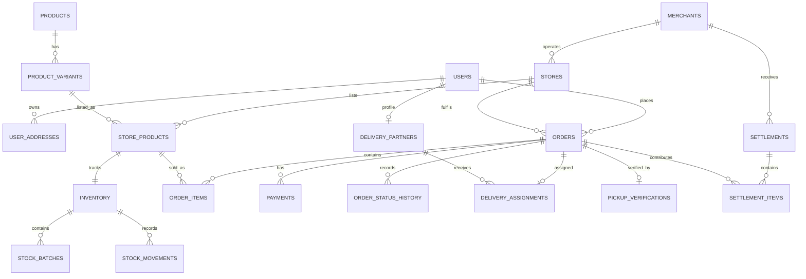

# Database design

**Status: Proposed.** No database, Prisma schema, or migration exists in this repository as of
BC-003 (see [ADR-0005](../03-decisions/ADR-0005-postgresql-database.md) and
[ADR-0006](../03-decisions/ADR-0006-prisma-orm-planned.md) — the technology is decided, the schema
is not implemented). This document captures the proposed entity model from earlier design work, so
a future database task has a verified starting point. Update this document, and change its status
to **Implemented**, once a real Prisma schema and migration land.

## Design principles (Proposed)

- UUID primary keys.
- `NUMERIC`/decimal types for money — never floating-point.
- Timestamps stored in UTC.
- Product catalogue and store listings are separate tables (see
  [`BUSINESS-RULES.md`](BUSINESS-RULES.md)).
- Order item prices are historical snapshots, not references to current prices.
- Every inventory change is recorded as a movement, not just a mutated counter.

## Proposed entity-relationship diagram

## Proposed core entities

| Module     | Tables                                                                 |
| ---------- | ---------------------------------------------------------------------- |
| Identity   | `users`, `user_roles`, `user_sessions`, `user_addresses`               |
| Merchant   | `merchants`, `merchant_staff`, `stores`, `store_operating_hours`       |
| Location   | `service_zones`, `store_locations`                                     |
| Catalogue  | `categories`, `products`, `product_variants`, `store_products`         |
| Inventory  | `inventory`, `stock_batches`, `stock_movements`, `stock_reservations`  |
| Commerce   | `carts`, `cart_items`, `orders`, `order_items`, `order_status_history` |
| Payment    | `payments`, `refunds`, `payment_webhook_events`                        |
| Fulfilment | `pickup_verifications`, `delivery_partners`, `delivery_assignments`    |
| Finance    | `settlements`, `settlement_items`                                      |
| Support    | `complaints`, `audit_logs`                                             |

## Critical design note: product vs. store inventory

Never store stock or price on the global `products` table. The same product (e.g. "Amul Curd
400g") can have different stock and price at different stores. `products`/`product_variants` hold
catalogue-level identity; `store_products` holds per-store price and availability; `inventory`
holds the actual stock count, linked to `store_products` one-to-one.

## Review

See [`DATABASE-DESIGN-REVIEW.md`](DATABASE-DESIGN-REVIEW.md) (BC-003.1) for a critical review of
this design — missing entities, constraint/index gaps, and proposed corrections pending
product-owner approval. This document has not yet been updated with those corrections.

## Related documents

- [`DATABASE-DESIGN-REVIEW.md`](DATABASE-DESIGN-REVIEW.md)
- [`../02-architecture/SYSTEM-ARCHITECTURE.md`](../02-architecture/SYSTEM-ARCHITECTURE.md)
- [`BUSINESS-RULES.md`](BUSINESS-RULES.md)
- [`../03-decisions/ADR-0005-postgresql-database.md`](../03-decisions/ADR-0005-postgresql-database.md)
- [`../03-decisions/ADR-0006-prisma-orm-planned.md`](../03-decisions/ADR-0006-prisma-orm-planned.md)
