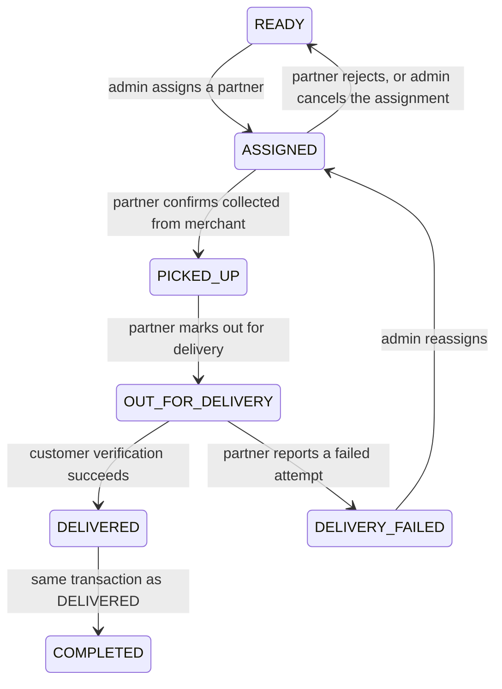

# Home delivery management design (BC-010)

**Status:** Implemented. Covers the `apps/api/src/delivery/` module (`DeliveryPartnerService`,
`DeliveryAssignmentService`, `DeliveryWorkflowService`, `DeliveryVerificationService`,
`DeliveryCodService`) and the delivery-partner-facing/admin-facing/merchant-facing/customer-facing
controllers in that module. See [`DELIVERY-PARTNER-DESIGN.md`](DELIVERY-PARTNER-DESIGN.md) for
partner onboarding/RBAC detail and
[`COD-DELIVERY-RECONCILIATION-DESIGN.md`](COD-DELIVERY-RECONCILIATION-DESIGN.md) for the financial
side. Builds directly on [`ORDER-FULFILMENT-DESIGN.md`](ORDER-FULFILMENT-DESIGN.md) (BC-009) and
[`ADR-0010`](../03-decisions/ADR-0010-pickup-manual-delivery.md) (manual, admin-controlled
assignment - no automated dispatch).

## Why this task needed no table-creation migration

`delivery_partners`, `delivery_assignments`, `delivery_events`, and `service_zones` were already
modeled by BC-004, and the `order_status` enum already contained `ASSIGNED`, `PICKED_UP`,
`OUT_FOR_DELIVERY`, `DELIVERED`, `DELIVERY_FAILED` - all unused until this task. BC-010 is their
first real consumer. The one schema change this task made is additive: new columns on
`delivery_assignments` (lifecycle timestamps/reasons, COD tracking, a `handover_id` link), two new
tables (`delivery_verifications`, `delivery_cod_handovers`), a `CHECK` constraint on
`delivery_assignments.delivery_status`, a `CHECK` constraint addition to
`payment_status_history.source` (adding `'DELIVERY_PARTNER'`, the same situation BC-009 found for
`'MERCHANT'`), and a partial unique index enforcing "at most one active assignment per partner."
See migrations `20261111115032_bc010_delivery_workflow`,
`20261111120500_bc010_delivery_payment_source_check`, and `20261111120600_bc010_delivery_grants`
(the last one closes a real gap found during this task - see "A note on the restricted runtime
role" below).

## Two state machines, not one overloaded enum

Per the task's own instruction ("without unnecessarily overloading the order status enum"), this
design keeps two state machines:

**`orders.status`** (every value already existed in the enum):

A pickup order (`fulfilment_type = PICKUP`) never enters this chain. Every delivery service method
re-checks `fulfilment_type = DELIVERY` itself (`DeliveryAssignmentService.getDeliveryOrderOrThrow`),
not just at the admin-queue-filter boundary.

**`delivery_assignments.delivery_status`** (new `VARCHAR` + `CHECK`):
`ASSIGNED -> ACCEPTED -> PICKED_UP -> OUT_FOR_DELIVERY -> DELIVERED`, with `REJECTED`, `FAILED`,
`CANCELLED` as side branches. **One row per order** - the existing `UNIQUE(order_id)` constraint
is never relaxed. Reassignment after a rejection, failure, or admin cancellation **updates that
same row** (`delivery_partner_id`, `delivery_status`, and every lifecycle timestamp reset) rather
than creating a new one. Full history is preserved through `delivery_events` instead - one row per
transition, including a `REASSIGNED` event whose `notes` names the previous partner.

Both machines use the exact compare-and-swap pattern `MerchantOrdersService.transition()`
established in BC-009: `updateMany({ where: { id, status: fromStatus } })`, `count === 0 -> 409`,
inside one `prisma.$transaction`, with one `order_status_history`/`delivery_events` row, one
`AuditService.record`, and one outbox event per transition. See
`DeliveryWorkflowService.transitionAssignment`/`casOrder` and
`DeliveryAssignmentService.assign`/`cancel`.

## Admin-controlled manual assignment (`DeliveryAssignmentService`)

- **Eligible queue** (`listEligibleOrders`): `fulfilment_type = DELIVERY` and `status IN (READY,
DELIVERY_FAILED)`. Because an _active_ assignment always keeps the order's own status at
  `ASSIGNED`/`PICKED_UP`/`OUT_FOR_DELIVERY` (never `READY`/`DELIVERY_FAILED`), this single
  order-status filter is sufficient - no separate join against `delivery_assignments` is needed to
  exclude already-assigned orders.
- **Assign/reassign** (`assign`): compare-and-swaps the order's status first (the authoritative
  concurrency guard - two admins racing to assign the same order can never both succeed), then
  either creates the assignment row (first-ever assignment) or resets the existing one
  (reassignment after `REJECTED`/`FAILED`/`CANCELLED`). A partner's own active-assignment limit
  (one at a time, this MVP's answer to "must not exceed any configured active-assignment limit")
  is enforced by the database itself - the partial unique index
  `uq_delivery_assignments_partner_active` - not merely application logic; a violation surfaces as
  Postgres error `23505`, mapped by Prisma to `P2002`, caught and turned into a clean `409`.
- **Cancel** (`cancel`): only from `ASSIGNED`/`ACCEPTED` (before physical collection) - the order
  goes back to `READY`, and the assignment row records `CANCELLED` with a mandatory reason. An
  already-`PICKED_UP` assignment cannot be "cancelled" this way (custody has already changed hands)
    - a failed delivery is reported instead, by the partner, once out for delivery.

## Partner's own workflow (`DeliveryWorkflowService`)

Every method starts with `assertOwnAssignment(userId, orderId)` - resolves the caller's own
`delivery_partners` row, then looks up the assignment scoped to _both_ `order_id` and
`delivery_partner_id`. A guessed order id belonging to another partner's assignment is a clean
`404`, never a `403` (which would confirm the order exists and is someone else's) - the same
ownership-isolation shape `MerchantOrdersService`/`OrdersService` already established.

| Action                            | Guard (`delivery_status` must be) | Effect                                                                                                 |
| --------------------------------- | --------------------------------- | ------------------------------------------------------------------------------------------------------ |
| `accept`                          | `ASSIGNED`                        | `-> ACCEPTED`                                                                                          |
| `reject` (reason required)        | `ASSIGNED`                        | `-> REJECTED`; order `ASSIGNED -> READY`                                                               |
| `markCollected`                   | `ACCEPTED`                        | `-> PICKED_UP`; order `ASSIGNED -> PICKED_UP`                                                          |
| `markOutForDelivery`              | `PICKED_UP`                       | `-> OUT_FOR_DELIVERY`; order `PICKED_UP -> OUT_FOR_DELIVERY`; generates the delivery verification code |
| `completeDelivery` (code)         | `OUT_FOR_DELIVERY`                | verifies the code; on success, atomically completes the order (see below)                              |
| `reportFailure` (reason required) | `OUT_FOR_DELIVERY`                | `-> FAILED`; order `OUT_FOR_DELIVERY -> DELIVERY_FAILED`                                               |

`reject` is only reachable from `ASSIGNED`, by design - once a partner has accepted, backing out
goes through `reportFailure` instead (with its own reason trail), never a silent re-rejection.

### Merchant handover

`MerchantDeliveryController.confirmHandover` / `DeliveryWorkflowService.confirmMerchantHandover`
sets `picked_up_confirmed_by_merchant_at` - **informational only**. It never drives the
order-status or `delivery_status` transition. The partner's own `markCollected` action is what's
authoritative, which is what makes "ensure the merchant cannot falsely mark delivery as completed"
true by construction rather than by an extra permission check: the merchant endpoint simply has no
power to change either state machine.

### Delivery verification (`DeliveryVerificationService`)

Structurally mirrors `PickupVerificationService` (same `randomInt` generation, HMAC-SHA256 with a
_separate_ secret, `SELECT ... FOR UPDATE`, `timingSafeEqual` comparison) but is its own table
(`delivery_verifications`, keyed by `delivery_assignment_id` not `order_id`), its own secret
(`DELIVERY_CODE_HASH_SECRET`), and its own in-memory plaintext cache - never shared code or a
shared record, per the task's own instruction. Because the assignment row is reused on
reassignment, `generateForAssignment` is an `upsert` keyed on `delivery_assignment_id`: a fresh
code for a reassigned/restarted lifecycle supersedes any earlier one for that same row rather than
colliding with it.

Same documented single-instance limitation as pickup codes (the plaintext cache lives in one
process's memory, evicted at expiry, never shared across horizontally-scaled instances) - tracked
as its own risk-register entry, not silently different from the pickup precedent.

### Atomic delivery completion

`completeDelivery` is the only path to `COMPLETED` for a delivery order, mirroring
`MerchantOrdersService.completePickup` exactly. Inside one transaction:

1. `DeliveryVerificationService.verify` (row-locked; wrong code -> `attemptsRemaining`, never
   touches order/assignment state).
2. Two real status transitions, both recorded: `OUT_FOR_DELIVERY -> DELIVERED`, then
   `DELIVERED -> COMPLETED` (`completed_at` set) - the handover to the customer and the order's own
   financial/operational closure are each worth their own history row, even though both happen in
   the same transaction.
3. `delivery_assignments` updated to `DELIVERED`, `delivered_at`, `cod_collected_amount` (the
   order's full `total_amount`, including delivery fee), `cod_collected_at`.
4. `ReservationService.consumeReservationForOrder` (same call BC-009 uses).
5. COD payment capture: `payments.status PENDING -> CAPTURED`, with a new
   `payment_status_history.source = 'DELIVERY_PARTNER'` value (migration
   `20261111120500_bc010_delivery_payment_source_check`) - a delivery partner collecting cash at
   the doorstep is a genuinely new actor type for that column, the same situation BC-009 found for
   `'MERCHANT'`.
6. `LedgerService.postDeliveryCodCollection` - see
   [`COD-DELIVERY-RECONCILIATION-DESIGN.md`](COD-DELIVERY-RECONCILIATION-DESIGN.md).
7. `delivery_events` (`DELIVERED`), audit record, outbox event (`DELIVERY_COMPLETED`).

A failed verification (wrong code, expired, locked, not found) leaves every one of the above
untouched - the transaction simply never reaches past the `'verified'` branch, exactly like
`completePickup`.

### Failed delivery and recovery

`reportFailure` only ever runs from `OUT_FOR_DELIVERY` - meaning COD was never collected (collection
only happens inside the same transaction as a _successful_ verification), so there is nothing to
reverse financially. It does **not** release the reservation (the order was already collected from
the merchant; inventory has physically left the store) and does **not** touch `payments`. The order
lands in `DELIVERY_FAILED`, from which an admin can `assign` a new partner (treated exactly like a
fresh assignment - `DELIVERY_FAILED` is one of the two statuses `listEligibleOrders` surfaces) or
leave it for manual resolution outside this system (refund/cancellation flows remain explicitly out
of scope, per the task brief).

## Customer-facing delivery visibility (`CustomerDeliveryController`)

Ownership is resolved through `OrdersService.getOwnOrder` first, exactly like
`CustomerPickupController` - another customer's order can never be reached. Two endpoints:

- `GET .../delivery-status` - order status, and (only once an assignment is active:
  `ASSIGNED`/`ACCEPTED`/`PICKED_UP`/`OUT_FOR_DELIVERY`/`DELIVERED`) the partner's name and phone,
  plus collection/out-for-delivery/delivered timestamps. Never admin notes, never the partner's
  other assignment history.
- `GET .../delivery-code` - only once `OUT_FOR_DELIVERY`, mirroring the pickup-code visibility
  rule exactly.

## Frontend

First admin UI in the web app (`apps/web/src/routes/admin/`) - no existing pattern to copy, so this
task establishes it: `AdminDeliveryPartnersPage` (onboard/activate/deactivate),
`AdminDeliveryQueuePage` (eligible orders + assign/reassign), `AdminCodHandoverPage` (per-partner
balance + handover recording). A new `routes/delivery-partner/` holds
`DeliveryPartnerInboxPage` - a single screen is sufficient since a partner has at most one active
assignment at a time (DB-enforced, see above). `MerchantOrderDetailPage` and
`CustomerOrderDetailPage` gained a delivery section each; `LandingRedirect` gained `ADMIN`/
`DELIVERY_PARTNER` branches. A small shared-primitives file
(`routes/components/FormPrimitives.tsx`) was extracted from `MerchantOrderDetailPage`'s original
inline styled-components, since this task's ~8 new pages made the duplication worth addressing -
the app's first shared UI primitives.

## A note on the restricted runtime role

While implementing this task, the application's restricted runtime role (`dropzo_app`, which
`PrismaService` actually connects as - see `APP_DATABASE_URL`) turned out to have no privileges on
the two new tables: the init migration's blanket `GRANT ... ON ALL TABLES IN SCHEMA public` only
ever covered tables that existed at that migration's own run time, exactly the situation BC-005
found for `otp_challenges`. Migration `20261111120600_bc010_delivery_grants` grants
`delivery_verifications` and `delivery_cod_handovers` explicitly, following that same precedent.

A second, unrelated latent bug was found and fixed in the course of building this task's own
integration tests: `StoreService.createStore`'s raw `INSERT` passed `serviceZoneId` without a
`::uuid` cast, which fails as soon as any caller actually supplies one (no existing test had -
BC-010's delivery-eligibility tests are the first). Fixed with a one-line cast; see `PROGRESS.md`.

## A note on a security finding

An automated post-implementation security review caught a real IDOR:
`MerchantDeliveryController.getOne` originally ignored `storeId` and read the assignment by
`orderId` alone, letting any merchant view another merchant's delivery assignment given its order
id. Fixed with `DeliveryAssignmentService.getOwnedByMerchant` - the same ownership-check shape
`confirmMerchantHandover` on the sibling endpoint already used correctly - with a regression test
added. See `PROGRESS.md` for the full detail.

## Out of scope (unchanged from ADR-0010 and the task brief)

Automatic matching/dispatch, GPS/live tracking, route optimization, multi-stop routing, dynamic
delivery pricing, an online payment gateway, advanced KYC/document upload, native mobile apps,
microservices/Redis/Kafka/Kubernetes. `FR-ADM-002` (admin-configurable commission/delivery-fee
_rules_) is a distinct requirement the roadmap loosely bundled with "delivery, and admin controls" -
this task implements the delivery-fee _accounting_ the design already specified, not a
configuration UI for the fee/commission rates themselves; that stays its own future task.
