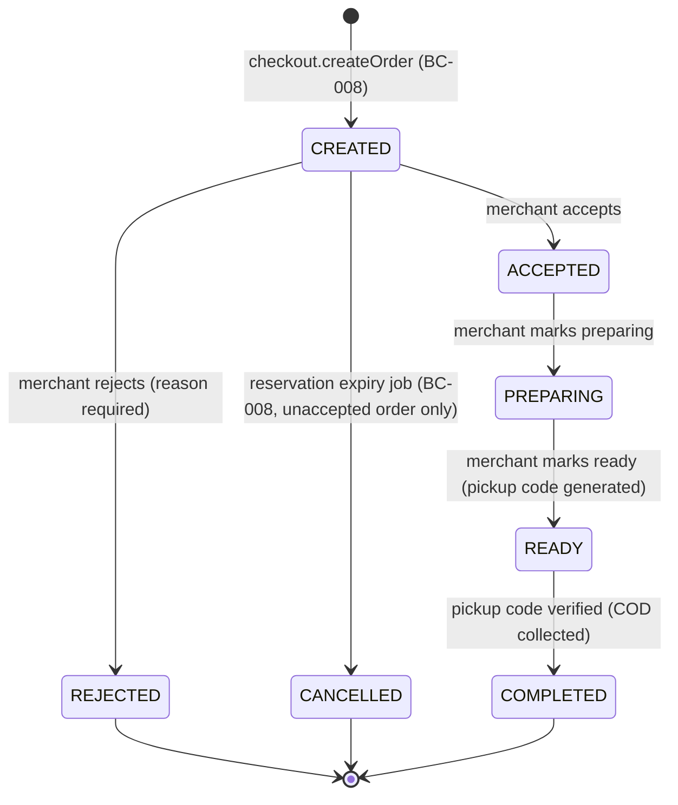

# Merchant order fulfilment and pickup collection design (BC-009)

**Status:** Implemented. Builds on [`ORDER-MANAGEMENT-DESIGN.md`](ORDER-MANAGEMENT-DESIGN.md) (order
creation, COD, reservation holding) and [`INVENTORY-MANAGEMENT-DESIGN.md`](INVENTORY-MANAGEMENT-DESIGN.md)
(FEFO reservation/release). Covers the first complete end-to-end operational workflow: a merchant
receiving a COD pickup order, accepting or rejecting it, preparing it, marking it ready, and
collecting cash against a verified one-time pickup code. See
[`PICKUP-WORKFLOW-DESIGN.md`](PICKUP-WORKFLOW-DESIGN.md) for the pickup-code's own security design,
and `DATABASE-DESIGN.md`'s "What posts, and when" table for the accounting side this doc's
`completePickup` step triggers.

Scope is deliberately narrow, per the task's explicit exclusions: no delivery-partner
onboarding/assignment/GPS/routing, no online payment gateways/webhooks, no loyalty/coupons/
subscriptions, no multi-store checkout, no new infrastructure (Redis/Kafka/Kubernetes). This
milestone is pickup-only - a delivery order's fulfilment flow is a later milestone's concern.

## Order status lifecycle

Every state is a real, pre-existing value in the Postgres `order_status` enum (BC-004) - **no
migration adds a new status value**. `REJECTED` and `CANCELLED` both already existed (the latter
used by BC-008's reservation-expiry job); this milestone reuses them rather than inventing a
parallel "order fell through" status. A merchant can never set `status` to `COMPLETED` directly -
it is reachable only through `MerchantOrdersService.completePickup`'s successful verification path
(see below and `PICKUP-WORKFLOW-DESIGN.md`).

## Every transition is an authenticated, authorized, transactional compare-and-swap

`MerchantOrdersService` (`apps/api/src/fulfilment/merchant-orders.service.ts`) implements `accept`,
`reject`, `markPreparing`, and `markReady` through one shared private `transition()` method, the
same compare-and-swap pattern established by BC-005/006/008 (`updateMany({where: {id, status:
fromStatus}})`, `count === 0` -> `409 ConflictException`):

1. **Authentication** - every call carries the caller's authenticated `userId` (the controller's
   `@CurrentUser()`, same as every other merchant-scoped endpoint).
2. **Authorization/ownership** - `assertCanOperate(userId, storeId)` resolves the store through
   `StoreService.getOwnStore` (throws if `userId` doesn't own `storeId` - **never trusts a
   `storeId` path parameter alone**), and additionally rejects if the store isn't `ACTIVE` or the
   owning merchant is `SUSPENDED`. `getOwnedOrThrow(storeId, orderId)` then re-scopes the order
   lookup to `{id: orderId, store_id: storeId}` - an order id from a different store 404s, it never
   leaks whether the id exists at all.
3. **Transactional** - the status `updateMany`, the caller's side effect (reservation release,
   pickup-code generation), the `order_status_history` insert, the audit record, and the outbox
   event all happen inside one `prisma.$transaction`. A failure at any point rolls back everything,
   including the status change itself.
4. **Concurrency-safe** - two concurrent requests racing to transition the same order can never
   both succeed; the loser's `updateMany` matches zero rows and gets a clean `409`, never a partial
   or duplicated effect. Proven directly:
   `fulfilment.integration-spec.ts`'s "rejects a concurrent double-accept" and "never lets a
   concurrent double-verification both succeed" tests fire two real, simultaneous requests against
   the real database and assert exactly one wins.
5. **Recorded** - every transition writes one `order_status_history` row (`old_status`,
   `new_status`, `changed_by`, optional `reason`) and one `AuditService.record` call
   (`action: 'ORDER_<TOSTATUS>'`), plus a generic outbox event (`event_type: 'ORDER_<TOSTATUS>'`) -
   see "Outbox events" below.

## Merchant actions

| Action          | From        | To          | Side effect (same transaction)                                                                                                                                                                                   |
| --------------- | ----------- | ----------- | ---------------------------------------------------------------------------------------------------------------------------------------------------------------------------------------------------------------- |
| `accept`        | `CREATED`   | `ACCEPTED`  | None beyond the status change itself - but see "Reservation confirmation" below: this transition is what removes the order from the expiry job's reach.                                                          |
| `reject`        | `CREATED`   | `REJECTED`  | `ReservationService.releaseReservationForOrder` - releases the order's reservation (restores `reserved_quantity`) exactly once. Requires a mandatory `reason` (3-2000 chars, `RejectOrderDto`).                  |
| `markPreparing` | `ACCEPTED`  | `PREPARING` | None.                                                                                                                                                                                                            |
| `markReady`     | `PREPARING` | `READY`     | `PickupVerificationService.generateForOrder` creates the one-time code (hash-only persisted) and an `ORDER_READY_FOR_PICKUP` outbox event carrying the plaintext for delivery (see `PICKUP-WORKFLOW-DESIGN.md`). |

There is no broader cancellation system beyond merchant rejection of a still-`CREATED` order - an
`ACCEPTED` order cannot later be cancelled by the merchant in this milestone (matches the task's
explicit "no broad cancellation system" instruction).

`MerchantOrdersController` exposes these at `PATCH /api/v1/merchants/me/stores/:storeId/orders/
:orderId/{accept,reject,preparing,ready}`, plus `GET` list/detail - all `@Roles('MERCHANT_OWNER')`.
See `API-SPECIFICATION.md` for the exact request/response shapes.

## Reservation lifecycle changes

BC-008's `ReservationService.releaseExpiredOrderReservations()` releases any reservation whose
`expires_at` has passed - originally regardless of the order's current status. BC-009 adds one
`where` clause: `order: { status: 'CREATED' }`. This is the one change that makes acceptance and
expiry mutually exclusive:

- **An order the merchant has already `accept`ed is never touched by the expiry job again**, no
  matter how stale its reservation's `expires_at` becomes - the join filter excludes it at the
  database query level, not via an application-side race-prone check-then-act.
- **A rejected order's reservation is released exactly once**, by `reject`'s own side effect
  (`releaseReservationForOrder`), itself idempotent (delegates to `releaseReservation`'s own
  compare-and-swap, a no-op on a second call).
- **A completed order's reservation is never releasable at all** - by the time `completePickup`
  runs, `consumeReservationForOrder` has already transitioned it `ACTIVE -> CONSUMED` (see below);
  `releaseReservationForOrder`'s `findFirst({status: 'ACTIVE'})` simply finds nothing for a
  consumed reservation.

`fulfilment.integration-spec.ts`'s "accepts a CREATED order and never again lets the expiry job
touch its reservation" test proves this directly: it force-expires the reservation's `expires_at`
_after_ acceptance, runs the real expiry job, and asserts `released: 0` and the reservation is
still `ACTIVE`. This is the race the task's section 4 specifically asked to be proven safe.

### Consuming a reservation at pickup (`consumeReservationForOrder`)

Implements `DATABASE-DESIGN.md`'s "Selling (order completion)" procedure exactly, reusing the same
ascending-id lock order every other inventory operation uses (inventory rows, then candidate stock
batch rows):

1. Compare-and-swap the reservation `ACTIVE -> CONSUMED` (`consumed_at` set) - a second call is a
   safe no-op (`updateMany` matches zero rows).
2. For each reservation item, decrement **both** `on_hand_quantity` and `reserved_quantity` on the
   inventory row (and the stock batch row, if batch-tracked) - the unit has physically left the
   store, not just been un-reserved.
3. Insert one `SOLD` `stock_movements` row per item (`reference_type: 'ORDER'`,
   `reference_id: orderId`, `created_by: <merchant userId>`).

## Rejection

`reject(userId, storeId, orderId, {reason})` - only a `CREATED` order is rejectable (the
compare-and-swap's `fromStatus`); an `ACCEPTED` order has moved past the point a merchant can
decline it in this milestone. The mandatory `reason` (`RejectOrderDto`, 3-2000 chars) is persisted
on the `order_status_history` row. Because the whole transition (status change + reservation
release + history + audit + outbox) is one compare-and-swap-gated transaction, a retried/duplicate
reject request against an already-`REJECTED` order cleanly 409s rather than double-releasing
inventory - proven in `fulfilment.integration-spec.ts`. COD stays payment-consistent: a rejected
order's `payments` row is simply never captured (it was never touched - `status` stays whatever
BC-008 left it, `PENDING`), so no payment-state cleanup is needed here.

## COD collection and completion (`completePickup`)

The **only** path that can set `status = COMPLETED`. Runs entirely inside one transaction, gated on
a successful `PickupVerificationService.verify()` call (see `PICKUP-WORKFLOW-DESIGN.md` for that
service's own concurrency/security guarantees):

1. `pickupVerification.verify(tx, orderId, suppliedCode)`. If the outcome isn't `'verified'`:
    - `'invalid'` returns `{verified: false, attemptsRemaining}` **without throwing and without
      touching the order** - a wrong code is an ordinary, expected outcome, not an error.
    - `'expired'` / `'locked'` / `'not_found'` throw `409 ConflictException` with a specific message.
2. Compare-and-swap `READY -> COMPLETED` (`completed_at` set). A concurrent second verification
   attempt (both holding a correct code, racing) loses this race cleanly - `count === 0` -> `409`.
3. `reservations.consumeReservationForOrder` (see above).
4. If a `PENDING` `payments` row exists: capture it (`status: 'CAPTURED'`) and insert a
   `payment_status_history` row with `source: 'MERCHANT'` and a reason - **COD is never marked
   paid before this physical-collection step**, matching the task's explicit accounting
   requirement. (`source: 'MERCHANT'` is a new, documented value - see "Schema change" below.)
5. `ledger.postCodCollection(tx, order, merchant)` - posts the financial journal entry (see
   `DATABASE-DESIGN.md`'s "What posts, and when" and `LedgerService`'s own doc comment): one
   `ledger_transactions` row containing `DEBIT COD_CASH_CLEARING` / `CREDIT MERCHANT_PAYABLE`
   (gross) and, in the **same** transaction, `DEBIT MERCHANT_PAYABLE` / `CREDIT
PLATFORM_COMMISSION_REVENUE` (commission, using the merchant's own `commission_percent` -
   already a schema field with an 8% default, no new column). No delivery-fee leg - this milestone
   is pickup-only.
6. `order_status_history` (`READY -> COMPLETED`, `reason: 'Pickup code verified.'`), an audit
   record (`ORDER_PICKUP_COMPLETED`), and an `ORDER_COMPLETED` outbox event.

All of 2-6 happen only after step 1 resolves `'verified'` - a failed verification (wrong code,
expired, locked) leaves every one of them untouched, proven by
`fulfilment.integration-spec.ts`'s "rejects an incorrect code without completing the order" test
(asserts the order is still `READY` and no side effect ran).

### Schema change: `payment_status_history.source` gains `'MERCHANT'`

`payment_status_history.source` was a documented-but-unconstrained `VARCHAR(20)` whose value list
(`SYSTEM, WEBHOOK, ADMIN, CUSTOMER`) had no value for "a merchant physically collected COD cash" -
a genuine gap, matching the established BC-006/007/008 pattern of adding a `CHECK` constraint to a
previously-unconstrained documented column. Migration
`20261111090000_bc009_pickup_workflow_checks` adds `'MERCHANT'` to the constrained list. See
`DATABASE-DESIGN.md`'s change log.

## Customer order experience

`OrdersService.getOwnOrder`/`listOwnOrders` (BC-008, unchanged) already return `status`,
`status_history`, and `items` scoped to `customer_id = <authenticated user>` - no new endpoint was
needed for "see acceptance/preparation/ready/completed/rejected status". The one new customer-facing
addition is pickup-code retrieval - see `PICKUP-WORKFLOW-DESIGN.md`.

## Outbox events

Every transition writes a transactional `outbox_events` row (`OutboxService.record`, the first
application code in the repository to use this table - see `PICKUP-WORKFLOW-DESIGN.md`'s
"Notifications" section for what remains before these are actually delivered to a device):

| `event_type`             | Payload                                                                                                                                                            |
| ------------------------ | ------------------------------------------------------------------------------------------------------------------------------------------------------------------ |
| `ORDER_ACCEPTED`         | `{orderId, orderNumber}`                                                                                                                                           |
| `ORDER_REJECTED`         | `{orderId, orderNumber, reason}`                                                                                                                                   |
| `ORDER_PREPARING`        | `{orderId, orderNumber}`                                                                                                                                           |
| `ORDER_READY_FOR_PICKUP` | `{orderId, orderNumber, pickupCode}` - the **only** place the plaintext code ever appears outside this process's in-memory cache; see `PICKUP-WORKFLOW-DESIGN.md`. |
| `ORDER_COMPLETED`        | `{orderId, orderNumber}`                                                                                                                                           |

## Scope boundary (explicit exclusions, per the task)

No delivery-partner onboarding/assignment/GPS/routing (pickup-only), no online payment gateway/
webhooks, no advanced analytics, no loyalty/coupons/subscriptions, no multi-store checkout, no
microservices/Redis/Kafka/Kubernetes, no native mobile apps, no admin UI for changing
`commission_percent` (the column and its default already exist; an admin-configuration screen is
FR-ADM-002, still Planned). These are later milestones, not gaps in this one.
